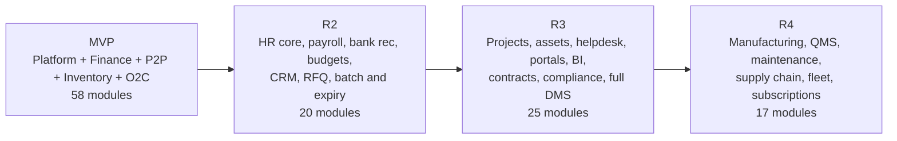

# Project Roadmap

Document status: Draft v0.1 (Stage 1). **Sequence only. No dates.** Dates need OQ-014.

## 1. Release roadmap

Module counts are by earliest release (see [inventory](../01-ERP-Module-Analysis/ERP-Module-Inventory.md)). Some MVP-lite modules finish in later releases.

## 2. Release themes and entry conditions

| Release | Theme | Entry condition |
|---|---|---|
| MVP | Commercial backbone with control | Sponsor approves BRD, MVP and architecture |
| R2 | Workforce and financial depth | MVP in production. OQ-006 answered for payroll |
| R3 | Operational breadth | R2 stable. Demand confirmed for each module |
| R4 | Industry modules | OQ-002 answered and a customer committed |

## 3. Documentation roadmap

| Stage | Content | Status |
|---|---|---|
| 1 | Business requirements, module analysis, MVP scope, project management | See [Documentation-Progress](Documentation-Progress.md) |
| 2 | FR, NFR, user stories, use cases, workflows, diagrams, architecture, database, API, RBAC and security | Not started |
| 3 | QA documents, RTM, UI/UX, development, operations, compliance, final audit | Not started |

## 4. Dependencies between phases

Architecture (Stage 2) needs the answers to OQ-005, OQ-015, OQ-016, OQ-019 and OQ-024 for final decisions. Draft ADRs will mark them as provisional.
QA (Stage 3) needs the FR and story IDs from Stage 2.
