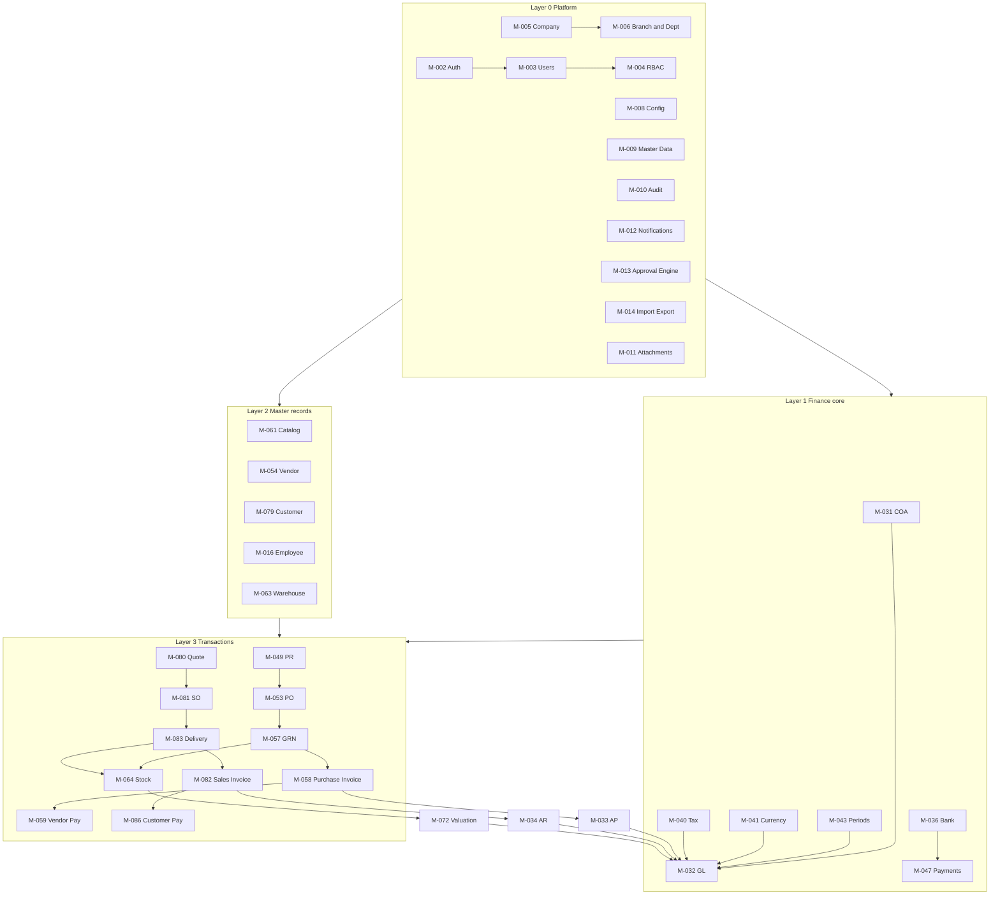

# Module Dependencies

Document status: Draft v0.1 (Stage 1). Dependencies are logical (data and workflow), not yet technical.

## 1. Dependency layers

## 2. Dependency table (MVP)

| Module | Depends on (hard) | Depends on (soft) | Feeds |
|---|---|---|---|
| M-002, M-003, M-004 | M-005 | M-016 | Every module |
| M-006 | M-005 | None | Scope for all transactional modules |
| M-013 | M-003, M-004, M-012 | M-016 (reporting line) | M-035, M-049, M-053, M-058, M-059, M-067, M-081 |
| M-010 | None | None | Auditors, M-048 |
| M-031 | M-005 | M-008 | M-032 |
| M-032 | M-031, M-043, M-041 | M-040 | M-046 |
| M-035 | M-032, M-013 | M-041 | M-032 |
| M-047 | M-036, M-033 or M-034 | M-013 | M-032 |
| M-049 | M-061, M-013, M-016 | M-038 (R2) | M-053 |
| M-053 | M-054, M-061, M-013 | M-051 (R2), M-056 (R3) | M-057 |
| M-057 | M-053, M-063, M-064 | M-104 (R4) | M-058, M-064 |
| M-058 | M-057, M-040, M-033 | None | M-059, M-032 |
| M-064 | M-061, M-063 | None | M-072, M-083 |
| M-072 | M-064, M-031 | None | M-032 |
| M-081 | M-079, M-061, M-064 | M-065 | M-083 |
| M-083 | M-081, M-064 | None | M-082 |
| M-082 | M-083, M-040, M-034 | None | M-086, M-085 |
| M-084, M-085 | M-082 | None | M-034, M-064 |
| M-001 | M-004, M-013 | Most transactional modules (widgets) | Users (landing view) |
| M-007 | M-016 | None | M-013 (reporting lines for lookup) |
| M-015 | M-005 | None | All screens and documents (formats, time zones) |
| M-030 | M-031, M-008 | None | M-032, M-033, M-034, M-072 (posting rules) |
| M-044 | M-005 | None | M-043 |
| M-045 | M-043, M-044, M-032 | M-033, M-034, M-072 (reconciliation checks) | M-046 |
| M-050 | M-013, M-049 | M-016 | M-053 |
| M-060 | M-053, M-057, M-058 | None | Managers (reports) |
| M-066 | M-063, M-064 | M-013 | M-064 |
| M-073 | M-064, M-031 | M-013 | M-064, M-032 |
| M-075 | M-064 | M-072 | Managers (reports) |
| M-088 | M-082, M-034 | M-081 | Managers (reports) |
| M-116 (basic) | M-010, M-009 | M-016 | M-014 (privacy export), all modules (retention rules) |

## 3. Post-MVP dependencies to reserve in the MVP data model

| Future module | Needs from MVP |
|---|---|
| M-037 Bank reconciliation | Bank accounts, payment status, ledger entry keys |
| M-038 Budget | Account, department, branch and project dimensions on every posting line |
| M-042 / M-110 Assets | Item category flag for capital items, GL accounts |
| M-051 RFQ | Vendor, item, PR link |
| M-068 to M-070 Batch, serial, expiry | Stock ledger line with optional tracking key |
| M-023 Payroll | Employee, department, GL postings, payment engine |
| M-089 to M-096 Projects | Project dimension on postings and documents |
| M-097 to M-109 Manufacturing | Stock ledger, item types, work centre as a dimension |
| M-118 Portals | Party-scoped access model |

## 4. Circular or risky dependencies

| Item | Issue | Handling |
|---|---|---|
| M-013 and M-016 | Approval needs reporting lines, employee needs users | Employee core (M-016) is in MVP. Chains can also name roles. |
| M-032 and M-072 | Valuation posts to ledger, ledger accounts are mapped by item category | Define default accounts in M-062 before M-072 is run. |
| M-047 and M-033 or M-034 | Payments allocate to invoices that need payments to close | Resolved by open-item model, not by module order. |
