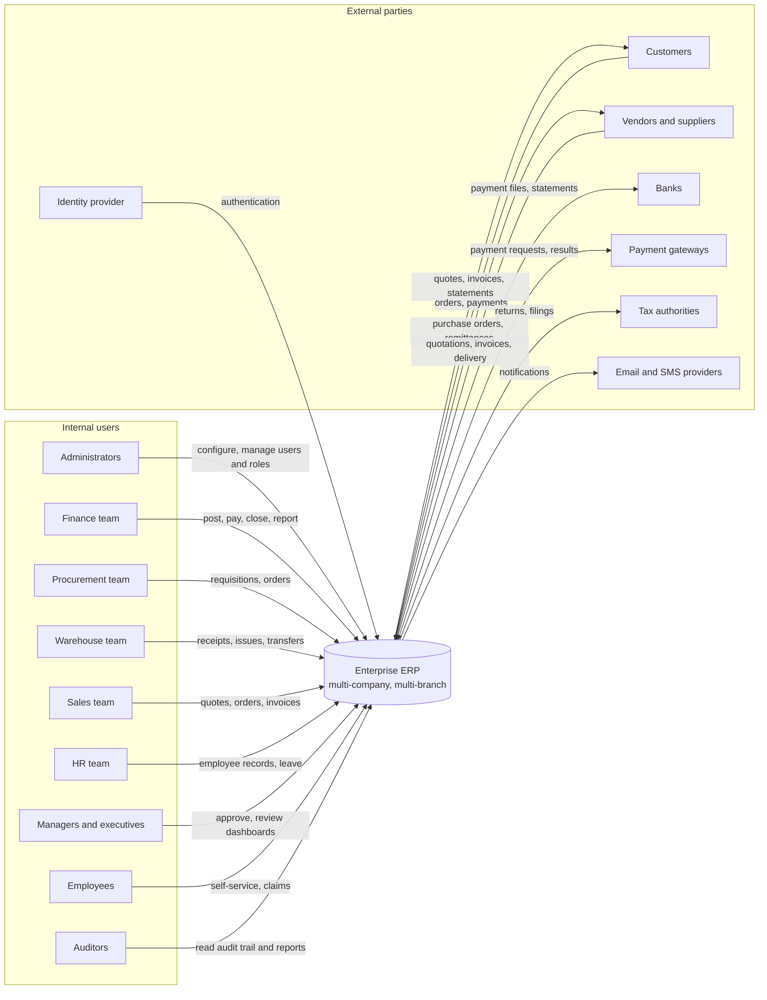

# Business Context

Document status: Draft v0.1 (Stage 1).
External parties are typical for an ERP. Which ones exist is TBD (OQ-017).

## 1. Business context diagram

## 2. Interfaces

| Interface | Direction | Data | Status | Linked question |
|---|---|---|---|---|
| Email and SMS provider | Out | Notifications, document copies | Assumed (email) | OQ-017 |
| Identity provider (SSO) | In | Identity assertions | TBD | OQ-023 |
| Bank | Both | Payment instructions, statements | TBD | OQ-017 |
| Payment gateway | Both | Card or online payments | TBD | OQ-017 |
| Tax authority | Out | Returns, e-invoices | TBD | OQ-007, OQ-017 |
| Legacy systems | In | Migrated master and open items | TBD | OQ-012 |

## 3. Business domains and ownership

| Domain | Owning department | Primary modules |
|---|---|---|
| Platform and security | IT | M-002 to M-015 |
| People | HR | M-016 to M-029 |
| Finance | Finance | M-030 to M-048 |
| Procurement | Procurement | M-049 to M-060 |
| Inventory | Warehouse and inventory | M-061 to M-075 |
| Sales | Sales | M-076 to M-088 |
| Projects | Project office | M-089 to M-096 |
| Manufacturing and supply chain | Operations | M-097 to M-109 |
| Enterprise services | Mixed | M-110 to M-120 |
