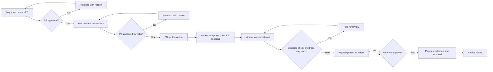
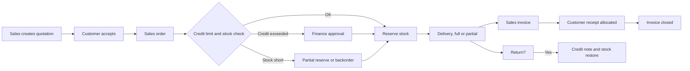
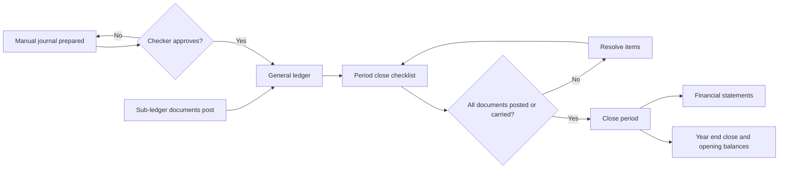

# To-Be Process Analysis

Document status: Draft v0.1 (Stage 1). Proposed target state.
Full step-by-step workflows, swimlanes and sequence diagrams are produced in Stage 2 (folder 05).
This document sets the target shape and control points the MVP must deliver.

## 1. Design principles

1. One record per fact. Master data is created once.
2. Documents flow forward and link back. Each document references its predecessor.
3. Every posting is balanced, dated into an open period and traceable.
4. Approvals are part of the document status, not a side channel.
5. Scope-limited access is the default.
6. Corrections are new documents, not edits of posted ones.

## 2. MVP target processes

### 2.1 Procure-to-Pay (BR-024 to BR-030)

### 2.2 Order-to-Cash (BR-041 to BR-047)

### 2.3 Record-to-Report (BR-014 to BR-019)

## 3. Control points the MVP must enforce

| Control | Process | Linked rule |
|---|---|---|
| Approval before commitment | P2P | BRL-009, BRL-031 |
| Three-way match | P2P | BRL-036 |
| Duplicate invoice check | P2P | BRL-037 |
| Credit limit check | O2C | BRL-047 |
| Stock availability check | O2C | BRL-040, BRL-041 |
| Maker-checker on journals and payments | R2R, P2P | BRL-008, BRL-057 |
| Closed period lock | R2R | BRL-018 |

## 4. Target roles per process (proposed)

| Process | Initiator | Approver | Executor | Reviewer |
|---|---|---|---|---|
| P2P | Employee, Procurement Officer | Department Manager, Procurement Manager, Finance Manager | Warehouse Staff, Accountant | Auditor |
| O2C | Sales Executive | Sales Manager, Finance Manager | Warehouse Staff, Accountant | Auditor |
| R2R | Accountant | Finance Manager | Accountant | Auditor |

## 5. Post-MVP target processes

H2R, Expense-to-Reimbursement, Budget-to-Actual, Asset Acquisition-to-Disposal, Lead-to-Customer, Contract-to-Renewal, Plan-to-Produce, Issue-to-Resolution are detailed in Stage 2 so their data needs are reserved in the MVP data model.
