# Data Migration Strategy

Document status: Draft v0.1 (Stage 2). Provisional. Source systems, data volumes and the history window are unknown (OQ-012, OQ-030). This is a framework to adapt.
Related: BR-009, FR-048, FR-049, BRL-064, UC-015, DEP-04.

## 1. Objectives

1. Load the master and opening data needed to operate on day one.
2. Prove completeness and correctness through reconciliation.
3. Keep the ledger valid: opening balances balance, sub-ledgers equal control accounts, stock valuation equals the ledger.
4. Make the cut-over repeatable and reversible until the go-live decision.

## 2. Scope (proposed)

| Data | Migrate | Notes |
|---|---|---|
| Companies, branches, departments, cost centres | Yes | Built in configuration, not imported from legacy |
| Users, roles | Rebuild, not copy | Access is redesigned, not inherited |
| Employees (core) | Yes | Privacy rules apply |
| Chart of accounts, tax codes, currencies and rates | Yes | Mapped to the new structure |
| Vendors, customers, items, categories, warehouses | Yes | Cleansed and de-duplicated |
| Opening balances (ledger trial balance) | Yes | As at the cut-over date |
| Open items (unpaid invoices, undelivered orders, open POs) | Yes | Carried as opening documents |
| Stock on hand with cost | Yes | As opening stock movements |
| Historical transactions | Only the agreed window | Default proposal: none, with the legacy system kept read-only. Decision OQ-012 |
| Attachments | Selected only | Volume and relevance TBD |

## 3. Approach

```mermaid
flowchart LR
    A[Profile source data] --> B[Map and design transformations]
    B --> C[Cleanse and de-duplicate at source]
    C --> D[Extract to staging files]
    D --> E[Validate-only load on test]
    E --> F{Errors?}
    F -- Yes --> C
    F -- No --> G[Load on test]
    G --> H[Reconcile to source totals]
    H --> I{Match?}
    I -- No --> B
    I -- Yes --> J[Rehearsal on staging with production-like volume]
    J --> K[Business sign-off on rehearsal]
    K --> L[Cut-over: freeze source, final extract, load, reconcile]
    L --> M{Go or no-go}
    M -- Go --> N[Go live]
    M -- No go --> O[Rollback: stay on legacy, restore pre-load snapshot]
```

## 4. Load order

Dependencies decide the order.

1. Currencies, units, payment terms, tax codes.
2. Companies, branches, departments, cost centres, warehouses.
3. Chart of accounts, posting rules, fiscal years and periods.
4. Item categories, items, conversions.
5. Vendors, customers, employees.
6. Opening open items (AP, AR) and open POs and orders.
7. Opening stock (as dated stock movements with cost).
8. Opening trial balance journal, balanced and posted in the opening period.
9. Verification reports, then close of the opening period checks.

## 5. Reconciliation

| Check | Method | Pass condition |
|---|---|---|
| Record counts | Source versus target per entity | Equal, or differences explained row by row |
| Trial balance | Legacy TB versus opening journal | Equal per account |
| AP and AR | Open items total versus control accounts | Equal (INV-03, INV-04) |
| Stock | Quantity and value per item and warehouse versus control account | Equal (INV-05, INV-06) |
| Sample | Business users trace sample records end to end | No unexplained differences |
| Rejected rows | Error report of validate-only and commit runs | Zero unexplained |

## 6. Roles

| Activity | Owner (proposed) |
|---|---|
| Source extraction | Legacy system owner, IT manager |
| Mapping and rules | Business analyst with data owners |
| Cleansing decisions | Data owners (finance, procurement, sales, inventory) |
| Load and reconciliation | Implementation lead |
| Sign-off | Finance Manager for balances, department heads for masters, Sponsor for go-live |

## 7. Risks

| Risk | Handling |
|---|---|
| Poor source data quality | Cleanse at source. Reject rather than guess. Duplicate detection (FR-029) |
| Time pressure at cut-over | At least two full rehearsals with timing |
| Opening balances do not match | Block go-live until reconciliation passes |
| Privacy in test environments | Masked data only outside production (NFR-039) |
| Mapping of tax and accounts wrong | Finance reviews the mapping sheet before any load |
| Rollback after go-live | Not supported after the first live posting. The go or no-go decision happens before it |

## 8. Tooling needs

The import module (M-014) covers master and open-document loads. Large opening stock or ledger loads may need a dedicated bulk loader that still uses the same validation. Tool choice is TBD (OQ-024).

## 9. Open points

OQ-012 (sources, volumes, history window), OQ-030 (retire date of the legacy system), OQ-021 (fiscal calendar and opening period), OQ-018 (chart mapping).

## 9. Phase 2 review findings and corrections (v0.2)

| # | Finding | Correction |
|---|---|---|
| 1 | Vendor bank details loaded by migration would bypass the bank change control (FR-139) | Migrated vendor bank accounts load as Unverified. Each is verified out of band before its first payment. The hold rule applies to the first payment after migration |
| 2 | "Users and roles: rebuild, not copy" did not say how grants are made | Bulk grants follow the tier rules and four-eyes approval (FR-131, FR-133). A migration run cannot grant Manager-tier or Auditor roles without a second approver |
| 3 | Opening credit limits would bypass FR-141 | Opening credit limits are loaded as the initial value with an audit record, then change only through requests |
| 4 | Import commit has no approver by default (RBAC Matrix section 6) | For migration of money-related master data (vendors with bank details, credit limits, opening balances) the commit needs a second approver. This is a proposal, PENDING APPROVAL |
