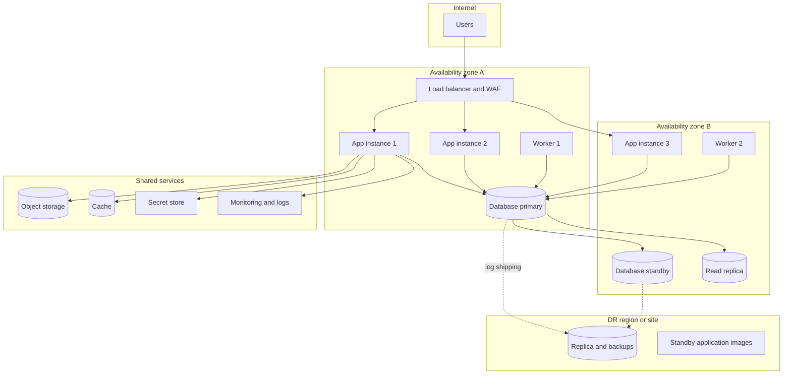
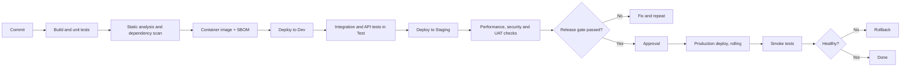

# Deployment Architecture

Document status: Draft v0.1 (Stage 2). Provisional. Hosting is undecided (OQ-016). The design is vendor-neutral.
Related: [ADR-015](Architecture-Decision-Records.md), [Infrastructure Architecture](Infrastructure-Architecture.md), [NFR](../03-Product-and-System-Requirements/NFR.md).

## 1. Environments

| Environment | Purpose | Data | Notes |
|---|---|---|---|
| Local | Developer work | Synthetic | Containerised dependencies |
| Dev | Integration of changes | Synthetic | Rebuilt often |
| Test (QA) | Test execution | Synthetic, controlled test data set | Stable between releases |
| Staging (pre-production) | Release rehearsal, performance, UAT, migration rehearsal | Masked copy or synthetic at scale | Same topology as production |
| Production | Live | Real | Restricted access |
| DR | Recovery site | Replica of production | Per RPO and RTO (OQ-028) |

Production data is never copied to lower environments unless masked (NFR-039).

## 2. Deployment topology (logical)

## 3. Release pipeline

Pipeline details are in the [CI/CD Strategy](../09-Development-and-Delivery/CICD-Strategy.md).

## 4. Deployment rules

| Rule | Detail |
|---|---|
| Build once, promote | The same image goes through every environment. Configuration differs, code does not (TR-017) |
| Rolling deployment | Instances are replaced one at a time behind the load balancer. No downtime for application changes |
| Database migrations | Backward compatible in two steps (expand, then contract) so old and new code run together during a rolling deploy |
| Workers | Drained before replacement. Jobs are idempotent (ADR-008) |
| Rollback | Previous image retained. Database changes that cannot roll back are released only after a restore point |
| Secrets | From the secret store at start, not baked into images |
| Change window | Production changes in agreed windows. Emergency change process in Change Management (Stage 3) |
| Feature flags | Used to release disabled code and to switch modules per tenant |
| Tenant onboarding | Scripted: create tenant, company, seed roles and permissions, numbering and settings |

## 5. Capacity starting point (placeholder)

| Component | Starting size | Basis |
|---|---|---|
| Application | 3 instances | Availability across two zones plus peak. TBD |
| Workers | 2 instances | Notifications, imports, reports. TBD |
| Database | One primary, one standby, one replica | Availability and report offload. TBD |
| Object storage | Elastic | Attachments and exports |

Sizing needs OQ-015 and a load test on staging (NFR-005). Phase 2: ADR-019 (PENDING APPROVAL) proposes designing to the NFR-005 envelope and deploying at the size the first customer needs. The sizes above remain starting points, not commitments.

## 6. Open points

OQ-016 (hosting and orchestrator), OQ-028 (RPO, RTO, availability), OQ-010 (region), OQ-019 (tenant isolation level, which can change topology to a database per tenant).
