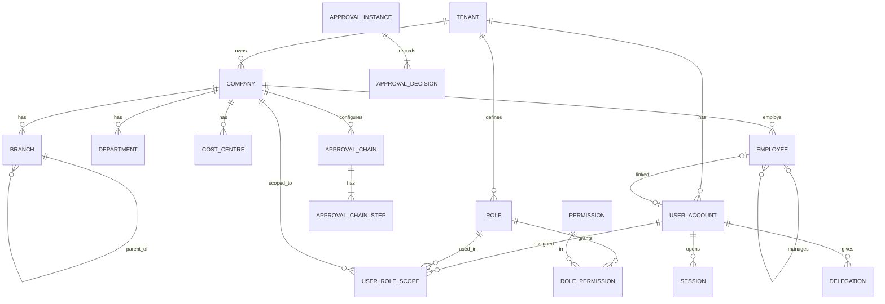
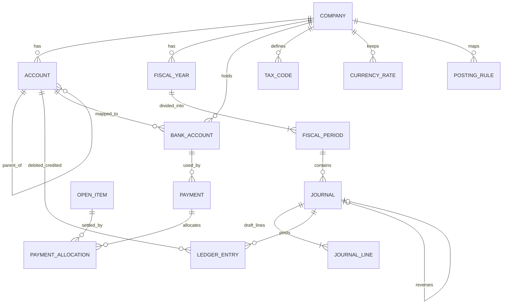
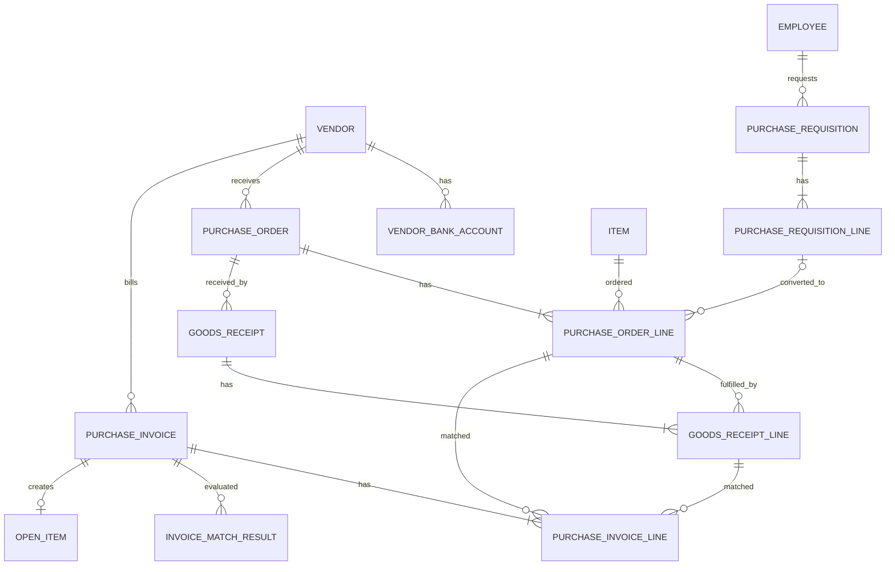
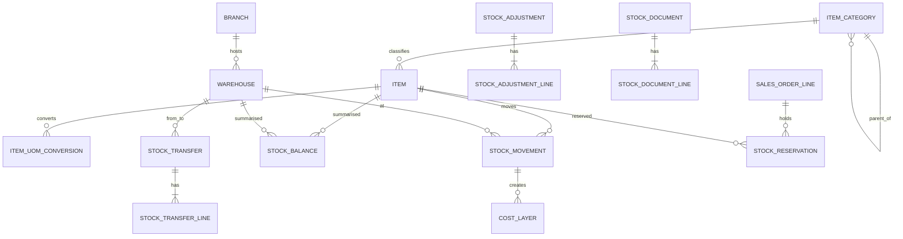
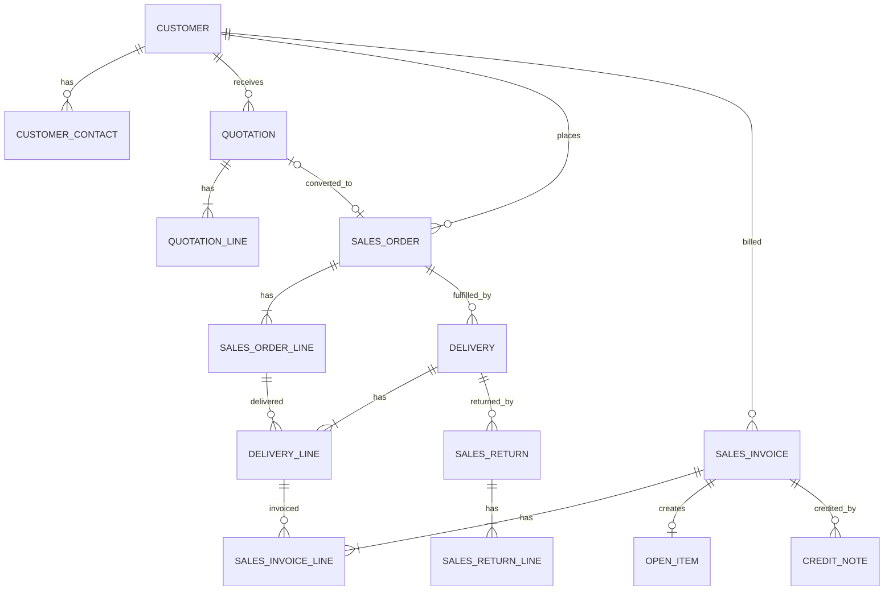
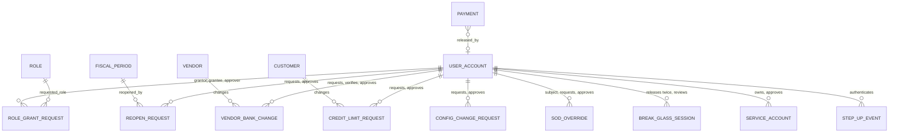

# Entity Relationship Diagrams

Document status: Draft v0.2 (Phase 2 remediation). Section 7 is new. Key relationships only. Full attribute lists are in [Database Design](Database-Design.md).
Cardinality: `||` exactly one, `o|` zero or one, `|{` one or many, `o{` zero or many.
Diagram syntax was checked with a Mermaid 10.9.1 parser (all diagram blocks in the package were re-rendered with Mermaid CLI 10.9.1 in Phase 2 (101 blocks, 0 errors)). The diagrams have **not been visually rendered or reviewed for layout**.

## 1. Identity, organisation and approvals

## 2. Finance

## 3. Procure-to-Pay

## 4. Inventory

## 5. Order-to-Cash

## 6. Cross-domain links

| From | To | Link |
|---|---|---|
| goods_receipt_line, delivery_line, stock_document_line, stock_adjustment_line | stock_movement | `source_type`, `source_id`, `source_line_id` |
| purchase_invoice, sales_invoice, payment, goods_receipt, delivery, credit_note | ledger_entry | `source_type`, `source_id` through the journal |
| Any approvable document | approval_instance | `doc_type`, `doc_id` |
| Any record | audit_log, attachment | `entity_type` or `owner_type` with id |
| Any document | outbox_event | event payload references the document |

These links are polymorphic references and need integrity checks in the domain layer, because a single foreign key cannot express them.

## 7. Authorisation hardening entities (v0.2)

Key relationships for the tables added in Database Design section 2.9.

