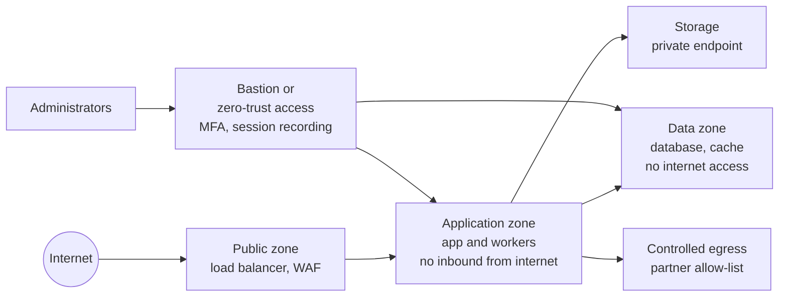

# Infrastructure Architecture

Document status: Draft v0.1 (Stage 2). Provisional and vendor-neutral. No provider, region or product is chosen (OQ-016).
Related: [Deployment Architecture](Deployment-Architecture.md), [ARD](ARD.md).

## 1. Infrastructure components

| Layer | Component | Requirement | Linked |
|---|---|---|---|
| Edge | DNS, TLS certificates, load balancer, web application firewall, DDoS protection | TLS only, WAF rules for OWASP Top 10, rate limiting | NFR-012, NFR-015, NFR-017 |
| Compute | Application instances, worker instances | Stateless, containerised, horizontally scalable, spread across zones | ADR-001, ADR-015 |
| Data | Primary relational database with synchronous or near-synchronous standby, read replica | Automatic failover, encryption at rest, point-in-time recovery | NFR-009, NFR-013 |
| Storage | Object storage for attachments, exports, backups | Encrypted, versioned, lifecycle rules, private access only | TR-012 |
| Cache | In-memory store for sessions and permission sets | Optional at MVP. No financial data cached | ADR-014 |
| Queue | Database-backed outbox. A broker is optional | Revisit on volume | ADR-008 |
| Secrets | Secret store with rotation and access audit | No secrets in code or images | NFR-014 |
| Identity | Identity provider for staff access to infrastructure. Optional customer SSO provider | MFA for all administrators | NFR-014 |
| Observability | Log aggregation, metrics, tracing, alerting, uptime checks | Correlation ids, retention per policy | NFR-028, NFR-029 |
| Backup | Continuous log archiving, daily full, cross-zone copy, periodic restore test | Per RPO and RTO | NFR-009 to NFR-011 |
| Network | Private networks, security groups, no public database access, private connectivity to partners where available | Least privilege | NFR-016 |
| CI/CD | Source control, build runners, artifact registry, scanners | Signed artifacts, scanned dependencies | NFR-019 |

## 2. Network zones

## 3. Security baseline

| Control | Requirement |
|---|---|
| Access | Least privilege, no shared accounts, MFA for privileged access, access reviewed every quarter (proposed) |
| Hardening | Minimal base images, patch cadence, vulnerability scanning of images and hosts |
| Encryption | In transit and at rest. Keys in a managed key store with rotation. Field-level protection for bank and tax data (NFR-013) |
| Network | Deny by default, database reachable only from the application zone |
| Logging | Administrative actions and infrastructure changes logged and retained |
| Infrastructure as code | All environments defined in code and reviewed (NFR-038) |

## 3a. Environment parity

Dev, Test, Staging and Production use the same definitions with different sizes and settings (TR-017).

## 4. Availability and recovery design

| Item | Design | Status |
|---|---|---|
| Zone failure | Application in at least two zones. Database fails over to standby | Proposed |
| Region failure | Restore from cross-region backups, or promote a replica in the DR site | Depends on OQ-028 |
| RPO and RTO | 15 minutes and 4 hours proposed | Not agreed |
| Backups | Encrypted, tested by restore each quarter | Proposed |
| Capacity | Autoscaling for application and workers. Database scaled vertically, replicas for reads | Needs sizing (OQ-015) |

Detailed plans are in [Backup and Recovery](../10-Deployment-and-Operations/Backup-and-Recovery.md) and [Disaster Recovery](../10-Deployment-and-Operations/Disaster-Recovery.md).

## 5. Cost drivers (qualitative)

Database size and IOPS (ledger, stock ledger, audit), report load, object storage growth, number of environments, DR site level (cold, warm, hot), log retention.
No cost estimate is given because volumes and provider are unknown.

## 6. Open points

| Point | Question |
|---|---|
| Provider, region, managed services versus self-run | OQ-016, OQ-010 |
| DR level and RTO | OQ-028 |
| Dedicated infrastructure for some tenants | OQ-019 |
| Compliance certifications required of the provider | OQ-016 |

## 7. Phase 2 review findings and corrections (v0.2)

| # | Finding | Correction |
|---|---|---|
| 1 | Administrator access to infrastructure is covered, but the emergency path is not | Break-glass access is defined in RBAC Matrix 8A.8 and FR-144. Infrastructure access by operators follows the same rule: two-person release, expiry, session recording |
| 2 | Hosting, region and sizing are open | Recommendations in ADR-019 and ADR-020, PENDING APPROVAL. This document stays vendor-neutral |
| 3 | Revocation latency depends on the cache | The permission and revocation cache must be invalidated within 60 seconds (SEC-010). Access token validity is proposed at 5 minutes |
