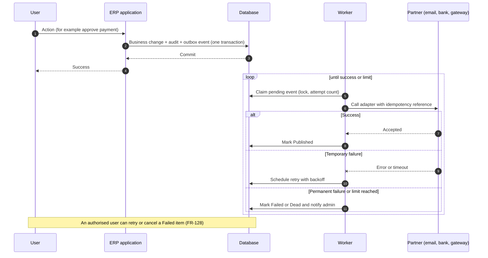
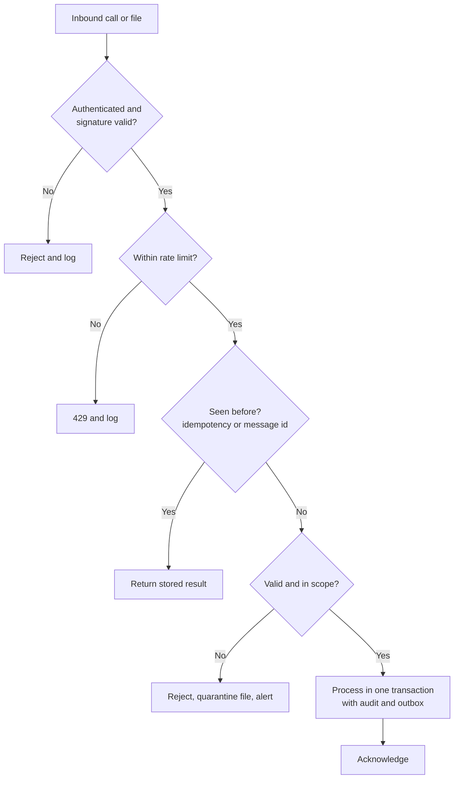

# Integration Architecture

Document status: Draft v0.1 (Stage 2). Provisional. No integration partner is confirmed (OQ-017). This document defines the pattern, not the partners.
Related: [ADR-008](Architecture-Decision-Records.md), [ADR-009](Architecture-Decision-Records.md), [API Documentation](API-Documentation.md), BR-060, FR-128.

## 1. Integration principles

1. A committed business event is never lost because a partner is down (BRL-062).
2. Every outbound call goes through the outbox and a worker. No partner call runs inside a user transaction.
3. Every inbound call is authenticated, validated, rate limited and idempotent.
4. Each partner is behind an adapter. Replacing a partner changes one adapter.
5. Partner credentials are stored as secrets, never in configuration files in source control.
6. All integration activity is logged with the correlation id and visible to authorised users.

## 2. Candidate integrations

| Integration | Direction | Release | Status | Pattern |
|---|---|---|---|---|
| Email and SMS provider | Out | MVP | Email assumed (ASM-05). SMS TBD | Outbox, template render, provider adapter |
| Identity provider (SSO) | In | MVP (P1) | TBD (OQ-023) | OpenID Connect redirect, user mapping |
| Bank files and statements | Both | MVP files out, R2 statements in | TBD (OQ-017) | Scheduled file exchange or bank API, adapter per bank |
| Payment gateway | Both | MVP optional | TBD (OQ-017) | Hosted payment page or API, webhook with signature check |
| Tax authority and e-invoicing | Out | Not MVP | TBD (OQ-007, OQ-017) | Adapter per jurisdiction |
| Legacy systems | In | One-time | TBD (OQ-012) | File-based migration ([Data Migration Strategy](Data-Migration-Strategy.md)) |
| Customer and vendor portals | Both | R3 | Future | Same public API with party-scoped access |
| Public REST API for customers' own systems | Both | MVP, limited | Proposed | [API Documentation](API-Documentation.md) |

## 3. Outbound flow with retry

## 4. Inbound flow (webhooks and files)

## 5. Retry and failure handling

| Item | Proposed value (TBD, OQ-017) |
|---|---|
| Retry policy | Exponential backoff with jitter |
| Maximum attempts | Configurable per integration (BRL-061) |
| Dead-letter | Item kept with last error, visible to Super Admin and Organization Admin |
| Duplicate delivery | Consumers store the message id and ignore repeats |
| Timeouts | Per adapter, shorter than the worker lease |
| Circuit breaker | Open after repeated failures to stop hammering a failing partner. Alert on open |
| Partner outage during payment release | Payment moves to Failed state with reason. Invoice reopens. No silent success (UC-009 EF2) |

## 6. Data synchronisation

| Case | Approach |
|---|---|
| ERP to partner (documents) | Outbox event leads to adapter call. The partner reference is stored back on the document |
| Partner to ERP (statements, payment results) | Scheduled pull or webhook. Idempotent import keyed by partner reference |
| Reference data (currency rates) | Scheduled pull from the configured source, with manual entry as fallback. A missing rate blocks the document (FR-068) |
| Conflicts | ERP is the system of record for ERP data. Partner data is stored as received, with a reconciliation view |

## 7. Security

| Control | Requirement |
|---|---|
| Transport | TLS only (NFR-012) |
| Webhook authenticity | Signature verification and timestamp window |
| Credentials | Secret store, rotated (NFR-014) |
| Least privilege | Integration users hold only needed permissions and scope |
| Data minimisation | Send only fields the partner needs (NFR-039) |

## 8. Open points

OQ-017 (which partners), OQ-023 (SSO protocol), OQ-010 (data residency of partners), and the broker question in the ADR list.

## 9. Phase 2 review findings and corrections (v0.2)

| # | Finding from the independent review | Correction |
|---|---|---|
| 1 | The outbound example says "approve payment" triggers the partner call. The partner call belongs to payment release, which now needs a different user and step-up (FR-135, FR-137) | The outbound flow in section 3 starts at payment release, not approval. Approval only makes the payment releasable |
| 2 | A bank callback must not post to the ledger by itself | A callback records the partner result against the payment through the application (state change plus audit plus outbox), never by direct database write. See the corrected SEQ-11 in the Sequence Diagrams |
| 3 | Integration users had no rule against approval rights | Integration users are service accounts (FR-149): never approve, release, reverse, reopen or grant. Section 7 "Least privilege" is tightened to that rule |
| 4 | No protection against a changed payment instruction between approval and send | The outbox event carries the approved amount, currency and account. The adapter sends only that snapshot. A difference stops the send (proposed control, needs design review) |
| 5 | Partner outage during release | A bank failure moves the payment to Failed, reverses any provisional posting, and keeps the invoice open. Payment states are defined in the Authoritative Workflow Definitions (Phase 2) |
