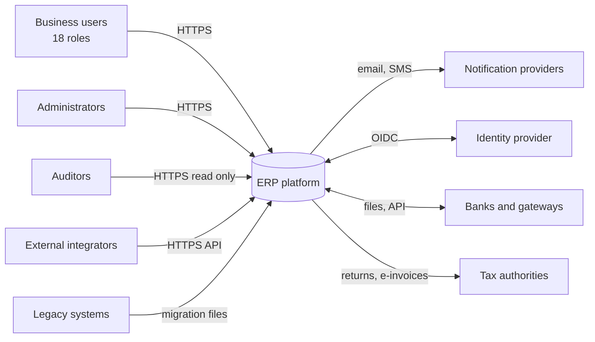
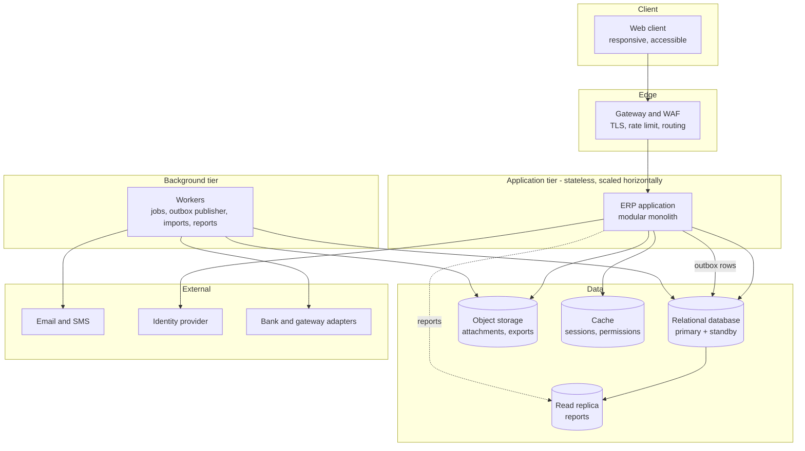
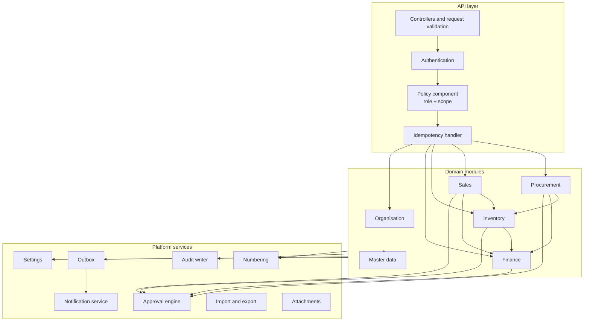
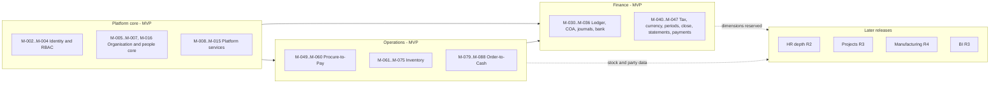

# System Architecture

Document status: Draft v0.1 (Stage 2). Provisional, see [ARD](ARD.md).
Diagrams here are the working set. The full diagram catalogue (swimlane, sequence, state, DFD, C4) is in [folder 05](../05-Workflows-and-Diagrams/Process-Flow.md).

## 1. System context

External parties are TBD except where marked in the [Business Context](../02-Business-Analysis/Business-Context.md).

## 2. Container view

## 3. Component view of the application

## 4. High-level ERP module architecture

## 5. Request lifecycle (summary)

1. The client calls the API over TLS. The gateway applies rate limits.
2. The application authenticates the session or token, sets tenant and company context for the database session.
3. The policy component checks permission and scope for the action and for the target record.
4. The idempotency handler checks the key for money and stock operations.
5. The domain module runs the operation in one database transaction: validations, document change, stock or ledger rows, audit record, outbox event.
6. On commit, the response returns. Workers publish outbox events to notifications and integrations.
7. Failures return a standard error with a correlation id.

Detailed sequence diagrams per critical flow are in [Sequence Diagrams](../05-Workflows-and-Diagrams/Sequence-Diagrams.md).

## 6. Posting design for cross-module operations

| Operation | Rows written in one transaction |
|---|---|
| Goods receipt (GRN) | GRN header and lines, stock movements, PO line received quantity, ledger entry (stock and goods-received-not-invoiced, if configured), audit, outbox event |
| Purchase invoice posting | Invoice status, payable open item, ledger entry, match result, audit, outbox event |
| Vendor payment release | Payment, allocations, bank account entry, ledger entry, invoice status, idempotency record, audit, outbox event |
| Delivery | Delivery header and lines, stock movements, reservation consumption, ledger entries (cost of goods), order line delivered quantity, audit, outbox |
| Sales invoice posting | Invoice, receivable open item, tax lines, ledger entry, audit, outbox |
| Manual journal posting | Journal, ledger rows, approval link, audit, outbox |

If any row fails, none is committed (NFR-021).

## 7. Open points

| Point | Question |
|---|---|
| Whether branch scope is part of the tenancy key or only an access scope | OQ-019 and RBAC design |
| Reporting load on the primary | OQ-015 |
| Gateway product and web application firewall | OQ-016 |

## Phase 2 notes (v0.2)

1. Tenancy: the recommended model is ADR-017 (PENDING APPROVAL). Every container diagram in this document assumes tenant_id on every business row and database row-level security.
2. Authorisation: the policy component now also enforces role tiers, four-eyes grants, step-up and controlled-change routing (ADR-022, RBAC Matrix 8A).
3. The component view in section 3 omits Identity and Reporting. This is recorded as a known gap (Diagram Consistency Report, D13) and is not changed here.
