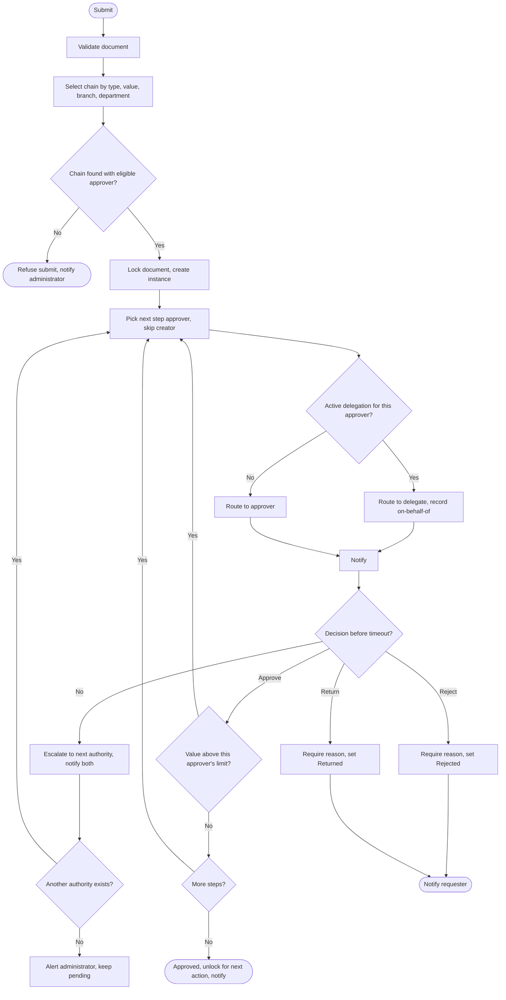
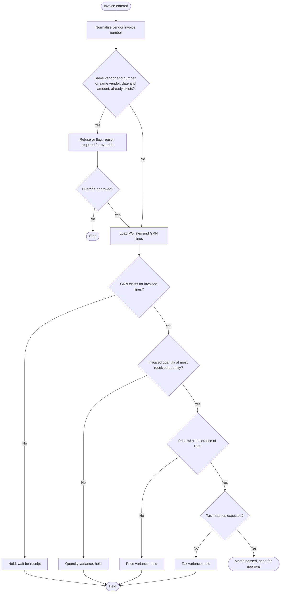
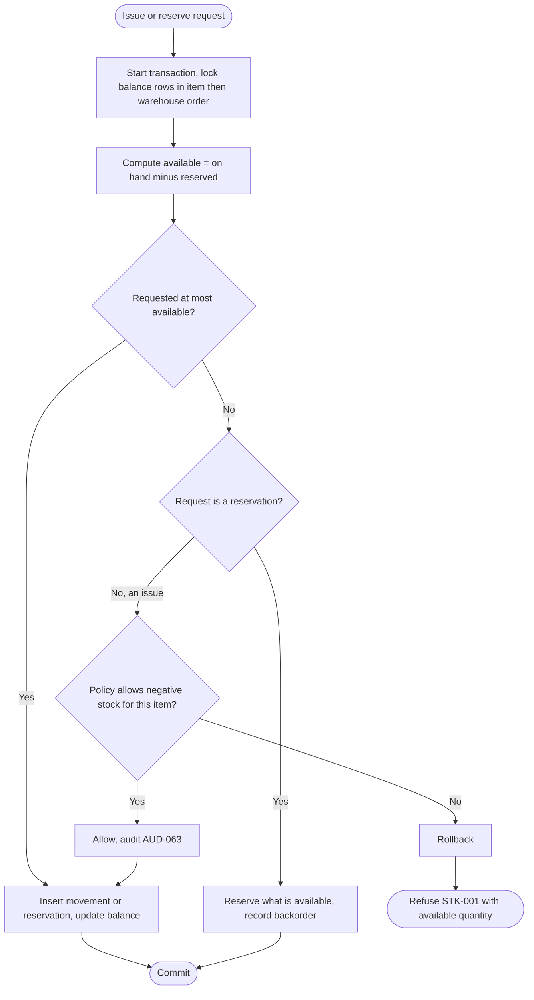
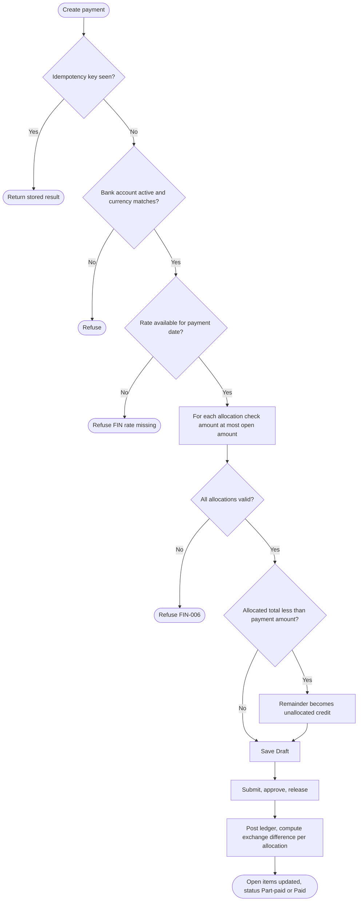
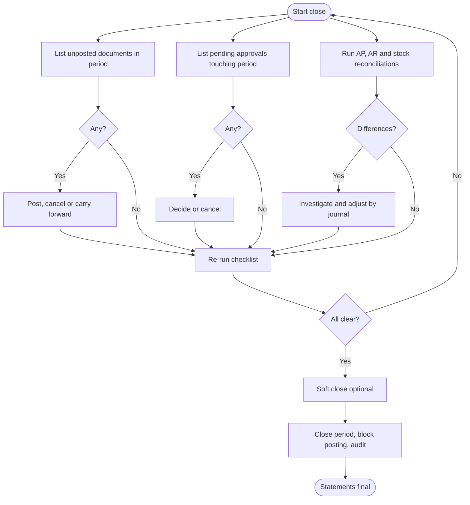
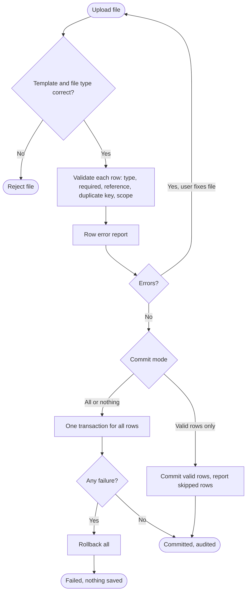
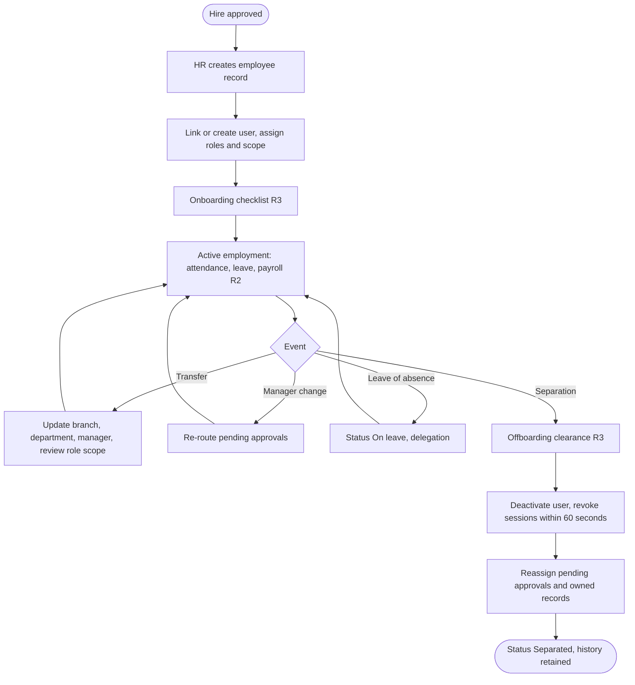
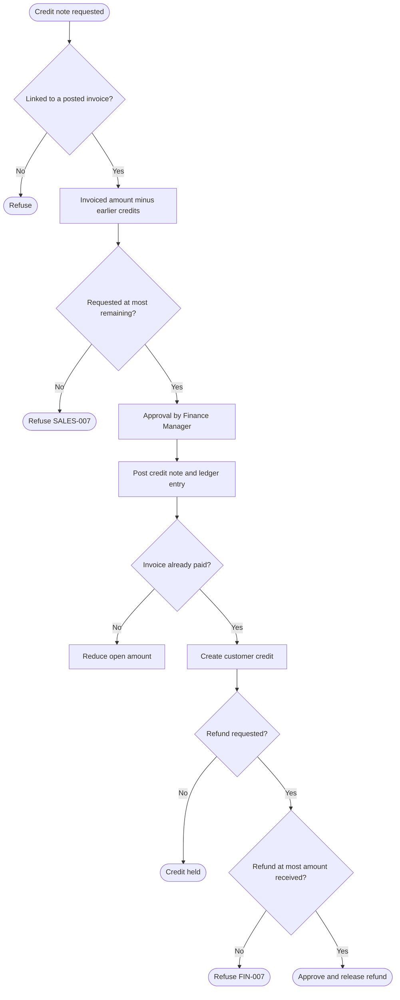

# Activity Diagrams

Document status: Draft v0.1 (Stage 2 part 2). Proposed. Diagram syntax was checked with a Mermaid 10.9.1 parser (all diagram blocks in the package were re-rendered with Mermaid CLI 10.9.1 in Phase 2 (101 blocks, 0 errors)). The diagrams have **not been visually rendered or reviewed for layout**.
Activity diagrams show the detailed logic inside a single operation or sub-process. Start and end are marked by rounded nodes. Decisions are diamonds. Parallel steps are shown by two arrows out of one node.

## ACT-01 Approval workflow and escalation

Covers the approval workflow and the escalation flow (FR-039 to FR-047).

## ACT-02 Three-way match and duplicate check

## ACT-03 Stock availability, reservation and negative stock prevention

## ACT-04 Payment creation and allocation

## ACT-05 Period close checklist

## ACT-06 Import validate and commit

## ACT-07 Employee lifecycle (MVP core and later releases)

## ACT-08 Credit note and refund limits

