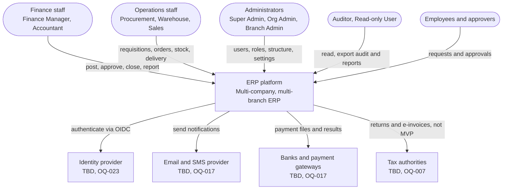
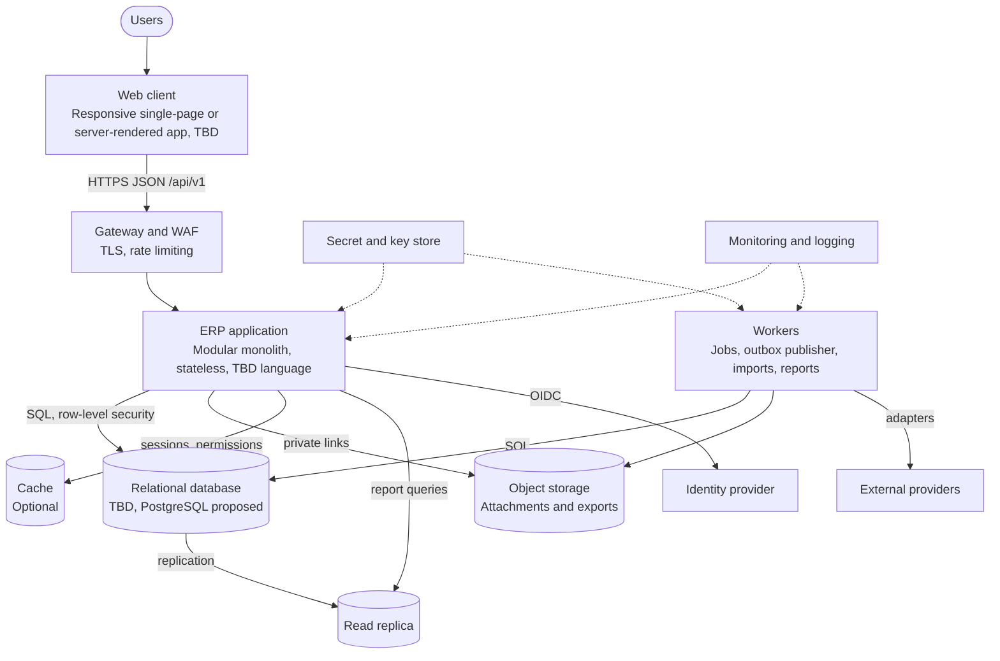
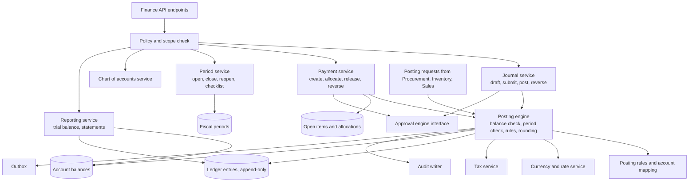
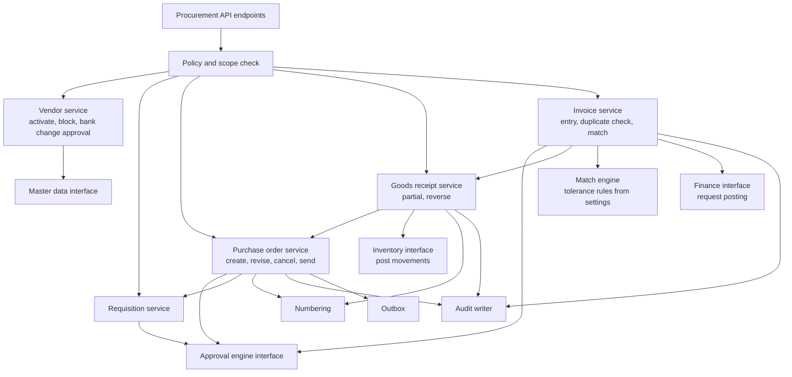

# C4 Architecture Diagrams

Document status: Draft v0.1 (Stage 2 part 2). Provisional, as the architecture is ([ARD](../04-System-Architecture/ARD.md)). Diagram syntax was checked with a Mermaid 10.9.1 parser (all diagram blocks in the package were re-rendered with Mermaid CLI 10.9.1 in Phase 2 (101 blocks, 0 errors)). The diagrams have **not been visually rendered or reviewed for layout**.
Mermaid's C4 syntax is experimental, so these diagrams use flowcharts with C4 naming: person, system, container, component.
Level 1 and the first container and component views already exist in [System Architecture](../04-System-Architecture/System-Architecture.md) sections 1 to 3. They are not repeated. This file adds the system context with roles, the container view with technologies marked as open, and component views of the Finance and Procurement modules.

## Level 1 System context (with roles)

## Level 2 Containers (technology open)

## Level 3 Components: Finance module

## Level 3 Components: Procurement module

## Notes

1. Component views for Inventory, Sales, Identity and Platform follow the same shape and are not drawn yet.
2. Boundaries follow the module rules in [ARD](../04-System-Architecture/ARD.md) section 5. Procurement reaches Finance and Inventory only through interfaces.
3. Technology labels are provisional (ADR-003, OQ-024).
