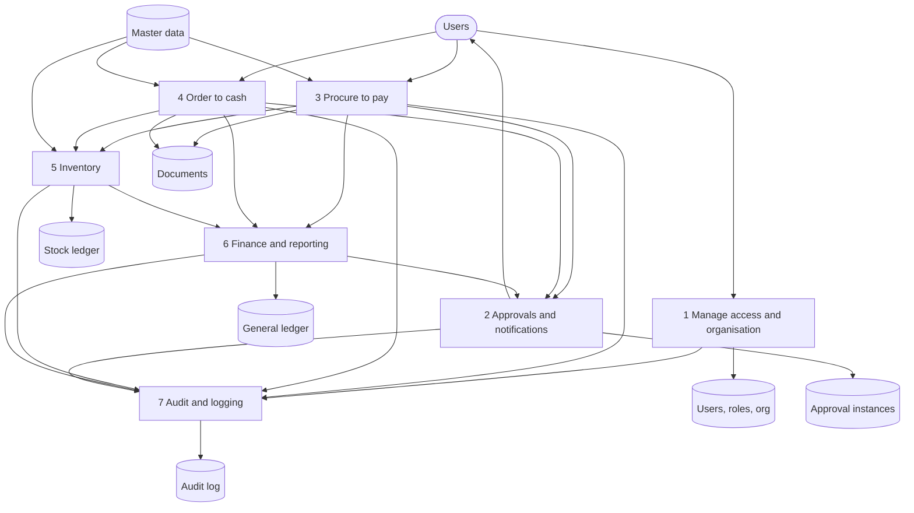
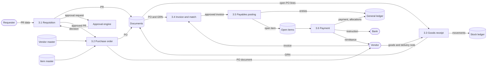
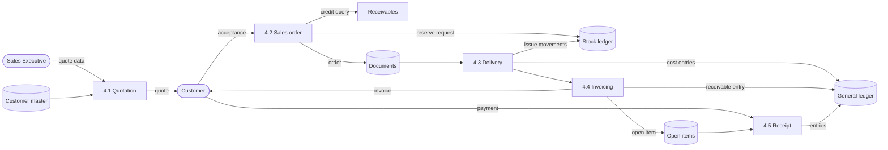
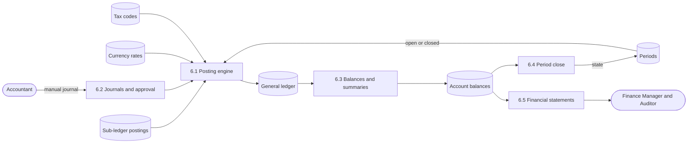
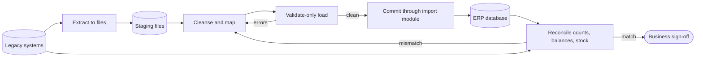
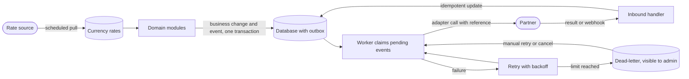

# Data Flow Diagrams

Document status: Draft v0.1 (Stage 2 part 2). Proposed. Diagram syntax was checked with a Mermaid 10.9.1 parser (all diagram blocks in the package were re-rendered with Mermaid CLI 10.9.1 in Phase 2 (101 blocks, 0 errors)). The diagrams have **not been visually rendered or reviewed for layout**.
Notation: rounded nodes are external entities, rectangles are processes, cylinders are data stores. Labels on arrows are data flows.

## DFD-0 Level 0 context

```mermaid
flowchart LR
    USR(["Internal users"]) -- "requests, approvals, documents" --> ERP["ERP system"]
    ERP -- "screens, reports, notifications" --> USR
    CUS(["Customers"]) -- "orders, payments" --> ERP
    ERP -- "quotes, invoices, statements" --> CUS
    VEN(["Vendors"]) -- "invoices, delivery notes" --> ERP
    ERP -- "purchase orders, remittances" --> VEN
    BNK(["Banks and gateways"]) -- "statements, payment results" --> ERP
    ERP -- "payment instructions" --> BNK
    IDP(["Identity provider"]) -- "identity assertions" --> ERP
    TAX(["Tax authorities"]) -- "rules and rates" --> ERP
    ERP -- "returns, reports" --> TAX
```

## DFD-1 Level 1 main processes and stores

## DFD-2a Level 2 Procure-to-Pay

## DFD-2b Level 2 Order-to-Cash

## DFD-2c Level 2 Record-to-Report

## DFD-3 Data migration flow

Detailed steps are in [Data Migration Strategy](../04-System-Architecture/Data-Migration-Strategy.md).

## DFD-4 Data synchronisation flow

## Data stores summary

| Store | Owner module | Contents |
|---|---|---|
| Users, roles, org | Identity and Organisation | Accounts, roles, assignments, companies, branches |
| Master data | Master data | Vendors, customers, items, units, taxes, currencies |
| Documents | Procurement, Sales, Inventory | PR, PO, GRN, invoices, orders, deliveries |
| Stock ledger | Inventory | Append-only stock movements and balances |
| General ledger | Finance | Append-only ledger rows and summaries |
| Open items | Finance | AP and AR items and allocations |
| Approval instances | Platform | Chains, instances, decisions |
| Audit log | Platform | Append-only audit records |
