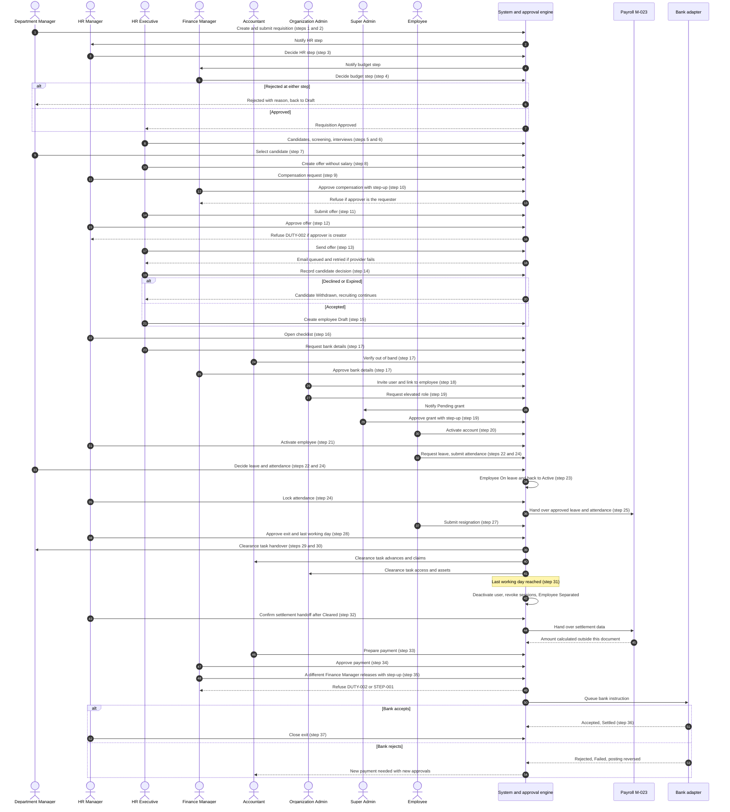
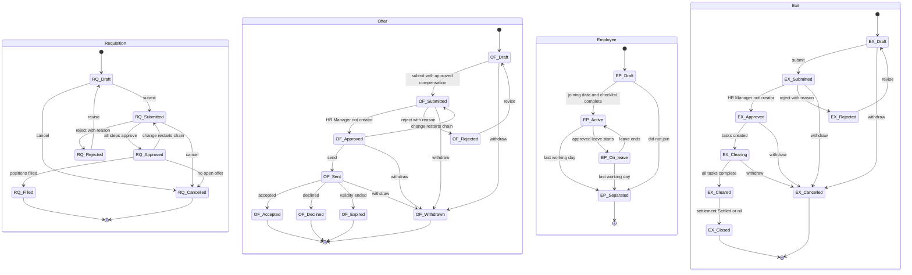

# WF-04 Hire-to-Retire

Document status: Draft v0.2 (Phase 2 remediation). Proposed. Outline promoted to implementation-ready documentation, not approved.
Lifecycle ID: WF-04. Release: R2 and R3, with the core employee record in the MVP.
This document replaces the outline row and the WF-04 outline section in [Cross-Module Workflows](../Cross-Module-Workflows.md) as the working definition. Those files are unchanged.
Every period, limit, threshold and status name that is not already in an approved source is marked "proposed, PENDING APPROVAL".
Payroll calculation is out of scope. This document describes only the handoff to payroll (M-023).
Related: [Authoritative Workflow Definitions](../Authoritative-Workflow-Definitions.md) (AWD-01 payment engine), [RBAC Matrix](../../06-RBAC-and-Security/RBAC-Matrix.md) sections 1 to 8A, [Business Rules](../../02-Business-Analysis/Business-Rules.md), [Open Questions](../../02-Business-Analysis/Open-Questions.md), [Test cases](../../08-QA-and-Testing/test-cases/Lifecycle-WF-04-Test-Cases.md).

## 1. Purpose and scope

Purpose: take a staffing need through approved requisition, recruitment, offer, onboarding, employment changes and separation, so that every person has the correct employee record, the correct system access and an audited exit.

In scope:

1. Job requisition and its approval.
2. Candidate tracking and offer, including the compensation approval.
3. Employee record creation, user invitation, user to employee link and role grants for the new hire.
4. Onboarding checklist, including employee bank details as controlled data.
5. Leave and attendance only as far as they change the employee status and feed payroll.
6. Manager change and transfer.
7. Exit request, clearance, access revocation, separation and closure.
8. The handoff of final settlement data to payroll and the payment of the final settlement through the payment engine (AWD-01).

Out of scope:

1. Payroll calculation, tax slabs, social contributions and pay cycles (OQ-006, M-023 internals).
2. Benefits design (M-024), performance review (M-025) and training (M-026).
3. Shift rostering (M-021).
4. Expense claim posting (M-028 and M-039, see WF-08). Only the clearance check that claims are settled is in scope.
5. External job boards and background-check providers. No integration is designed (section 11).

Release position (from the Module Inventory): M-016 core record and M-003 user management are MVP. M-020, M-022, M-023, M-027 and M-029 are R2. M-017, M-018, M-019, M-021, M-024 and M-025 are R3. M-026 is R4. There are no R2 functional requirements written yet for this lifecycle. See section 15.

## 2. Actors and responsibilities

Only the 18 default roles of the RBAC Matrix are used, plus the Employee role (one of the 18), the system and two external parties.
Tiers are from RBAC Matrix 8A.1.

| Actor | Tier | Responsibility in WF-04 | Default scope (RBAC Matrix section 3) |
|---|---|---|---|
| Department Manager | T2 | Raises the job requisition. Records interview feedback and selection. Approves leave and attendance of own department. Completes the handover clearance task. May raise a termination request. | Own department and sub-units. Approves only items of own department |
| HR Manager | T2 | Approves the HR step of a requisition. Raises compensation requests. Approves offers and exit requests. Activates and changes employee records. Locks attendance for payroll handoff. Closes the exit record. The only role that sees salary fields (R2) | HR data of assigned companies |
| HR Executive | T3 | Records candidates. Creates offers without salary. Creates employee records. Requests employee bank details. Cannot see salary fields and cannot approve | HR data of assigned companies |
| Finance Manager | T2 | Approves the budget step of a requisition. Approves compensation requests and employee bank detail changes (controlled data). Approves and releases the final settlement payment (two different users) | Assigned companies |
| Accountant | T3 | Verifies employee bank details out of band. Prepares the final settlement payment. Confirms advances and claims in clearance | Assigned companies or branches |
| Organization Admin | T1 | Invites the user, links it to the employee, requests elevated role grants, deactivates users. Holds no HR approval permission | Assigned companies |
| Branch Admin | T2 | Invites and links users in own branches. Grants only T3 and T4 roles in own branches. Confirms return of assets and equipment in clearance (proposed) | Assigned branches |
| Super Admin | T0 | Approves four-eyes role grants (identity.role.grant.approve). Holds no HR or finance permission | Tenant, platform administration only |
| Employee | T4 | Requests leave, submits attendance, submits a resignation, views own record. Never approves own items | Own records only |
| Auditor | Oversight | Reads audit records and reviews access grants. Read only. Not a participant in any decision | Assigned companies, read only |
| Approval engine (system) | n/a | Routes, locks, skips ineligible approvers, escalates, notifies (M-013, M-012) | n/a |
| HR and payroll modules (system) | n/a | Creates clearance tasks, changes statuses on dates, deactivates the user at last working day, hands data to payroll | n/a |
| Candidate (external) | n/a | Receives the offer and answers it. Has no user account and no role | n/a |
| Bank (external) | n/a | Accepts or rejects the final settlement payment through the adapter (AWD-01) | n/a |

Roles not named above (Procurement Manager, Procurement Officer, Inventory Manager, Warehouse Staff, Sales Manager, Sales Executive, Project Manager, Read-only User) take no part in WF-04. Read-only User holds no HR access.

Notes on duties:

1. The Organization Admin and Branch Admin hold user management permissions (identity.user) and the HR Manager holds read only on users. HR creates the person, administration creates the login.
2. The Super Admin holds no business permission by design, and so approves grants but never HR or finance steps.
3. Each person who is a Department Manager, HR Manager or Finance Manager also holds the Employee role (stacking, RBAC Matrix section 1 and 8A.11).

## 3. Preconditions

1. The company, branch, department and cost centre exist (M-005, M-006, M-008).
2. An approved position or headcount budget exists for the department. How a position is approved before a requisition is not defined (see OQ proposal in section 16).
3. The approval chain for the document type "job requisition", "offer", "exit request", "leave request" and "controlled change" is configured by the Organization Admin and checked by the Finance Manager (RBAC Matrix 8A.3, FR-039). Limits and thresholds are TBD (OQ-013).
4. At least two users exist who can hold each approving role where the chain needs different users. A company with one HR Manager waits and never falls back to self-approval (RBAC Matrix 8A.4).
5. The employee core record model (FR-023, FR-024) and user to employee link (FR-011) are available. These are MVP.
6. The Organization Admin has an active session. Step-up authentication is available for the sensitive actions in section 5.
7. An active bank account and an open fiscal period exist before a final settlement payment is prepared (AWD-01 preconditions).
8. For leave and attendance steps (R2): company leave and attendance policy is defined. Policy values are TBD.
9. Payroll rules for the company are defined before the payroll handoff step is used (OQ-006). Without them the handoff step is not active.

## 4. Step-by-step workflow

Statuses are shown as entity status. Entity names are in section 8. All status names that are not already in an approved source are proposed, PENDING APPROVAL.
"Controlled" means a controlled data change under RBAC Matrix 8A.10 (maker-checker, FR-138).

| Step | Actor | Action | System behaviour | Resulting status |
|---|---|---|---|---|
| 1 | Department Manager | Creates a job requisition with position, department, number of positions, reason and budget line | Checks the department is in the manager scope. Assigns a document number (FR-025) | Requisition Draft |
| 2 | Department Manager | Submits the requisition | Starts the approval instance, locks the document from edits (FR-040), routes to the HR step, notifies the HR Manager | Requisition Submitted |
| 3 | HR Manager | Decides the HR step | Refuses if the decider created or last edited the requisition (DUTY-002). Reject needs a reason (FR-041). A rejection returns the requisition to the requester, who revises and resubmits as a new round (FR-046) | Requisition Submitted, or Rejected |
| 4 | Finance Manager | Decides the budget step | Same checks as step 3. When all steps have approved the engine sets the final status. A change to positions or budget after approval restarts the chain (RBAC Matrix 8A.5 rule 3) | Requisition Approved, or Rejected |
| 5 | HR Executive | Records a candidate against an Approved requisition | Refuses a requisition that is not Approved. Stores personal data under retention and privacy rules (BR-059) | Candidate Applied |
| 6 | HR Executive | Screens the candidate and schedules interviews | Records each stage and the reason for a rejection | Candidate Screened, then Interviewing |
| 7 | Department Manager | Records the interview result and selects the candidate | Allows one Selected candidate per open position | Candidate Selected |
| 8 | HR Executive | Creates the offer from the selected candidate, without compensation | The HR Executive cannot see or enter salary fields | Offer Draft |
| 9 | HR Manager | Raises a compensation change request for the offer (controlled, proposed WF04-R1) | The compensation is held as Pending and is not part of the offer until approved. Old or empty value stays in force | Compensation request Pending |
| 10 | Finance Manager | Approves or rejects the compensation request | Approver is never the requester (SOD-26). Step-up is proposed for this approval (WF04-R2, PENDING APPROVAL). Audit event AUD-100 is reserved for salary change in R2 | Compensation request Approved, or Rejected |
| 11 | HR Executive | Submits the offer | Refuses submission when no approved compensation exists. Locks the offer. Starts the approval instance | Offer Submitted |
| 12 | HR Manager | Approves the offer | Approver is never the offer creator or the last editor (BRL-008, SOD-32 pattern). If the only HR Manager raised the compensation request, the offer still needs an approver who did not create it (proposed WF04-R3, PENDING APPROVAL). With no eligible approver the step pauses and alerts. It never auto-approves | Offer Approved, or Rejected |
| 13 | HR Executive | Sends the offer to the candidate (proposed validity period, PENDING APPROVAL) | Queues the email through the integration queue (FR-128). A failed send does not change the offer decision (BRL-062) | Offer Sent. Candidate Offered |
| 14 | HR Executive | Records the candidate decision | Accepted, Declined, or Expired by the validity end. A Declined or Expired offer returns the position to recruiting | Offer Accepted, Declined or Expired. Candidate Hired or Withdrawn after step 15 or on decline |
| 15 | HR Executive | Creates the employee record from the accepted offer | Employee code is unique per company (FR-023). A manager is required and a reporting cycle is refused (FR-024). Compensation is copied from the approved request, visible to the HR Manager only | Employee Draft. Candidate Hired |
| 16 | HR Manager | Opens the onboarding checklist (M-018) | System creates the checklist items. Proposed items: identity and tax documents, bank details, department induction, equipment, user access. Items are proposed, PENDING APPROVAL | Checklist Open |
| 17 | HR Executive (request), Accountant (verify), Finance Manager (approve) | Captures and approves employee bank details (controlled, proposed WF04-R4) | Three different users. Old details stay active until approval. A first payment to new details is held for a hold period (proposed, PENDING APPROVAL, see OQ-035 for the vendor equivalent) | Bank details Pending, Verified, Approved |
| 18 | Organization Admin (or Branch Admin in own branch) | Invites the user with the Employee role and links the user to the employee | The link is refused if the user already has an employee or the employee already has an active user (BRL-054, FR-011). The invitation token is single use (SEC-005) | User Invited |
| 19 | Organization Admin, then Super Admin | Requests any role above Employee for the new hire. The Super Admin approves when required | Tier and scope rules apply (BRL-066). A Manager-tier or Auditor role, or a role with approve, release or reverse permission, stays Pending until a second administrator approves (BRL-067). The grantor, the grantee and the user creator are never the approver. A Branch Admin grants only T3 and T4 roles (FR-134) | Role grant Pending, then Active |
| 20 | Employee (new hire) | Activates the account and signs in | The user is scoped to the assigned company, branch and department (FR-010) | User Active |
| 21 | HR Manager | Completes the checklist and activates the employee on the joining date | Refuses activation with open mandatory items. When the number of active hires equals the positions on the requisition, the requisition closes | Employee Active. Requisition Filled when all positions are filled |
| 22 | Employee, then Department Manager | Requests leave. The manager decides | Approver is never the requester. For a manager's own leave the next approver decides. A rejection needs a reason | Leave Submitted, then Approved or Rejected |
| 23 | System | Moves the employee to and from leave on the leave dates | Only Approved leave changes the employee status | Employee On leave, then Active |
| 24 | Employee, Department Manager, HR Manager | Employee submits attendance for the period. The manager approves. The HR Manager locks the period | A locked period is not editable. A correction is a new adjustment document | Attendance Submitted, Approved, Locked |
| 25 | System (HR and payroll modules) | Hands approved leave and attendance of the period to payroll (M-023) | Passes only approved and locked data (BR-050). Payroll calculation itself is outside this document | Payroll input Handed over |
| 26 | HR Manager | Changes manager, department or branch (transfer) | Refuses a reporting cycle (FR-024). Pending approvals that the old manager held are re-routed to the new approver. Salary changes in a transfer use steps 9 and 10 | Employee Active (unchanged status) |
| 27 | Employee, or Department Manager, or HR Manager | Creates and submits an exit request: resignation, termination or end of contract | Records reason and requested last working day. The creator is recorded | Exit Draft, then Submitted |
| 28 | HR Manager | Approves the exit request and confirms the last working day | Approver is never the creator. For a termination raised by the HR Manager a different HR Manager approves (proposed WF04-R5, PENDING APPROVAL). Reject needs a reason | Exit Approved, or Rejected |
| 29 | System | Creates clearance tasks and notifies the owners | Tasks are proposed, PENDING APPROVAL: work handover, assets and equipment, advances and expense claims, access removal | Exit Clearing |
| 30 | Department Manager, Branch Admin, Accountant | Complete their clearance tasks | A task owner cannot be the leaver. Each completion is audited | Exit Cleared when all tasks are complete |
| 31 | System (or Organization Admin or Branch Admin earlier on request) | At the last working day, deactivates the user, revokes sessions and tokens, and ends delegations given or received | Revocation runs whether or not clearance is complete. Target within 60 seconds, proposed from the outline and BRL-055 (default TBD, PENDING APPROVAL). History stays (BRL-015, FR-009). Pending approvals of the leaver are re-routed | User Deactivated. Employee Separated |
| 32 | HR Manager | Confirms the final settlement handoff to payroll after the exit is Cleared | Hands leave balance, attendance and notice data to M-023. The amount is calculated by payroll, outside this document. Handoff is refused while clearance is open (proposed WF04-R6, PENDING APPROVAL) | Settlement data Handed over |
| 33 | Accountant | Prepares the final settlement payment to the verified bank account | Uses the payment engine AWD-01. Refused if employee bank details are unverified or on hold (HOLD-001 pattern) | Payment Draft, then Submitted |
| 34 | Finance Manager | Approves the payment. Above limit A a second distinct Finance Manager approves | Limits TBD (OQ-013, OQ-034). Approver is never the preparer (SOD-06) | Payment Approved |
| 35 | A different Finance Manager | Releases the payment with step-up | Releaser differs from preparer and approver (BRL-068, SOD-14, SOD-15). STEP-001 if step-up is missing. Posts to bank clearing | Payment Released |
| 36 | Bank (adapter), System | Accepts or rejects the payment | Accepted: Settled. Rejected: Failed, posting reversed by the system. A retry is a new payment with new approvals (AWD-01) | Payment Settled, or Failed |
| 37 | HR Manager | Closes the exit record | Allowed when the exit is Cleared and the settlement payment is Settled, or when payroll confirms a nil settlement. Retention rules start (BRL-063, OQ-022) | Exit Closed |

## 5. Approval hierarchy

Rules (all from existing sources unless marked proposed):

1. The creator never approves (BRL-008, FR-042, DUTY-002). The last editor of an offer or requisition is skipped as well (RBAC Matrix 8A.5 rule 2).
2. Approval limits are data of the approval chain, not of roles (FR-043). Values are TBD (OQ-013).
3. A step with no eligible approver pauses and alerts. It never auto-approves and never skips (RBAC Matrix 8A.5 rule 4).
4. A change of value after approval restarts the chain.
5. Delegation is limited by BRL-073: the delegate holds permission and scope, passes the SoD check, and cannot receive release, reverse, reopen or grant-approval authority. A delegation ends when delegator or delegate is deactivated (RBAC Matrix 8A.7 rule 4).

| Document | Initiator | Level 1 | Level 2 | Notes |
|---|---|---|---|---|
| Job requisition | Department Manager (or HR Manager) | HR Manager | Finance Manager (budget) | Never the creator. If the HR Manager created it, a different HR Manager approves or the step waits |
| Compensation request (controlled) | HR Manager | Finance Manager | | Requester never approves (SOD-26). Proposed WF04-R1, PENDING APPROVAL |
| Offer | HR Executive | HR Manager (not creator, not the last editor) | | Offer needs an approved compensation request |
| Employee record Draft to Active | HR Executive | HR Manager | | Activation is a status change by the manager, not an approval chain, unless the company configures one |
| Employee bank details (controlled) | HR Executive or Employee | Accountant verifies | Finance Manager approves | Three different users (pattern of SOD-20 and SOD-21). Proposed WF04-R4 |
| User invitation and link | Organization Admin or Branch Admin | none | | Audited. Link rules BRL-054 |
| Role grant Manager tier, Auditor, scope widening, approve or release role | Organization Admin | Super Admin (identity.role.grant.approve, step-up) | | Grantor, grantee and user creator never approve (SOD-28, SOD-29, FR-132, FR-133). Question OQ-033 is open |
| Role grant T3 or T4 | Branch Admin (own branches) or Organization Admin | none | | Audited (AUD-101) |
| Leave request | Employee | Department Manager | HR Manager when the requester is the manager | Requester never approves |
| Attendance period | Employee | Department Manager | HR Manager locks | |
| Exit request | Employee, Department Manager, or HR Manager | HR Manager (not creator) | | Proposed WF04-R5 for the case where the HR Manager is the creator |
| Final settlement payment | Accountant prepares | Finance Manager approves | Second Finance Manager above limit A | Release by a third user, a different Finance Manager, with step-up. Prepare, approve, release are three different users (AWD-01, BRL-068, FR-135, FR-137) |
| Salary or bank change on the employee record | HR Manager or HR Executive | Finance Manager | | Never a direct edit. A direct change attempt returns CTRL-001 (proposed WF04-R1) |

Step-up (RBAC Matrix 8A.6) applies to: release payment, reverse payment, approve role grant. Proposed additions for this lifecycle, PENDING APPROVAL: approve compensation change, approve employee bank details.
The step-up window is the proposed 5 minutes of 8A.6.

## 6. Business rules

Existing rules that apply:

| ID | Rule (short) | Where used |
|---|---|---|
| BR-049 | One employee record serves directory, approvals, self-service and payroll. Deactivation ends access | Steps 15, 18, 31 |
| BR-050 | Attendance and leave feed payroll under company policy. Payroll uses approved leave and attendance only | Steps 22 to 25 |
| BR-052 | Employees see and request their own HR items | Steps 22, 24, 27 |
| BR-006 | Configurable approvals with delegation and escalation | All approvals |
| BR-021 | Maker-checker | Steps 3 to 4, 12, 28, 34 |
| BR-003 | Role and scope based access | Steps 18, 19 |
| BR-004 | Secure sign-in, sessions expire | Steps 20, 31 |
| BR-005 | Complete audit trail | All steps |
| BR-007 | Actionable notifications | Section 9 |
| BR-020, BR-030 | Payments are recorded, approved and traceable | Steps 33 to 36 |
| BR-059 | Data retention and privacy | Steps 5, 37 |
| BR-060 | External integration resilience | Steps 13, 36 |
| BRL-054 | One employee record maps to at most one active user | Step 18 |
| BRL-055 | Deactivation disables sign-in within a configurable time, default TBD | Step 31 |
| BRL-056 | An employee views only their own personal data in self-service | Steps 22, 27 |
| BRL-002, BRL-003, BRL-004 | Company assignment, scope intersection, default deny | All |
| BRL-008 | Creator never approves | Steps 3, 4, 12, 28 |
| BRL-009 | Approver holds authority for the value | Steps 4, 34 |
| BRL-010, BRL-011 | Rejection needs a reason. A resubmission is a new round | Steps 3, 4, 12, 28 |
| BRL-012, BRL-013, BRL-073 | Delegation and escalation, delegation limits | Section 5 |
| BRL-015 | Referenced records are deactivated, never deleted | Step 31 |
| BRL-057 | Same user cannot both create and approve, or approve and pay, a payable | Steps 33 to 35 |
| BRL-059 | Temporary role grants expire automatically | Step 19 |
| BRL-061, BRL-062 | Notification retry, failed external call does not roll back a committed event | Steps 13, 36 |
| BRL-063 | Retention for the longest legal period, default TBD (OQ-022) | Step 37 |
| BRL-064 | Import runs in validate-only mode first | Initial employee load |
| BRL-065 | Stale save is refused | Steps 15, 26 |
| BRL-066, BRL-067 | Role tiers and four-eyes grant | Step 19 |
| BRL-068 | Prepare, approve, release are three different users on one payment | Steps 33 to 35 |
| BRL-070 | Controlled data changes are requested and approved by different users | Steps 9, 10, 17 |
| BRL-074 | SoD is evaluated on permissions across all assignments | Step 19 |

Proposed new rules. They have no BRL number and are not approved.

| Label | Proposed rule | Status |
|---|---|---|
| Proposed new rule WF04-R1 | An employee salary, pay grade or other compensation field changes only through a controlled change (request by one user, approval by another, old value stays active until approval). A direct update is refused with CTRL-001. This extends BRL-070, which today lists vendor bank details, credit limits, approval limits, posting rules, SoD rules and retention rules | Proposed, PENDING APPROVAL |
| Proposed new rule WF04-R2 | Approval of a compensation change and approval of employee bank details need step-up authentication within the step-up window | Proposed, PENDING APPROVAL |
| Proposed new rule WF04-R3 | The approver of an offer is not the offer creator, not its last editor, and not the requester of the compensation request carried in the offer. If no such approver exists the step waits | Proposed, PENDING APPROVAL |
| Proposed new rule WF04-R4 | Employee bank details change by request, out-of-band verification by a different user, and approval by a Finance Manager, with a hold on the first payment to the new account for a proposed hold period. This copies FR-139 for employees | Proposed, PENDING APPROVAL |
| Proposed new rule WF04-R5 | An exit request is approved by an HR Manager who is not the creator. When the HR Manager is the creator, a different HR Manager approves, or the step waits | Proposed, PENDING APPROVAL |
| Proposed new rule WF04-R6 | Final settlement data is handed to payroll only after the exit is Cleared, and the final settlement payment is prepared only after the handoff | Proposed, PENDING APPROVAL |
| Proposed new rule WF04-R7 | Access revocation at the last working day does not wait for clearance, handover or settlement. It runs at the effective time. Target: within 60 seconds (outline figure, BRL-055 default is TBD) | Proposed, PENDING APPROVAL |
| Proposed new rule WF04-R8 | A Separated employee record is not reactivated. A rehire creates a new employee record with a new employee code and keeps the old record for history | Proposed, PENDING APPROVAL |

## 7. Input and output data

| Stage | Input data | Output data |
|---|---|---|
| Requisition | Position, department, branch, number of positions, reason, budget line, requested start date | Requisition with approval history |
| Recruitment | Candidate name and contact, résumé attachment, interview notes, stage, rejection reason | Candidate record, selected candidate |
| Offer | Position, start date, terms text, validity end (proposed), approved compensation | Offer with approval history, candidate decision |
| Employee record | Employee code, name, job, branch, department, manager, status (FR-023), joining date, compensation (HR Manager only), bank details (encrypted, controlled) | Employee record, reporting line, checklist |
| User and access | Email, role, scope, validity of temporary grants, employee link | User, link, role grants, grant approvals |
| Leave and attendance | Leave type, dates, balance, attendance entries, corrections | Approved leave, locked attendance, payroll input set |
| Exit | Type, reason, requested and approved last working day, clearance tasks | Exit record, clearance results, access revocation record |
| Final settlement | Payroll result (from M-023), bank account, payment preparer and approvers | Payment (AWD-01), allocations, bank result |
| Cross-cutting | Attachments with the access rules of the parent record (BRL-060) | Audit events (FR-030), notifications (FR-035, FR-036), retention markers |

## 8. Status transitions

Status names for requisition, candidate, offer, exit, leave and attendance are proposed, PENDING APPROVAL. Employee statuses Draft, Active, On leave and Separated come from the outline in Cross-Module Workflows. The Data Dictionary status table has no row for these entities yet.

### 8.1 Requisition

| From | To | Condition | Actor |
|---|---|---|---|
| (new) | Draft | Created inside the manager scope | Department Manager |
| Draft | Submitted | Submitted | Department Manager |
| Submitted | Approved | All steps approved by different eligible users | HR Manager, Finance Manager |
| Submitted | Rejected | An approver rejects with a reason | HR Manager, Finance Manager |
| Rejected | Draft | Revise | Department Manager |
| Approved | Submitted | Positions or budget changed after approval, chain restarts | Department Manager |
| Approved | Filled | Active hires equal the number of positions | System |
| Draft, Submitted | Cancelled | Cancelled by the requester | Department Manager |
| Approved | Cancelled | No open offer is Sent or Accepted | HR Manager |

Terminal: Filled, Cancelled. Rejected returns to Draft (as for other documents in the Data Dictionary).

### 8.2 Candidate and offer

Candidate:

| From | To | Condition | Actor |
|---|---|---|---|
| (new) | Applied | Requisition is Approved | HR Executive |
| Applied | Screened | Screening done | HR Executive |
| Screened | Interviewing | Interview scheduled | HR Executive |
| Interviewing | Selected | Selected for an open position | Department Manager |
| Selected | Offered | Offer is Sent | System |
| Offered | Hired | Offer is Accepted and employee record exists | System |
| Offered | Withdrawn | Offer is Declined or Expired | System |
| Applied, Screened, Interviewing, Selected | Rejected | Reason recorded | HR Executive |
| Applied, Screened, Interviewing, Selected | Withdrawn | Candidate withdraws | HR Executive |

Terminal: Hired, Rejected, Withdrawn.

Offer:

| From | To | Condition | Actor |
|---|---|---|---|
| (new) | Draft | Candidate is Selected | HR Executive |
| Draft | Submitted | Approved compensation exists | HR Executive |
| Submitted | Approved | HR Manager who is not creator or last editor approves | HR Manager |
| Submitted | Rejected | Rejected with a reason | HR Manager |
| Rejected | Draft | Revise | HR Executive |
| Approved | Submitted | Compensation or terms changed, chain restarts | HR Executive |
| Approved | Sent | Sent to the candidate | HR Executive |
| Sent | Accepted | Candidate accepts inside the validity period | HR Executive |
| Sent | Declined | Candidate declines | HR Executive |
| Sent | Expired | Validity end reached with no answer | System |
| Draft, Submitted, Approved, Sent | Withdrawn | Withdrawn before acceptance | HR Manager |

Terminal: Accepted, Declined, Expired, Withdrawn.

### 8.3 Employee

| From | To | Condition | Actor |
|---|---|---|---|
| (new) | Draft | Created from an accepted offer, or by import (BRL-064), unique code, valid manager | HR Executive |
| Draft | Active | Joining date reached and mandatory checklist items complete | HR Manager |
| Active | On leave | An Approved leave starts | System |
| On leave | Active | The leave ends or is cancelled | System |
| Active | Separated | Last working day reached on an Approved exit | System |
| On leave | Separated | Last working day reached on an Approved exit | System |
| Draft | Separated | Candidate did not join, reason recorded | HR Manager |

Terminal: Separated. A rehire is a new record (proposed WF04-R8).
A change of manager, department or branch does not change the status.

### 8.4 Leave and attendance (only as far as WF-04 needs)

Leave request:

| From | To | Condition | Actor |
|---|---|---|---|
| (new) | Draft | Employee creates | Employee |
| Draft | Submitted | Submitted | Employee |
| Submitted | Approved | Approver is not the requester | Department Manager |
| Submitted | Rejected | Reason recorded | Department Manager |
| Rejected | Draft | Revise | Employee |
| Draft, Submitted, Approved | Cancelled | Before the leave starts | Employee |

Attendance period:

| From | To | Condition | Actor |
|---|---|---|---|
| Open | Submitted | Entries complete | Employee |
| Submitted | Approved | Approver is not the submitter | Department Manager |
| Submitted | Open | Returned for correction with reason | Department Manager |
| Approved | Locked | Handed to payroll | HR Manager |

Terminal: Locked.

### 8.5 Exit and offboarding

| From | To | Condition | Actor |
|---|---|---|---|
| (new) | Draft | Created for an Active or On leave employee | Employee, Department Manager, HR Manager |
| Draft | Submitted | Submitted | Creator |
| Submitted | Approved | HR Manager who is not the creator approves and sets last working day | HR Manager |
| Submitted | Rejected | Reason recorded | HR Manager |
| Rejected | Draft | Revise | Creator |
| Approved | Clearing | System creates clearance tasks | System |
| Clearing | Cleared | All clearance tasks complete | Task owners |
| Cleared | Closed | Settlement payment is Settled, or nil settlement confirmed | HR Manager |
| Draft, Submitted, Approved, Clearing | Cancelled | Resignation withdrawn before the last working day, employee not yet Separated | HR Manager |

Terminal: Closed, Cancelled.
Employee Separated and User Deactivated happen at the last working day whatever the exit status is (WF04-R7).

## 9. Notifications

Channels are in-app (FR-035) and email (FR-036). Mandatory approval notices cannot be switched off (FR-038). Failed sends are retried (FR-037, BRL-061).

| Event | Recipient | Channel |
|---|---|---|
| Requisition submitted | HR Manager (HR step), then Finance Manager | In-app, email |
| Requisition decided | Department Manager | In-app, email |
| Requisition Approved | HR Executive | In-app |
| Compensation request raised | Finance Manager | In-app, email |
| Compensation request decided | HR Manager | In-app |
| Offer submitted | HR Manager | In-app, email |
| Offer decided | HR Executive | In-app |
| Offer Sent | Candidate | Email (integration queue) |
| Offer Accepted, Declined or Expired | HR Executive, HR Manager, Department Manager | In-app |
| Employee record created | HR Manager, Department Manager | In-app |
| Bank details need verification or approval | Accountant, Finance Manager | In-app, email |
| User invited | New hire | Email (activation token) |
| Role grant Pending | Super Admin | In-app, email |
| Role grant decided | Organization Admin | In-app |
| Employee Active | Department Manager, Organization Admin | In-app |
| Leave submitted | Department Manager | In-app, email |
| Leave decided | Employee | In-app, email |
| Attendance period submitted or locked | Department Manager, HR Manager | In-app |
| Manager change | Employee, old and new manager | In-app, email |
| Exit request submitted | HR Manager | In-app, email |
| Exit Approved, clearance tasks created | Employee, Department Manager, Branch Admin, Accountant | In-app, email |
| User deactivated at last working day | Organization Admin, HR Manager | In-app |
| Pending approvals of the leaver re-routed | New approver, requesters | In-app, email |
| Settlement payment ready for approval or release | Finance Manager | In-app, email |
| Settlement payment Settled or Failed | HR Manager, Accountant | In-app |
| Approval overdue | Next approver (escalation, BRL-013) | In-app, email |

## 10. Related modules

| ID | Module | Role in WF-04 |
|---|---|---|
| M-016 | Employee Management | Core record, reporting line, status |
| M-017 | Recruitment & Applicant Tracking | Candidate and offer (R3) |
| M-018 | Employee Onboarding | Checklist (R3) |
| M-019 | Employee Offboarding | Exit, clearance (R3). Access revocation is handled in M-003 for MVP |
| M-020 | Attendance Management | Attendance period (R2) |
| M-021 | Shift & Roster Management | Not used unless the company uses shifts (R3) |
| M-022 | Leave Management | Leave requests and balances (R2) |
| M-023 | Payroll Management | Receives handoff data. Calculation out of scope (R2) |
| M-024 | Benefits & Compensation | Compensation structure behind the proposed controlled change (R3) |
| M-025 | Performance Management | Not part of the state flow (R3) |
| M-026 | Training & Development | Not part of the state flow (R4) |
| M-027 | Employee Self-Service | Leave, attendance, resignation, own data (R2) |
| M-028 | Travel & Expense Claims | Clearance check for open claims (R2) |
| M-029 | HR Reports & Analytics | Headcount and turnover reports (R2) |
| M-003 | User Management | Invitation, link, deactivation |
| M-004 | Role & Permission Management (RBAC) | Role grants, tiers, four-eyes |
| M-007 | Employee Directory | Read view of M-016 |
| M-010 | Audit Logs & Activity Tracking | Audit trail |
| M-011 | Document Management | Attachments (résumé, offer letter) |
| M-012 | Notification & Communication Management | Notices and retry |
| M-013 | Workflow & Approval Engine | Approval chains |
| M-047 | Payment & Refund Management | Final settlement payment (AWD-01) |
| M-116 | Data Governance | Retention and privacy |

## 11. Integration dependencies

| Dependency | Use | Status |
|---|---|---|
| Email provider | Offer, invitation, notices | Through the integration queue (FR-128). A failure does not undo a committed event (BRL-062) |
| Bank adapter | Final settlement payment | AWD-01. Adapter details not designed. OQ-017 |
| Payroll engine M-023 | Receives leave, attendance and settlement data | Internal module. Rules unknown (OQ-006) |
| Identity and session store | Revocation of sessions and tokens | Access token validity is 5 minutes and every request checks the revocation list (RBAC Matrix 8A.11) |
| Job boards, background checks, e-signature of offer | Not designed. Not assumed | Not in scope. Open decision in section 16 |
| APIs available today | API-011 (create or invite user), API-014 (deactivate), API-015 (employee link), API-016 (role assignment), API-033 to API-035 (employees), API-062 (approval decisions), API-094 and API-095 (payment release and reverse), API-170 (approve role grant) | Existing. No API exists for requisitions, candidates, offers, exit, leave or attendance, and none is invented here |

## 12. Exception scenarios

| Scenario | Behaviour |
|---|---|
| Requisition rejected | Returns to Draft with the reason. Resubmission starts a new round and keeps history (BRL-010, BRL-011) |
| Requisition creator is an HR Manager | The HR step needs a different HR Manager. With none, the step waits and alerts |
| Candidate declines or offer expires | Offer Declined or Expired, Candidate Withdrawn. The requisition stays Approved and recruiting continues |
| Offer changed after approval | Compensation or terms change restarts the chain (offer back to Submitted) |
| Requisition cancelled with an Accepted offer | Refused. The HR Manager withdraws the offer first or completes the hire |
| Duplicate employee code | Refused with CONF-001 (FR-023) |
| Reporting line cycle | Refused (FR-024) |
| User already linked, or employee already has a user | Refused (BRL-054, FR-011) |
| HR Executive tries to open or edit salary | Field is absent and the API refuses (BRL-004) |
| Direct salary or bank edit | Refused with CTRL-001, and a change request is required (proposed WF04-R1, WF04-R4) |
| Role above the grantor's tier requested | Refused with TIER-001 (BRL-066). Self-grant refused with SELF-001 |
| Leave requested by a manager with no other approver | Goes to the next approver (HR Manager). It never self-approves |
| Employee on leave resigns | Allowed. Exit runs. On leave to Separated at the last working day |
| Leaver has pending approvals | Re-routed to the next approver, and delegations given or received end |
| Leaver is an approver in a payment chain | The payment chain skips the user and re-routes. A payment already approved by the leaver stays valid and its audit record keeps the name |
| Clearance not complete at the last working day | Access is revoked and the employee is Separated. Settlement waits for Cleared (WF04-R6, WF04-R7) |
| Resignation withdrawn | Exit Cancelled before the last working day. The employee stays Active |
| Rehire | New employee record and new code. The old record stays Separated (WF04-R8) |
| Manager of the leaver departs at the same time | Reporting lines of subordinates must be reassigned before the manager is Separated. Open decision (section 16) |
| Settlement payment with unverified bank details | Refused. The hold applies (WF04-R4) |
| Single approver company | The step waits. It never falls back to self-approval. A company that cannot staff two users must use an SoD override (FR-142) or accept a business decision (OQ-032, OQ-034) |

## 13. Failure and recovery scenarios

| Failure | Recovery |
|---|---|
| Email provider down at offer send or invitation | The event stays committed. The message is queued and retried, then flagged (FR-037, FR-128, BRL-061, BRL-062). The user can resend |
| Audit write fails during a status change | The business change does not complete (FR-032). The user retries |
| Employee create fails after the offer is marked Accepted | One transaction. The offer stays Sent and nothing partial is saved. The retry is idempotent |
| Deactivation fails because the session store is unavailable | The deactivation is retried and alerts Organization Admin. Access must still end. The deactivation is idempotent. This is the highest-priority recovery in the lifecycle |
| Approver unavailable | Delegation (BRL-012) or escalation after the configured time (BRL-013, FR-045). The step never auto-approves |
| Bank rejects the settlement payment | Payment Failed, posting reversed, exit stays Cleared. A retry is a new payment with new approvals (AWD-01) |
| Payroll data not ready at handoff | Handoff stays pending. The exit cannot close. Nothing is posted |
| Concurrent edit of one employee record | The second save is refused with CONF-002 and the user reloads (FR-125, BRL-065) |
| Initial employee import contains errors | Validate-only run reports row errors and saves nothing. A commit in all-or-nothing mode saves nothing on any error (BRL-064, FR-048, FR-049) |
| Wrong employee linked to a user | The Organization Admin removes the link through an audited change and links the right employee. History keeps both events. The method is not designed and is an open decision |
| Period closed when the settlement is posted | Posting date moves to the next open period by a user decision (FIN-002, as in WF-01) |

## 14. Diagrams

The diagrams agree with the step table in section 4 and the status tables in section 8. Step numbers in nodes are the numbers of section 4.
They were validated with the Mermaid command line renderer (see the final report of this task). They have not been reviewed for layout by a designer.

### 14.1 Process flow

```mermaid
flowchart TD
    S0(["Staffing need"]) --> S1["1 DM creates requisition: Draft"]
    S1 --> S2["2 DM submits: Submitted"]
    S2 --> S3{"3 HR Manager decides HR step"}
    S3 -- "Reject with reason" --> RJ["Requisition Rejected"]
    RJ --> S1
    S3 -- "Approve" --> S4{"4 Finance Manager decides budget"}
    S4 -- "Reject with reason" --> RJ
    S4 -- "Approve" --> S4A["Requisition Approved"]
    S4A --> S5["5 Candidate Applied"]
    S5 --> S6["6 Screened then Interviewing"]
    S6 --> S7["7 DM selects: Candidate Selected"]
    S7 --> S8["8 HR Executive creates offer: Draft"]
    S8 --> S9["9 HR Manager raises compensation request"]
    S9 --> S10{"10 Finance Manager decides compensation"}
    S10 -- "Reject" --> S9
    S10 -- "Approve" --> S11["11 HR Executive submits offer: Submitted"]
    S11 --> S12{"12 HR Manager approves offer, not creator"}
    S12 -- "Reject with reason" --> S8
    S12 -- "Approve" --> S13["13 Offer Sent, Candidate Offered"]
    S13 --> S14{"14 Candidate decision"}
    S14 -- "Declined or Expired" --> S5
    S14 -- "Accepted" --> S15["15 Employee record Draft"]
    S15 --> S16["16 Onboarding checklist Open"]
    S16 --> S17["17 Bank details request, verify, approve"]
    S17 --> S18["18 User invited and linked"]
    S18 --> S19{"19 Role above Employee needed"}
    S19 -- "Yes" --> S19A["Grant Pending until Super Admin approves"]
    S19A --> S20["20 User Active"]
    S19 -- "No" --> S20
    S20 --> S21["21 HR Manager activates: Employee Active"]
    S21 --> S22["22 to 24 Leave and attendance"]
    S22 --> S25["25 Handoff to payroll"]
    S25 --> S26["26 Changes of manager or department"]
    S26 --> S27["27 Exit request Submitted"]
    S27 --> S28{"28 HR Manager approves exit, not creator"}
    S28 -- "Reject with reason" --> S27
    S28 -- "Approve" --> S29["29 Clearing: tasks created"]
    S29 --> S30["30 Clearance tasks done: Cleared"]
    S29 --> S31["31 Last working day: User Deactivated, Employee Separated"]
    S30 --> S32["32 Settlement data handed to payroll"]
    S31 --> S32
    S32 --> S33["33 Accountant prepares payment"]
    S33 --> S34{"34 Finance Manager approves"}
    S34 -- "Reject" --> S33
    S34 -- "Approve" --> S35["35 Different Finance Manager releases with step-up"]
    S35 --> S36{"36 Bank result"}
    S36 -- "Failed" --> S33
    S36 -- "Settled" --> S37["37 HR Manager closes exit: Closed"]
    S37 --> E0(["Person separated, records retained"])
```

Notes: the arrow from "Failed" to step 33 means a new payment with new approvals (AWD-01). The arrow from a rejected offer to step 8 means the offer returns to Draft.
Step 31 runs at the last working day in parallel with step 30. Settlement (step 32) needs both.

### 14.2 Swimlane

```mermaid
flowchart LR
    subgraph DM["Department Manager"]
        D1["1 Create requisition"]
        D2["2 Submit"]
        D7["7 Select candidate"]
        D22["22 Decide leave and attendance"]
        D30["30 Handover task"]
    end
    subgraph HM["HR Manager"]
        H3["3 HR step"]
        H9["9 Compensation request"]
        H12["12 Approve offer"]
        H21["21 Activate employee"]
        H28["28 Approve exit"]
        H32["32 Settlement handoff"]
        H37["37 Close exit"]
    end
    subgraph HE["HR Executive"]
        E5["5 to 6 Candidates"]
        E8["8 Create offer"]
        E11["11 Submit offer"]
        E13["13 Send offer"]
        E15["15 Create employee"]
    end
    subgraph FM["Finance Manager"]
        F4["4 Budget step"]
        F10["10 Approve compensation"]
        F17["17 Approve bank details"]
        F34["34 Approve payment"]
        F35["35 Release payment, different user"]
    end
    subgraph AC["Accountant"]
        A17["17 Verify bank details"]
        A30["30 Advances task"]
        A33["33 Prepare payment"]
    end
    subgraph AD["Organization Admin, Branch Admin, Super Admin"]
        O18["18 Invite and link user"]
        O19["19 Role grant, Super Admin approves"]
        O30["30 Assets task"]
    end
    subgraph EM["Employee"]
        M20["20 Activate account"]
        M22["22 Request leave, submit attendance"]
        M27["27 Resign"]
    end
    subgraph SY["System and Bank"]
        Y23["23 Leave status"]
        Y25["25 Payroll handoff"]
        Y29["29 Create clearance tasks"]
        Y31["31 Deactivate user, Separated"]
        Y36["36 Bank result"]
    end
    D1 --> D2 --> H3 --> F4 --> E5 --> D7 --> E8 --> H9 --> F10 --> E11 --> H12 --> E13 --> E15
    E15 --> A17
    A17 --> F17
    F17 --> O18 --> O19 --> M20 --> H21
    H21 --> M22 --> D22 --> Y23 --> Y25
    Y25 --> M27 --> H28 --> Y29
    Y29 --> D30
    Y29 --> A30
    Y29 --> O30
    Y29 --> Y31
    D30 --> H32
    A30 --> H32
    O30 --> H32
    Y31 --> H32
    H32 --> A33 --> F34 --> F35 --> Y36 --> H37
```

### 14.3 Sequence

### 14.4 State transition

The diagram shows requisition, offer, employee and exit. Candidate, leave and attendance are in the tables of section 8 only.

## 15. Requirement cross-reference

Status of requirements: there are no R2 functional requirements for recruitment, onboarding, offboarding, attendance, leave, payroll or self-service yet. FR-001 to FR-150 cover MVP only. The FR rows below are the MVP requirements that this lifecycle uses. Gaps are listed at the end of the table and in section 16.
No API, FR, BR, BRL, US or OQ number was created for this document.

| Area | Business requirement | Business rule | Functional requirement | Module | User story | Test cases |
|---|---|---|---|---|---|---|
| Employee core record | BR-049 | BRL-054, BRL-065 | FR-023, FR-024, FR-125 | M-016 | US-014 | TC-0787, TC-0795, TC-0813, TC-0814, TC-0821, TC-0822, TC-0830 |
| User invitation and link | BR-003, BR-049 | BRL-054, BRL-002, BRL-003 | FR-008, FR-010, FR-011 | M-003, M-016 | US-006 | TC-0788, TC-0804, TC-0830 |
| Role grants for new hire | BR-003 | BRL-066, BRL-067, BRL-074 | FR-131 to FR-134, FR-017 | M-004 | US-081, US-082, US-083 | TC-0789, TC-0805, TC-0806, TC-0807 |
| Approvals and maker-checker | BR-006, BR-021 | BRL-008, BRL-009, BRL-010, BRL-011, BRL-012, BRL-013, BRL-073 | FR-039 to FR-046, FR-143 | M-013 | none (no HR story) | TC-0785, TC-0797, TC-0798, TC-0800, TC-0801, TC-0815, TC-0816, TC-0820, TC-0823, TC-0828 |
| Controlled salary and bank data | BR-006 | BRL-070 (extended by proposed WF04-R1 and WF04-R4) | FR-138, FR-139 | M-016, M-013 | none | TC-0786, TC-0799, TC-0802, TC-0803 |
| Leave and attendance | BR-050, BR-052 | BRL-056, BRL-008, BRL-003 | none at R2 | M-020, M-022, M-027 | none | TC-0790, TC-0791, TC-0809, TC-0831 |
| Payroll handoff | BR-050 | none written (OQ-006) | none at R2 | M-023 | none | TC-0791, TC-0831 |
| Offboarding and deactivation | BR-049, BR-004 | BRL-055, BRL-015 | FR-009, FR-004 | M-003, M-019 | US-007 | TC-0792, TC-0793, TC-0818, TC-0819, TC-0827, TC-0832 |
| Final settlement payment | BR-020, BR-030 | BRL-068, BRL-057 | FR-135, FR-137, FR-145 | M-047 | US-084 | TC-0794, TC-0810, TC-0811, TC-0812, TC-0817, TC-0825, TC-0832 |
| Notifications and retries | BR-007, BR-060 | BRL-061, BRL-062 | FR-035 to FR-038, FR-128 | M-012 | US-080 | TC-0824 |
| Audit and integrity | BR-005 | BRL-007 | FR-030, FR-032 | M-010 | US-078 (retention) | TC-0826, TC-0833 |
| Privacy and retention | BR-059 | BRL-063, BRL-056 | FR-129 | M-116 | US-079 | TC-0796, TC-0833 |
| Import | BR-009 | BRL-064 | FR-048, FR-049 | M-014 | none | TC-0829 |
| Self-service and own data | BR-052 | BRL-056 | FR-022 | M-027, M-007 | US-015 | TC-0796, TC-0808 |

Gaps found while writing this document, none of them fixed here:

1. No FR exists for requisition, recruitment, offer, onboarding checklist, exit, clearance, leave or attendance.
2. No API exists for those entities.
3. No user story exists for the HR Executive, for recruitment, or for exit.
4. The Data Dictionary has no status row for the entities in section 8.
5. BRL-070 does not list salary or employee bank details as controlled data.
6. The 60-second figure in the outline for access revocation is not in a BRL (BRL-055 says default TBD).

Test case file: [Lifecycle WF-04 Test Cases](../../08-QA-and-Testing/test-cases/Lifecycle-WF-04-Test-Cases.md) (TC-0785 to TC-0833).

## 16. Open decisions

All items are PENDING APPROVAL.

Existing open questions that block or shape this lifecycle:

| Item | Question | Status |
|---|---|---|
| OQ-006 | Which countries and payroll rules apply. Needed for the payroll handoff content and the final settlement | PENDING APPROVAL |
| OQ-012 | What data holds employees today and how far back is history migrated. Shapes the initial employee import | PENDING APPROVAL |
| OQ-013 | Approval limits and thresholds per document type, including limit A for the settlement payment | PENDING APPROVAL |
| OQ-022 | Legal retention periods per record type, including the personnel file | PENDING APPROVAL |
| OQ-010 | Where data is stored and which privacy laws apply to candidate and employee data | PENDING APPROVAL |
| OQ-017 | Which external systems integrate, including bank and any job board | PENDING APPROVAL |
| OQ-023 | Whether MFA is mandatory. Defines the step-up method | PENDING APPROVAL |
| OQ-026 | Whether delegation may chain. This draft says no | PENDING APPROVAL |
| OQ-032 | Segregation-of-duties override for small companies, relevant when one person holds both HR roles | PENDING APPROVAL |
| OQ-033 | Whether a second Organization Admin may approve a role grant instead of a Super Admin | PENDING APPROVAL |
| OQ-034 | Payment limits A and B and a role above Finance Manager | PENDING APPROVAL |
| OQ-035 | Hold period for the first payment to changed bank details. Used here by analogy for employees | PENDING APPROVAL |
| OQ-037 | Meaning of team scope. Affects how a manager sees a team | PENDING APPROVAL |

New questions proposed by this document. They have no OQ number yet.

| Proposed question | Detail | Status |
|---|---|---|
| New question A | Should salary and employee bank details be added to the controlled data list of BRL-070 (WF04-R1 and WF04-R4)? | PENDING APPROVAL |
| New question B | How is a position or headcount approved before a requisition exists? | PENDING APPROVAL |
| New question C | Offer validity period (proposed value to be set by HR) and who may extend it | PENDING APPROVAL |
| New question D | Access revocation time at the last working day. The outline says 60 seconds. BRL-055 says TBD | PENDING APPROVAL |
| New question E | Clearance task list and owners for the company (proposed: work handover, assets and equipment, advances and claims, access removal) | PENDING APPROVAL |
| New question F | Does an HR Manager approve an exit raised by another HR Manager only, or may the Organization Admin approve when only one HR Manager exists (WF04-R5)? | PENDING APPROVAL |
| New question G | Is a rehire a new employee record (WF04-R8) or a reactivation of the old record? | PENDING APPROVAL |
| New question H | Hold period and out-of-band method for the first payment to changed employee bank details | PENDING APPROVAL |
| New question I | Should approve-compensation and approve-bank-details be added to the step-up list of RBAC Matrix 8A.6 (WF04-R2)? | PENDING APPROVAL |
| New question J | Whether the final settlement may be paid before all clearance tasks are complete (WF04-R6) | PENDING APPROVAL |
| New question K | Who reassigns the reporting lines of a departing manager's team, and when | PENDING APPROVAL |
| New question L | Leave and attendance policy values: leave types, balance rules, lock timing, correction after lock | PENDING APPROVAL |
| New question M | Whether a Branch Admin or another role owns the asset return clearance task | PENDING APPROVAL |
| New question N | Whether job boards, background checks or e-signature of the offer are in scope | PENDING APPROVAL |
