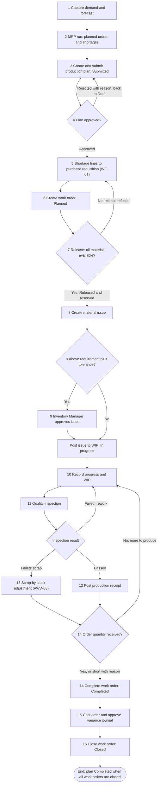
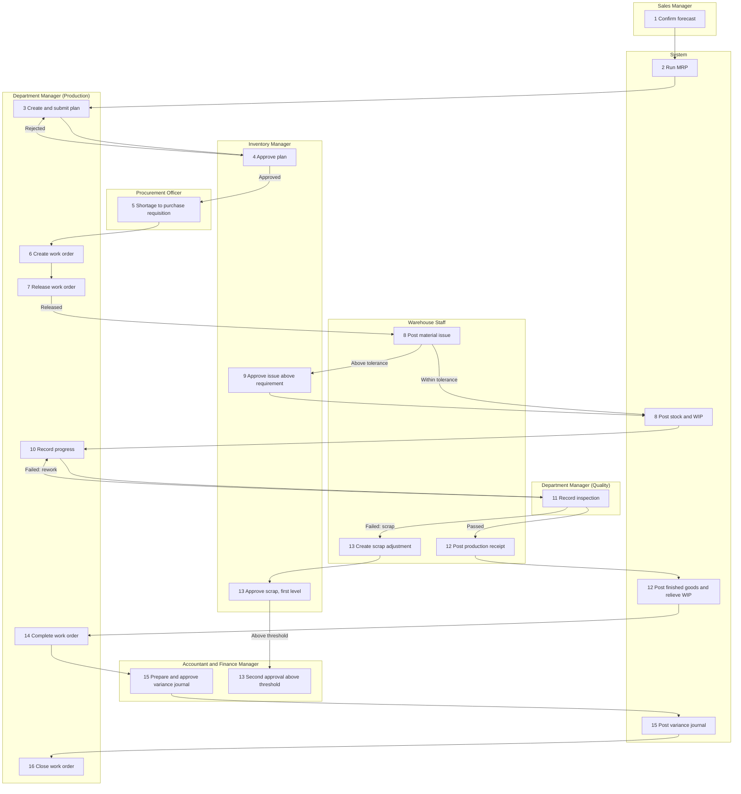
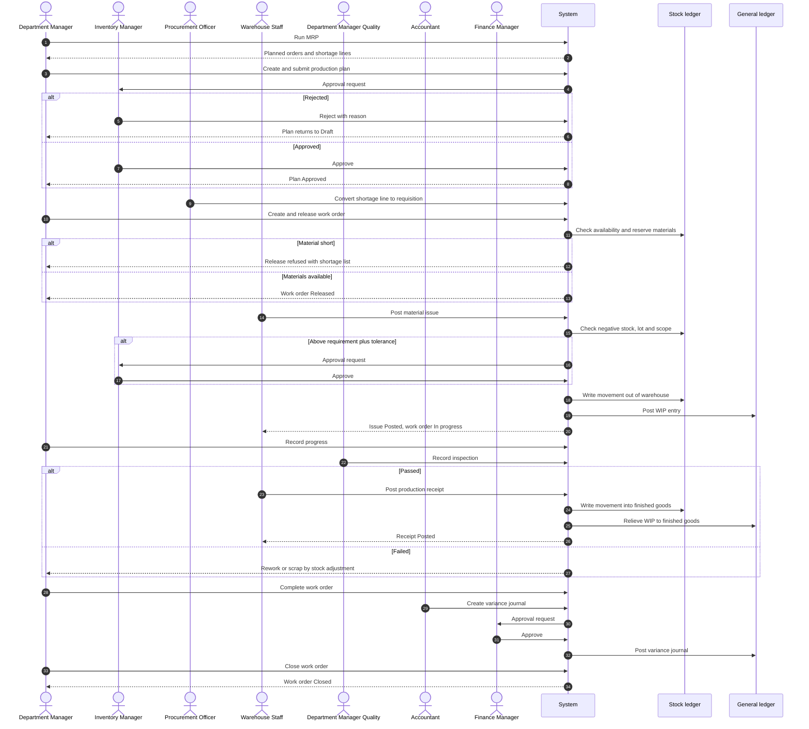
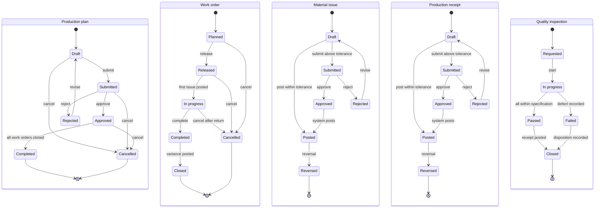

# WF-05 Plan-to-Produce

Document status: Draft v0.2 (Phase 2 remediation). Proposed. Outline promoted to implementation-ready documentation, not approved.
Release: R4. Previous detail level: outline in [Cross-Module Workflows](../Cross-Module-Workflows.md).
Every value, role mapping, status and rule that is new in this document is proposed, PENDING APPROVAL.
There are no R4 functional requirements, no production permission codes and no production API paths yet.
This document invents none. Where an ID is missing the text says so.
Related: [Authoritative Workflow Definitions](../Authoritative-Workflow-Definitions.md), [RBAC Matrix](../../06-RBAC-and-Security/RBAC-Matrix.md), [Business Rules](../../02-Business-Analysis/Business-Rules.md), [Data Dictionary](../../04-System-Architecture/Data-Dictionary.md), [Open Questions](../../02-Business-Analysis/Open-Questions.md), [test cases](../../08-QA-and-Testing/test-cases/Lifecycle-WF-05-Test-Cases.md).

## 1. Purpose and scope

Purpose: turn demand into finished goods with controlled material use, quality control and a costed, auditable result.
The lifecycle covers demand and forecast, material requirements planning (MRP), the production plan, work orders, material issue, work-in-progress (WIP), quality inspection, production receipt, scrap, costing and closure.

In scope:
1. Demand from confirmed sales orders (WF-02) and from forecast.
2. MRP netting and planned orders, with shortage lines.
3. Production plan approval.
4. Work order creation, release, progress, completion and close.
5. Material issue to a work order, including issue above the requirement.
6. Quality inspection and defect handling for produced quantity.
7. Production receipt of finished goods.
8. Scrap, rework and cost variance.

Out of scope in this version:
1. Maintenance work (M-106, M-107) except as a cause of machine downtime.
2. Subcontracting and outside processing.
3. Multi-level co-product and by-product costing.
4. Capacity planning detail beyond the schedule data of M-101.
5. Shop-floor devices and barcode scanning (M-074 is R3).

Business basis: BR-057 (Production and quality) is the only business requirement written for this lifecycle.
Its acceptance statement is that material consumption posts to stock and WIP.
It depends on OQ-002, which asks which industry uses the first release.
This lifecycle does not start before OQ-002 is answered.

## 2. Actors and responsibilities

Only the 18 default roles of the RBAC Matrix plus the system are used.
They are: Super Admin, Organization Admin, Branch Admin, Department Manager, HR Manager, HR Executive, Finance Manager, Accountant, Procurement Manager, Procurement Officer, Inventory Manager, Warehouse Staff, Sales Manager, Sales Executive, Project Manager, Employee, Auditor, Read-only User.
No default role is a production planner, production supervisor, shop-floor operator or quality inspector.
Production duties are assigned to the closest existing roles.
This mapping is a proposal, PENDING APPROVAL.

| Actor | Tier | Responsibility in WF-05 (proposed, PENDING APPROVAL) |
|---|---|---|
| Sales Manager | T2 | Confirms the demand forecast. Owns the sales orders that create demand |
| Department Manager (Production department) | T2 | Stands in for the production planner. Runs MRP, creates and submits the plan, creates, releases, completes and closes work orders, records progress |
| Department Manager (Quality department) | T2 | Stands in for the quality inspector. Records inspections and defects. Must be a different user from the work order creator and from the receipt poster |
| Inventory Manager | T2 | Approves the production plan (material commitment). Approves issues above the requirement. First approver of scrap adjustments (AWD-03). Approves a reversal of a stock document |
| Warehouse Staff | T3 | Posts material issues and production receipts. Creates scrap adjustments. Acts only in assigned warehouses |
| Procurement Officer | T3 | Converts shortage lines into purchase requisitions in WF-01 |
| Procurement Manager | T2 | Approves the purchase requisition chain in WF-07 for shortage purchases |
| Accountant | T3 | Prepares the cost variance journal |
| Finance Manager | T2 | Approves the plan above limit A (TBD, OQ-013). Second approver of scrap above the threshold. Approves the cost variance journal |
| Auditor | Oversight | Read-only review of production documents and audit |
| Super Admin, Organization Admin, Branch Admin | T0 to T2 | No production duty. Maintain users, scopes and approval chains only |
| HR roles, Project Manager, Sales Executive, Employee, Read-only User | T3 to T4 | No production duty. Read-only User may read operational production documents in scope |
| System | none | Runs MRP, snapshots BOM and routing, checks stock and period, reserves and consumes stock, posts stock and ledger entries, sends notifications |

Missing roles (proposals, PENDING APPROVAL, each needs a stakeholder decision and a permission design):
1. Production Planner (T3 for create and submit, with plan approval kept in a T2 role).
2. Production Supervisor (T2, release and close of work orders).
3. Shop-floor Operator (T3, progress and issue requests only).
4. Quality Inspector (T3, inspection results, separate from receipt posting).
Until these roles exist, the Department Manager role carries these duties and the segregation rules in section 5 still apply.
A user who holds two of these duties on one document is refused.

## 3. Preconditions

1. OQ-002 is answered and manufacturing is in the release scope.
2. Finished and component items exist and are Active (M-061).
3. At least one bill of materials (BOM) version is Active for each item to be produced (M-098).
4. A routing (operations and work centres) exists for each produced item, or the item is declared as having none.
5. Warehouses exist for raw material and finished goods (M-063). The default WIP location rule is PENDING APPROVAL.
6. The valuation method per item is set (M-072, OQ-009) and does not change once the item has movements (BRL-044).
7. The posting rules for WIP, finished goods and variance accounts exist as controlled data (BRL-070).
8. The fiscal period for the posting date is Open (BRL-018).
9. Approval chains for production plan, issue above requirement and variance journal exist in M-013, with limits (TBD, OQ-013).
10. The negative stock policy is known. The default is refuse (BRL-040, OQ-020).
11. Users hold the proposed production duties and are inside the scope of the warehouses and department concerned (BRL-003).
12. The quality inspection plan exists for items flagged as quality controlled (M-103, M-104).

## 4. Step-by-step workflow

Resulting statuses use the status lists of section 8.
Statuses of purchase requisition and stock adjustment come from the Data Dictionary.

| Step | Actor | Action | System behaviour | Resulting status |
|---|---|---|---|---|
| 1 | Sales Manager | Confirms or enters the demand forecast for the planning horizon. Confirmed sales orders count as demand without entry | Stores a forecast version with author and date (M-109). Reads confirmed sales orders and open reservations | Forecast saved. No status list is proposed |
| 2 | Department Manager, System | Runs MRP on schedule or on request | Nets demand against on-hand, reserved, in-transit and available stock (FR-105), open purchase orders and open work orders. Explodes the Active BOM version. Creates suggested planned orders and shortage lines (M-100) | Planned orders suggested |
| 3 | Department Manager | Reviews and adjusts planned orders, creates the production plan and submits it | Shows estimated material cost. Locks the plan from edits and starts an approval instance (FR-040) | Production plan Submitted |
| 4 | Inventory Manager, Finance Manager above limit A | Approves or rejects the plan | Approver is never the creator or last editor (BRL-008). Rejection needs a reason and returns the plan to Draft (BRL-010). Above limit A a Finance Manager approves as a second level. A step with no eligible approver pauses and alerts | Production plan Approved, or Rejected then Draft |
| 5 | Procurement Officer | Converts each shortage line into a purchase requisition (WF-01) | Offers the shortage lines as a source. Never creates a purchase order automatically (proposed rule WF05-R7). The requisition follows WF-07 | Plan stays Approved. Purchase requisition Draft |
| 6 | Department Manager | Creates work orders from approved plan lines and selects the BOM version and routing | Copies the Active BOM version and routing into the work order as a snapshot (proposed rule WF05-R1) | Work order Planned |
| 7 | Department Manager | Releases the work order | Checks the plan is Approved, the BOM version is Active, items are Active and the period is Open. Reserves the required materials (BRL-041). Refuses release if any material is short (proposed rule WF05-R2) | Work order Released. Reservations Active |
| 8 | Warehouse Staff | Creates a material issue for the work order and posts it within the requirement | Checks scope, negative stock (BRL-040), expired or quarantined lots (BRL-045) and reservations. Writes stock ledger movements out of the warehouse into WIP (BRL-038). Posts the WIP entry. Marks reservations Consumed | Material issue Posted. Work order In progress at the first issue |
| 9 | Warehouse Staff, Inventory Manager | When the issue is above requirement plus tolerance, the creator submits it and the Inventory Manager decides | Stock is not changed until approval. Approver is neither creator nor submitter (BRL-008, same pattern as AWD-03). The system posts at approval | Material issue Submitted, Approved, Posted. Rejected returns to Draft |
| 10 | Department Manager | Records operation progress, quantity completed and machine downtime | Updates WIP quantity and cost (M-102). Updates the schedule (M-101) | Work order In progress |
| 11 | Department Manager (Quality) | Records the inspection on a completed quantity with passed and failed counts. Records defects | Refuses an inspector who created the work order or who will post the receipt (proposed rule WF05-R6). Failed quantity needs a disposition: rework, scrap | Quality inspection In progress, then Passed or Failed |
| 12 | Warehouse Staff | Posts the production receipt for the passed quantity | For quality controlled items requires a Passed inspection (proposed rule WF05-R5). Checks over-production tolerance (proposed rule WF05-R4). Posts finished goods into stock and relieves WIP to finished goods at actual cost by the valuation method (BR-039, BRL-044). Posting date must be in an Open period | Production receipt Posted |
| 13 | Warehouse Staff, Inventory Manager, Finance Manager | Records scrap through a stock adjustment | Follows AWD-03 in full. Financial impact shown before approval. Finance Manager adds a second level above the threshold. The system posts at final approval | Stock adjustment Draft, Submitted, Approved, Posted. Rejected returns to Draft |
| 14 | Department Manager | Completes the work order when the order quantity is received, or completes short with a reason | Refuses completion while an issue or receipt is Draft or Submitted. Releases remaining reservations | Work order Completed |
| 15 | Accountant, Finance Manager | Costs the order. The Accountant creates the variance journal. A different Finance Manager approves | Compares actual material cost, plus labour and overhead by a method that is PENDING APPROVAL, with standard cost. Approver is never the creator (BRL-069, BR-021). The system posts at final approval | Journal Draft, Submitted, Approved, Posted |
| 16 | Department Manager | Closes the work order | Checks every issue and receipt is Posted, every inspection is Closed and the variance journal is Posted. Closed order is read-only | Work order Closed. Plan Completed when all its work orders are Closed or Cancelled |

## 5. Approval hierarchy

Approval limits are company data and stay TBD (OQ-013, OQ-034).
Only the structure is proposed here, PENDING APPROVAL.

| Document | Maker | Level 1 | Level 2 | Rule |
|---|---|---|---|---|
| Production plan | Department Manager (Production) | Inventory Manager | Finance Manager above limit A | Approver is never the creator or last editor (BRL-008). Each level is a different user. A change of quantity or date after approval restarts the chain (same principle as RBAC Matrix 8A.5 rule 3) |
| Work order release | Department Manager | No approval when the plan is Approved and materials are available | None | A work order above plan quantity needs a revised plan. PENDING APPROVAL |
| Material issue within requirement | Warehouse Staff | None. Routine goods issue (FR-110) | None | Scope, negative stock and lot rules apply |
| Material issue above requirement plus tolerance | Warehouse Staff | Inventory Manager | None | Approver is neither creator nor submitter. Tolerance is proposed at 5 percent, PENDING APPROVAL |
| Production receipt within tolerance | Warehouse Staff | None. Quality gate replaces approval | None | Inspector is not the receipt poster (proposed rule WF05-R6) |
| Production receipt above over-production tolerance | Warehouse Staff | Inventory Manager | None | Tolerance proposed at 2 percent, PENDING APPROVAL |
| Scrap and stock adjustment | Warehouse Staff or Inventory Manager | Inventory Manager | Finance Manager above the threshold | AWD-03 applies unchanged. Value equal to the threshold needs only the first level. Approver is neither creator nor submitter (SOD-07, SOD-31). Threshold TBD (OQ-013) |
| Reversal of a posted issue or receipt | Warehouse Staff | Inventory Manager (not the requester) | None | A reversal is a new document (BRL-017 pattern, BRL-039) |
| Cost variance journal | Accountant | Finance Manager, a different user from the creator | Second Finance Manager above limit A | BRL-069 and BR-021. The system posts, never the approver |
| Shortage purchase | Procurement Officer | Per WF-01 and WF-07 | Per WF-01 | PO creator and approver rules of WF-01 are unchanged (SOD-32) |

Rules that apply to every row:
1. The creator never approves (BRL-008, FR-042).
2. A step with no eligible approver waits. It never falls back to self-approval (RBAC Matrix 8A.4).
3. Delegation follows BRL-012 and BRL-073.
4. Valuation and ledger postings follow the existing finance rules: the system posts, posted entries are immutable and corrections use reversing entries (BRL-016, BRL-017, BRL-018).
5. Stock adjustments, including scrap, follow AWD-03.
6. The step-up list of RBAC Matrix 8A.6 contains no production action. No step-up is proposed for WF-05 except the existing finance reversal actions. A step-up for a plan approval above a high value is a possible addition, PENDING APPROVAL.

## 6. Business rules

Existing rules used by this lifecycle:

| ID | Rule in short | Used at step |
|---|---|---|
| BR-057 | Manufacturers plan production, consume materials and control quality. Consumption posts to stock and WIP | All |
| BR-034, BRL-038, BRL-039 | Every stock change is a document and a ledger movement. Stock is never edited directly | 8, 9, 12, 13 |
| BR-035, BRL-040 | Negative stock is refused by default (OQ-020) | 8 |
| BR-036, BRL-041, BRL-052 | Reservations reduce available stock. A cancelled sales order releases its reservations | 7, 14 |
| BR-038, BRL-043 | Adjustments need a reason and approval, with impact shown | 13 |
| BR-039, BRL-044 | Stock is valued by the configured method and posted to the ledger. The method is fixed once movements exist | 12, 15 |
| BR-040, BRL-045 | Expired or quarantined batches cannot be issued | 8 |
| BR-006, BRL-009 to BRL-011, BRL-013 | Configurable approvals, authority limit, reason on rejection, new round on resubmission, escalation | 4, 9 |
| BRL-008, BR-021, BRL-069 | No self-approval. Journal maker-checker | 4, 9, 13, 15 |
| BRL-016 to BRL-018 | Balanced journals, immutable posted entries, open periods only | 12, 15 |
| BRL-061, BRL-062 | Notification retry. External failure does not roll back a committed event | 9 |
| BRL-065 | A save is refused if the record changed since it was opened | All edits |
| BRL-074 | SoD is evaluated on permissions across all assignments | 11 |

Proposed new rules, none has a BRL id, all are PENDING APPROVAL:

| Label | Proposed rule |
|---|---|
| Proposed new rule WF05-R1 | A work order keeps a snapshot of the BOM version and routing chosen at creation. Later BOM changes do not alter a released work order |
| Proposed new rule WF05-R2 | A work order is released only when all required materials are available. Partial release is not allowed in this proposal |
| Proposed new rule WF05-R3 | A material issue above the requirement plus a tolerance (proposed 5 percent) needs Inventory Manager approval by a user who is neither creator nor submitter |
| Proposed new rule WF05-R4 | A production receipt above the order quantity plus a tolerance (proposed 2 percent) needs Inventory Manager approval |
| Proposed new rule WF05-R5 | For items flagged quality controlled, a production receipt posts only for the quantity of a Passed inspection |
| Proposed new rule WF05-R6 | The inspector of a work order is neither its creator nor the user who posts its receipt |
| Proposed new rule WF05-R7 | MRP shortage lines never create a purchase order automatically. A Procurement Officer converts them into requisitions |
| Proposed new rule WF05-R8 | A work order is Closed only when all its issues and receipts are Posted, all inspections are Closed and the variance journal is Posted |
| Proposed new rule WF05-R9 | A work order with posted issues cannot be Cancelled until the issued material is returned by a reversal or a return receipt |

## 7. Input and output data

| Data | Direction | Content (proposed) | Owner |
|---|---|---|---|
| Demand | In | Confirmed sales orders (M-081), forecast lines by item, period and quantity | Sales Manager |
| Forecast | In | Forecast version, item, period, quantity, author, date (M-109) | Sales Manager |
| Bill of materials | In | Item, version, status, component, quantity per unit, unit, scrap factor (PENDING APPROVAL) (M-098) | Department Manager |
| Routing | In | Operations, sequence, work centre, standard time (M-101) | Department Manager |
| Stock and reservations | In | On-hand, reserved, in-transit, available (FR-105) | System |
| Planned order | Out | Item, quantity, due date, source demand, shortage lines | System |
| Production plan | Out | Plan number, lines, estimated cost, status, approvers | Department Manager |
| Work order | Out | Number, item, quantity, BOM version, routing, planned dates, status, plan line | Department Manager |
| Material issue | Out | Work order, component, quantity, lot, warehouse, reason if above requirement, stock movements | Warehouse Staff |
| WIP record | Out | Work order, quantity in process, accumulated cost (M-102) | System |
| Quality inspection | Out | Work order, inspected, passed and failed quantities, defect codes, disposition (M-104, M-105) | Quality department |
| Production receipt | Out | Work order, quantity, warehouse, lot, unit cost, stock movement | Warehouse Staff |
| Scrap | Out | Stock adjustment with reason, quantity, value, approvers (AWD-03) | Warehouse Staff |
| Cost | Out | Actual material cost, labour and overhead (method PENDING APPROVAL), standard cost, variance, variance journal | Accountant |
| Audit and notifications | Out | Every status change, approval and posting (M-010), notices (M-012) | System |

## 8. Status transitions

Status names follow the Data Dictionary style: lifecycle order, terminal states, Rejected returns to Draft.
These lists are not in the Data Dictionary today. Adding them is part of the R4 work, PENDING APPROVAL.

### 8.1 Production plan

Statuses: Draft, Submitted, Approved, Rejected, Completed, Cancelled. Terminal: Completed, Cancelled.

| From | To | Condition | Actor |
|---|---|---|---|
| Draft | Submitted | Lines valid, items Active | Department Manager |
| Submitted | Approved | Required levels decided by users who are not creator or last editor | Inventory Manager, Finance Manager above limit A |
| Submitted | Rejected | Any approver rejects, reason required | Inventory Manager, Finance Manager |
| Rejected | Draft | Revise | Department Manager |
| Draft, Submitted, Approved | Cancelled | No work order of the plan is Released or later | Department Manager |
| Approved | Completed | All work orders of the plan are Closed or Cancelled | System |

### 8.2 Work order

Statuses: Planned, Released, In progress, Completed, Closed, Cancelled. Terminal: Closed, Cancelled.

| From | To | Condition | Actor |
|---|---|---|---|
| Planned | Released | Plan Approved, BOM Active, materials available, period Open | Department Manager |
| Released | In progress | First material issue Posted | System |
| In progress | Completed | Order quantity received, or completed short with reason, no Draft or Submitted issue or receipt | Department Manager |
| Completed | Closed | Variance journal Posted, inspections Closed | Department Manager |
| Planned, Released | Cancelled | No issue posted. Reservations released | Department Manager |
| In progress | Cancelled | Issued material returned (WF05-R9) | Department Manager |

### 8.3 Material issue

Statuses: Draft, Submitted, Approved, Posted, Rejected, Reversed. Terminal: Reversed. Rejected returns to Draft.

| From | To | Condition | Actor |
|---|---|---|---|
| Draft | Posted | Within requirement plus tolerance, stock available, lot allowed, period Open | Warehouse Staff |
| Draft | Submitted | Above requirement plus tolerance | Warehouse Staff |
| Submitted | Approved | Approver is neither creator nor submitter | Inventory Manager |
| Submitted | Rejected | Reason required | Inventory Manager |
| Rejected | Draft | Revise | Warehouse Staff |
| Approved | Posted | Stock re-checked at posting | System |
| Posted | Reversed | New reversal document approved by another user | Inventory Manager |

### 8.4 Production receipt

Statuses: Draft, Submitted, Approved, Posted, Rejected, Reversed. Terminal: Reversed. Rejected returns to Draft.

| From | To | Condition | Actor |
|---|---|---|---|
| Draft | Posted | Inspection Passed where required, within tolerance, period Open | Warehouse Staff |
| Draft | Submitted | Above over-production tolerance | Warehouse Staff |
| Submitted | Approved | Approver is not the creator | Inventory Manager |
| Submitted | Rejected | Reason required | Inventory Manager |
| Rejected | Draft | Revise | Warehouse Staff |
| Approved | Posted | System posts stock and ledger together | System |
| Posted | Reversed | Goods still on hand, approved reversal by another user | Inventory Manager |

### 8.5 Quality inspection

Statuses: Requested, In progress, Passed, Failed, Closed. Terminal: Closed.

| From | To | Condition | Actor |
|---|---|---|---|
| Requested | In progress | Inspector is not the work order creator or receipt poster | Department Manager (Quality) |
| In progress | Passed | All inspected quantity within specification | Department Manager (Quality) |
| In progress | Failed | Any failed quantity, defect recorded | Department Manager (Quality) |
| Passed | Closed | Receipt of the passed quantity Posted | System |
| Failed | Closed | Disposition recorded for each failed unit: rework, scrap | Department Manager (Quality) |

A reworked quantity creates a new inspection, which starts at Requested.

## 9. Notifications

Notifications use M-012 with in-app and email channels, retry (FR-037, BRL-061) and no loss of the business event when sending fails (BRL-062).
Mandatory approval notices cannot be switched off (FR-038).

| Event | Recipient | Channel (proposed) |
|---|---|---|
| Plan submitted | Inventory Manager (and Finance Manager above limit A) | In-app, email |
| Plan decided | Plan creator | In-app, email |
| Shortage lines created | Procurement Officer, planner | In-app |
| Work order released | Warehouse Staff of the warehouse, Quality department | In-app |
| Material issue needs approval | Inventory Manager | In-app, email |
| Inspection failed | Planner, Inventory Manager | In-app, email |
| Receipt posted | Planner, sales team for linked orders | In-app |
| Scrap adjustment needs approval | Inventory Manager, Finance Manager above threshold | In-app, email |
| Variance journal needs approval | Finance Manager | In-app, email |
| Work order closed | Planner, Accountant | In-app |
| Demand changed or cancelled | Planner | In-app |

## 10. Related modules

| ID | Module | Role in WF-05 |
|---|---|---|
| M-097 | Production Planning | Production plan |
| M-098 | Bill of Materials (BOM) | BOM versions |
| M-099 | Work Order Management | Work orders |
| M-100 | Material Requirements Planning (MRP) | Netting and planned orders |
| M-101 | Production Scheduling | Routing and dates |
| M-102 | Work-in-Progress Tracking | WIP quantity and cost |
| M-103 | Quality Management (QMS) | Inspection plans |
| M-104 | Quality Inspection | Inspections |
| M-105 | Defect Management | Defects and disposition |
| M-106, M-107 | Maintenance Management, Preventive Maintenance | Machine downtime only |
| M-108 | Supply Chain Management | Supply view |
| M-109 | Demand Forecasting | Forecast |
| M-061 | Product & Service Catalog | Items |
| M-063 | Warehouse Management | Locations |
| M-064 | Stock Management | Stock ledger |
| M-065 | Stock Reservation | Reservations |
| M-067 | Stock Adjustment | Scrap |
| M-072 | Inventory Valuation | Cost and valuation |
| M-073 | Goods Issue & Goods Receipt | Issue and receipt documents |
| M-081 | Sales Order Management | Demand |
| M-049, M-053, M-057 | Purchase Requisition (PR), Purchase Order (PO), Goods Receipt Note (GRN) | Shortage purchasing (WF-01) |
| M-032 | General Ledger | Postings |
| M-013, M-012, M-010 | Workflow & Approval Engine, Notification & Communication Management, Audit Logs & Activity Tracking | Approval, notices, audit |

## 11. Integration dependencies

No production API path is designed. No integration is invented here.

| Dependency | Needed from | Note |
|---|---|---|
| Inventory | M-064, M-065, M-067, M-073 | Movements, reservations, adjustments. Tables and ledger rules of the MVP are reused (FR-104, FR-113) |
| Finance posting | M-032, M-072 | Posting rules for WIP, finished goods and variance are controlled data (BRL-070). Posting only to open periods (BRL-018). Method per OQ-009 |
| Procurement for shortages | M-049, M-053, M-057 (WF-01), M-013 (WF-07) | Shortage line becomes a requisition. No automatic PO |
| Sales | M-081 (WF-02) | Demand. Cancellation releases reservations (BRL-052) |
| Quality | M-103, M-104, M-105 | Inspection hook on production receipt. The MVP has no quality hook (see Manufacturing Test Cases) |
| Approval and notification | M-013, M-012 | Production document types must be added to the approval engine |
| Audit | M-010 | Every status change and approval |
| Atomicity and idempotency | All | Idempotent posting (NFR-025) and atomic document plus posting (NFR-021) |

## 12. Exception scenarios

| Scenario | Handling (proposed, PENDING APPROVAL) | Test case |
|---|---|---|
| Material shortage at release | Release is refused with the shortage list. The Procurement Officer converts shortages to requisitions. Release is retried after receipt. Partial release is an open decision | TC-0849, TC-0875 |
| Material shortage at issue | Issue is refused when stock would go negative (BRL-040). Message shows the available quantity | TC-0850 |
| Scrap | Recorded through a stock adjustment (AWD-03). Value is shown before approval. Over a threshold a Finance Manager approves too | TC-0842, TC-0853, TC-0854, TC-0864 |
| Rework | Failed quantity is reworked and inspected again as a new inspection. Extra material for rework is an issue above requirement | TC-0876 |
| Over-production | Receipt above order quantity plus tolerance needs Inventory Manager approval. The treatment of the excess quantity (extra stock or refuse) is an open decision | TC-0863 |
| Wrong BOM version | Release is refused when the version is not Active. A released order keeps its snapshot. A change of version needs cancel and recreate, or a controlled change order (PENDING APPROVAL) | TC-0838, TC-0848 |
| Backdated receipt | Posting date must be in an Open period. A closed period refuses the posting and offers the next open period as a user decision (BRL-018). A posting date before the last issue date of the work order is also refused (proposed) | TC-0858 |
| Expired or quarantined lot | Issue is refused (BRL-045) | TC-0851 |
| Machine downtime | Recorded on the operation. Schedule moves. No stock effect | none |
| Demand cancelled | Reservations of unissued work orders are released. Planner is notified | TC-0877 |
| Self-approval or duty overlap | Refused by SoD checks | TC-0846, TC-0852, TC-0859, TC-0860 |

## 13. Failure and recovery scenarios

| Scenario | Behaviour (proposed) | Test case |
|---|---|---|
| Partial completion | The work order is completed short with a reason. Remaining reservations are released. Costing runs on received quantity | TC-0871 |
| System failure during a multi-line issue or backflush | The document and its movements commit together or not at all (NFR-021). The user retries. A second post with the same key does nothing (NFR-025) | TC-0868, TC-0869 |
| Cost or ledger posting failure | The receipt stays unposted with no stock effect. Retry is safe. An external failure never rolls back a committed event (BRL-062) | TC-0870 |
| Reversal of a receipt or an issue | A new document, approved by another user. A receipt cannot be reversed when the goods have left stock. The original stays unchanged (BRL-017, BRL-039) | TC-0872 |
| Notification failure | Retried, then flagged. The status change stays (BRL-061, BRL-062) | TC-0873 |
| Concurrent issue of the last stock | One request succeeds, the other is refused (FR-113, NFR-024) | TC-0867 |
| Approver unavailable | Delegation or escalation (BRL-012, BRL-013). No auto-approval | none |

Backflush (automatic issue on receipt) is an option, not a decision.
Whether backflush is allowed and for which items is PENDING APPROVAL.
If it is allowed, it uses the same checks as a manual issue and the all-or-nothing rule above.

## 14. Diagrams

The four diagrams use the step numbers of section 4 and the statuses of section 8.

### 14.1 Process flow

### 14.2 Swimlane

### 14.3 Sequence

### 14.4 State transition

## 15. Requirement cross-reference

There are no R4 functional requirements (FR) for manufacturing yet.
No FR, API, user story or permission code exists for WF-05.
The table lists existing IDs that the lifecycle relies on.
BR-057 is the only requirement written for it.
Test cases are in [Lifecycle WF-05 Test Cases](../../08-QA-and-Testing/test-cases/Lifecycle-WF-05-Test-Cases.md).

| Existing ID | Subject | Related modules | Test cases |
|---|---|---|---|
| BR-057 | Production and quality | M-097 to M-109 | TC-0835, TC-0837, TC-0838, TC-0844, TC-0845, TC-0848, TC-0849, TC-0857, TC-0859, TC-0863, TC-0866, TC-0871, TC-0874, TC-0875, TC-0876, TC-0877 |
| BR-034, BRL-038 | Stock ledger and documents | M-064, M-073 | TC-0837, TC-0839, TC-0840, TC-0841, TC-0862, TC-0863, TC-0868, TC-0869, TC-0872, TC-0874, TC-0875 |
| BR-035, BRL-040, FR-106 | Negative stock | M-064 | TC-0850, TC-0865 |
| BRL-041, BRL-052 | Reservations | M-065 | TC-0838, TC-0839, TC-0871, TC-0877 |
| BR-038, BRL-043, FR-109 | Adjustment and scrap (AWD-03) | M-067 | TC-0842, TC-0853, TC-0854, TC-0862, TC-0864, TC-0876 |
| BR-039, BRL-044, FR-111 | Valuation | M-072 | TC-0840, TC-0874 |
| BR-040, BRL-045 | Lots | M-068, M-073 | TC-0851 |
| BRL-008, BR-021, FR-042, SEC-020 | No self-approval | M-013 | TC-0836, TC-0841, TC-0846, TC-0852, TC-0853, TC-0860 |
| BRL-069 | Journal maker-checker | M-032 | TC-0843, TC-0860, TC-0874 |
| BRL-017, BRL-018 | Immutable entries, open periods | M-032, M-073 | TC-0858, TC-0872 |
| BRL-039, FR-104 | Documents only change stock | M-064 | TC-0861 |
| BRL-003, BRL-002, SEC-013, SEC-014, BRL-004, BRL-074 | Access and scope | M-099, M-013 | TC-0847, TC-0855, TC-0856, TC-0859 |
| FR-113, NFR-024 | Concurrency | M-064 | TC-0867 |
| NFR-021, NFR-025, BRL-062 | Atomicity, idempotency, external failure | M-073, M-072 | TC-0868, TC-0869, TC-0870, TC-0873 |
| BRL-061, FR-037 | Notification retry | M-012 | TC-0873 |
| FR-040, FR-041, BRL-010 | Submit and decide | M-013 | TC-0835, TC-0836 |

## 16. Open decisions

All items are PENDING APPROVAL.

| Item | Decision needed | Existing question |
|---|---|---|
| Industry and first customer | Which industry uses manufacturing first. Without it WF-05 does not start | OQ-002 |
| Valuation method | FIFO, weighted average or standard cost for finished goods and WIP | OQ-009 |
| Approval limits and adjustment threshold | Limit A for plan approval, scrap threshold, variance journal limit | OQ-013, OQ-034 |
| Negative stock policy for components | Whether any component may be issued below zero | OQ-020 |
| Adjustment approval for all values | Whether every scrap adjustment needs approval (AWD-03 assumes yes) | OQ-038 |
| Production roles (new question, no OQ number yet) | Whether to add Production Planner, Production Supervisor, Shop-floor Operator and Quality Inspector as default roles, or to keep the Department Manager mapping | New |
| Tolerances (new question) | Excess issue tolerance (proposed 5 percent) and over-production tolerance (proposed 2 percent), per item or global | New |
| Partial release (new question) | Whether a work order may be released with only some materials | New |
| Over-production treatment (new question) | Whether excess quantity is received to stock or refused | New |
| Backflush (new question) | Whether automatic issue on receipt is allowed and for which items | New |
| Labour and overhead costing (new question) | Method and source of labour and overhead cost in WIP | New |
| BOM change after release (new question) | Whether a controlled change order may replace the BOM version of a released work order | New |
| Quality concession (new question) | Whether failed quantity may be accepted with a concession and who approves it | New |
| Backdating limit (new question) | Whether a posting date before the last issue date of the work order is refused | New |
| Step-up (new question) | Whether plan approval above a high value needs step-up | New |
| Data Dictionary and permissions (new question) | Adding the status lists of section 8, production permission codes and the production API in the R4 requirements | New |
