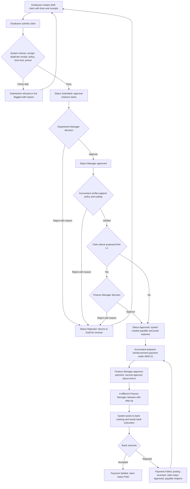
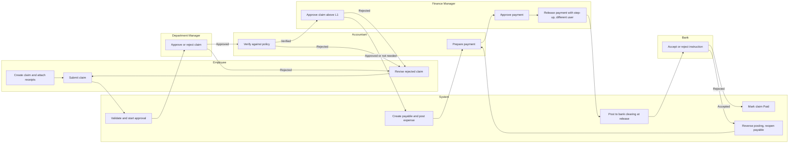
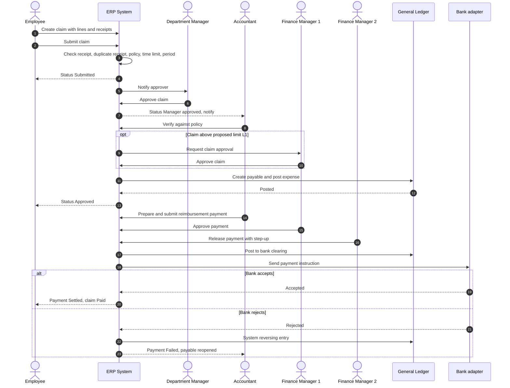
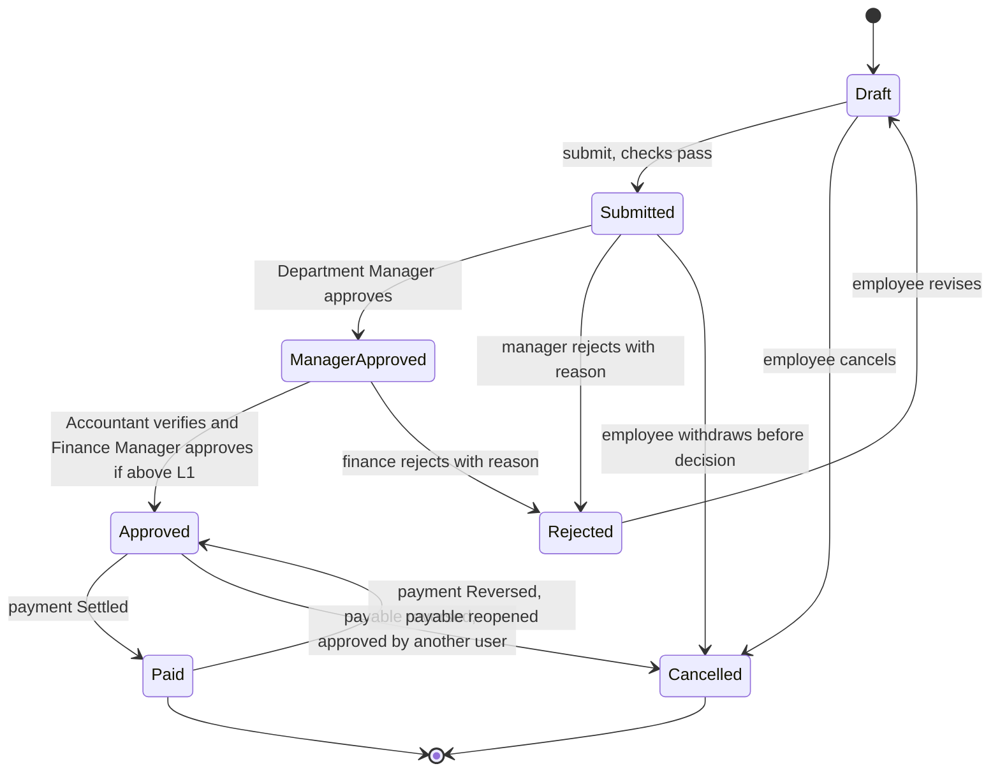

# WF-08 Expense-to-Reimbursement

Document status: Draft v0.2 (Phase 2 remediation). Proposed. Outline promoted to implementation-ready documentation, not approved.
Lifecycle ID: WF-08. Release: R2. Source outline: [Cross-Module Workflows](../Cross-Module-Workflows.md) section WF-08.
Related: [Authoritative Workflow Definitions](../Authoritative-Workflow-Definitions.md) (AWD-01 payment engine), [RBAC Matrix](../../06-RBAC-and-Security/RBAC-Matrix.md), [Business Rules](../../02-Business-Analysis/Business-Rules.md), [Open Questions](../../02-Business-Analysis/Open-Questions.md), [Data Dictionary](../../04-System-Architecture/Data-Dictionary.md).
Test cases: [Lifecycle WF-08 Test Cases](../../08-QA-and-Testing/test-cases/Lifecycle-WF-08-Test-Cases.md), IDs TC-0885 to TC-0929.
Every limit, threshold, time limit and period in this document is a proposal.
Each is marked "proposed, PENDING APPROVAL" and must not be built as a fixed value until a stakeholder decides.
Rules without a BRL id are labelled "Proposed new rule WF08-R1" and so on.
They are not entries in the Business Rules register.

## 1. Purpose and scope

Purpose: let an employee claim business expenses and travel costs with evidence, have them approved and checked against policy, and be repaid through the shared payment engine, with the expense posted correctly in the ledger.
The business need is BR-051: employees submit claims, approvers decide, finance reimburses, and an approved claim creates a payable.

In scope:
1. Expense claims with one or more lines, receipts, categories, currencies and cost centres.
2. Optional employee advances and their settlement against claims.
3. Approval by line manager, then Finance Manager above a proposed limit.
4. Finance verification against policy.
5. Payable creation and ledger posting.
6. Reimbursement payment through AWD-01 (prepare, approve, release by three different users, bank clearing, Settled or Failed).
7. Reversal and recovery paths.

Out of scope for this document:
1. Corporate card reconciliation and mileage rate engines (not in the module inventory for R2).
2. Payroll calculation (M-023). Payroll handoff is described only as an option (section 11).
3. Travel booking.
4. Tax recovery rules beyond a placeholder link to M-040 (OQ-007).

State of the design today:
1. WF-08 is an outline in the Cross-Module Workflows document.
2. There are no R2 functional requirements (FR ids) for expense claims yet. Section 15 says so again.
3. No API is designed for WF-08 ("API dependencies: None designed" in the outline). This document therefore names no API paths.
4. Claim, claim line and advance status lists are proposals. They are not yet in the Data Dictionary.

## 2. Actors and responsibilities

Only the 18 default roles of the RBAC Matrix (including Employee) and the system are used.
The Bank is an external party reached through the bank adapter, not a role.

| Actor | Tier | Responsibility in WF-08 |
|---|---|---|
| Employee | T4 | Creates, edits (while Draft), submits, withdraws and revises own claims. Sees own claims only (BR-052, BRL-056). Requests advances |
| Department Manager | T2 | First approver of claims of own department and its sub-units. Never approves own claim (BRL-008) |
| Accountant | T3 | Verifies claims against policy and coding. Prepares the reimbursement payment (AWD-01 prepare) |
| Finance Manager | T2 | Approves claims above proposed limit L1. Approves the payment. A different Finance Manager releases it with step-up. Approves reversals |
| HR Manager | T2 | Confirms employment status for leaver claims (exception 12.5). Owns the employee record rules |
| HR Executive | T3 | Maintains the employee record (reporting line, department, status) that the approval routing reads. Cannot see salary fields |
| Organization Admin | T1 | Maintains expense categories, limits and approval chains as controlled data (BRL-070). The other maker or checker is a Finance Manager (RBAC Matrix 8A.3) |
| Auditor | Oversight | Read only review of claims, approvals, overrides and postings |
| Super Admin | T0 | No business role in WF-08 |
| Branch Admin | T2 | No approval role in WF-08. Scope administration only |
| Procurement Manager, Procurement Officer, Inventory Manager, Warehouse Staff, Sales Manager, Sales Executive, Project Manager, Read-only User | T2 to T4 | No role in WF-08 unless the person is also a claimant (every staff user holds Employee). A manager of these types is a claimant like any Employee. Their line manager follows the Department Manager rule |
| System | n/a | Validates, routes approvals, enforces SoD and scope, creates the payable, posts to the ledger and bank clearing, sends notifications, writes the audit trail |

Scope rules:
1. A Department Manager approves only items of own department (RBAC Matrix section 3).
2. An Accountant or Finance Manager acts only in assigned companies or branches (BRL-002).
3. SoD is evaluated on permissions across all assignments of a user (BRL-074).

## 3. Preconditions

1. The claimant is an active employee with an active user account and a reporting line (M-016, M-007).
2. The claimant belongs to a department with an active Department Manager. If none exists, submission is refused or routed to the next level of the approval chain (section 5).
3. Expense categories, per-category policy limits and the receipt rule are configured (proposed new rules WF08-R1 and WF08-R3).
4. The approval chain for claims is defined in M-013 (FR-039). Limit values are TBD (OQ-013).
5. The fiscal period for the posting date is open (BRL-018, M-043).
6. The employee has an active, verified reimbursement bank account (M-036 or the employee record). The rule for changing it is proposed new rule WF08-R7.
7. The currency and exchange rate source are configured (M-041, OQ-008) when a foreign currency line is claimed.
8. The payment engine (AWD-01) is available: bank account of the company is active and no unverified bank change exists.

## 4. Step-by-step workflow

Status names in the last column are proposals (section 8).
Payment states in steps 10 to 14 are the AWD-01 states and are authoritative.

| Step | Actor | Action | System behaviour | Resulting status |
|---|---|---|---|---|
| 1 | Employee | Creates a claim: header (purpose, period, cost centre) and lines (date, category, merchant, amount, currency, receipt) | Saves a draft. Shows the policy limit per category. Attaches receipts to the line (M-011). Converts foreign currency lines at the expense date rate (WF08-R5) | Claim Draft. Lines Draft |
| 2 | Employee | Submits the claim | Runs checks: receipt present above threshold (WF08-R1), duplicate receipt (WF08-R2), category limit (WF08-R3), time limit (WF08-R4), open period. Refuses or flags failing lines with a reason. Locks the claim from edits (FR-040) and starts an approval instance | Claim Submitted. Lines Submitted |
| 3 | System | Routes to the approver | Finds the claimant's Department Manager. Skips the claimant, the creator and any conflicting user (BRL-008, FR-042). If no eligible approver exists the claim waits and an alert is sent. It never auto-approves | Claim Submitted |
| 4 | Department Manager | Approves, rejects (reason required) or returns the claim, line by line if needed | Records the decision append-only (FR-041). A reduced approved amount needs a reason (WF08-R8) | Claim Manager approved, or Rejected. Lines Approved or Rejected |
| 5 | Accountant | Verifies the claim against policy, receipts and account coding | Shows policy flags and duplicate warnings. A policy override is a recorded decision by a Finance Manager (section 12.3) | Claim Manager approved, then verified |
| 6 | Finance Manager | Approves the claim when the total is above proposed limit L1 (proposed, PENDING APPROVAL) | Routes by authority limit (FR-043). The approver is not the claimant, not the department approver of step 4, and not the verifier of step 5 where the chain requires distinct users | Claim Approved, or Rejected |
| 7 | System | Creates the payable and posts the expense | Creates a reimbursement payable for the employee. Posts expense and liability to the ledger in an open period (BRL-016, BRL-018). Failed posting rolls back fully and can be retried | Claim Approved. Payable open |
| 8 | Accountant | Selects approved claims or an advance and prepares a payment to the employee | Uses the AWD-01 payment engine. Checks the open amount (BRL-026, BRL-027). Applies any advance offset (section 12.7). Idempotency key stops a double submit (BRL-029) | Payment Draft, then Submitted |
| 9 | Finance Manager | Approves the payment | A different user from the preparer (BRL-068, SOD-06). A second distinct approver above limit A (FR-137, OQ-034). The payee never approves own payment (WF08-R6) | Payment Approved, or Rejected |
| 10 | Finance Manager (a different one) | Releases the payment with step-up | Needs a recent step-up (FR-145). Releaser differs from preparer and approver (SOD-14, SOD-15). Refused with DUTY-002, STEP-001 or HOLD-001 | Payment Released |
| 11 | System | Posts to bank clearing and queues the bank instruction | Ledger is not ahead of a draft decision. A posted payment cannot be edited, only reversed (BRL-028) | Payment Released |
| 12a | Bank | Accepts the instruction | System marks the payment Settled, allocates it to the payable and closes the payable | Payment Settled. Claim Paid |
| 12b | Bank | Rejects the instruction | System marks the payment Failed (final), reverses the posting with a system reversing entry and reopens the payable. A retry is a new payment with new approvals | Payment Failed. Claim stays Approved |
| 13 | System | Notifies and audits | Sends notifications (section 9). Writes the audit trail for every decision | No change |
| 14 | Finance Manager and a different Finance Manager | Reverses a Settled reimbursement when needed | Reversal is a new document with its own approver, step-up on both (BRL-068, SOD-16). Payable and claim reopen | Payment Reversed. Claim Approved |

Advance variant (optional): the employee requests an advance first (section 8.3). The advance is disbursed through steps 8 to 12 and is later offset against the claim in step 8.

## 5. Approval hierarchy

All values below are proposed, PENDING APPROVAL, and depend on OQ-013 (approval limits) and OQ-034 (payment limits A and B, a role above Finance Manager).

| Stage | Role | When | Rule |
|---|---|---|---|
| Claim level 1 | Department Manager (line manager) | Every claim | Own department only. Never the claimant (BRL-008, FR-042) |
| Claim verification | Accountant | Every claim | Verifies receipts, policy and coding. Does not replace approval |
| Claim level 2 | Finance Manager | Claim total above proposed limit L1 | Different user from level 1 and from the claimant. Routed by FR-043 |
| Payment prepare | Accountant | Every reimbursement | AWD-01 prepare |
| Payment approve | Finance Manager | Every reimbursement | Different from the preparer |
| Payment approve level 2 | A second Finance Manager | Payment above limit A (OQ-034) | Each level a different user (RBAC Matrix 8A.5) |
| Payment release | A different Finance Manager | Every reimbursement | Step-up. Not the preparer or an approver (BRL-068) |

Principles:
1. The claimant never approves own claim at any stage (BRL-008, FR-042, BRL-057).
2. A claim by a Department Manager goes to the next eligible approver of the chain defined in M-013. It does not fall back to self-approval. Where nobody is eligible, it waits and alerts (RBAC Matrix 8A.5 rule 4).
3. A claim by a Finance Manager is decided by another Finance Manager. The same person cannot be payee and approver or releaser of the payment (proposed new rule WF08-R6).
4. A value change after approval restarts the chain (FR-092 applies to POs, the same behaviour is proposed here, WF08-R11).
5. A rejection needs a reason and returns the claim to the claimant. Resubmission starts a new round and keeps the earlier rounds (BRL-010, BRL-011).

Delegation (BRL-073 and BRL-012, FR-044, FR-143):
1. A delegate must hold the underlying permission and scope, and pass the SoD check at delegation and at use.
2. A delegate cannot approve a claim the delegator created or claimed.
3. Release, reverse, reopen and grant-approval authority cannot be delegated. Release of a reimbursement payment is therefore never delegated.
4. Maximum delegation period 30 days (proposed in RBAC Matrix 8A.7, PENDING APPROVAL). Chained delegation is not allowed in this draft (OQ-026).
5. Delegation limits for claim approval value are proposed to equal the delegator's own limit, PENDING APPROVAL. A delegate with a lower limit routes the claim onward.
6. The audit record names delegator, delegate and claim (AUD-121).

Escalation: a claim pending longer than a configured time goes to the next approver (FR-045). The time is not defined. PENDING APPROVAL.

Payment of the reimbursement uses AWD-01 without change.
There is no separate or faster path for employee reimbursements.

## 6. Business rules

Existing rules reused:

| Rule | Statement (summary) | Applied at |
|---|---|---|
| BR-051 | Employees submit claims, approvers decide, finance reimburses. An approved claim creates a payable | Whole lifecycle |
| BR-052, BRL-056 | An employee sees and requests only own HR items and own data | Steps 1, 2, 13 |
| BR-006, BRL-009 | Configurable approval chains by type and value | Steps 3 to 6 |
| BRL-008 | A user cannot approve a document they created | Steps 3, 4, 6 |
| BRL-010 | A rejection needs a reason and returns the document | Steps 4 to 6 |
| BRL-011 | A resubmitted document starts a new round and keeps history | Section 12.5 |
| BRL-012, BRL-073 | Delegation limits | Section 5 |
| BRL-016 | Every journal balances in transaction and base currency | Step 7 |
| BRL-017 | Posted entries are immutable. Correct by reversing entry | Steps 12b, 14 |
| BRL-018, BR-016 | Postings go to open periods only | Step 7 |
| BR-020, BRL-026, BRL-027 | Allocation never exceeds open amount. Overpayment is unallocated credit | Step 8 |
| BRL-028 | A posted payment cannot be edited, only reversed | Steps 11, 14 |
| BRL-029 | Duplicate submit of one payment request creates one payment | Step 8 |
| BRL-057 | Same user cannot create and approve, or approve and pay, the same payable | Steps 6 to 10 |
| BRL-068 | Prepare, approve and release are three different users. A reversal has its own approver | Steps 8 to 10, 14 |
| BRL-070 | Controlled changes (approval limits, posting rules) need request and approval by different users | Section 5 configuration |
| BRL-074 | SoD is evaluated on permissions across all assignments | All approvals |
| BRL-004, BRL-002 | Default deny. Company assignment required | All steps |

Proposed new rules (no BRL id, not in the register, all PENDING APPROVAL):

| Label | Proposed rule | Proposed value |
|---|---|---|
| Proposed new rule WF08-R1 | A receipt is required for a claim line above a receipt threshold. Below it, a declaration is enough | Threshold: proposed, PENDING APPROVAL |
| Proposed new rule WF08-R2 | Duplicate receipt detection: a line with the same merchant, receipt number, date and amount as an earlier line (any claimant) is blocked or flagged. An override is a recorded Finance Manager decision, never by the Accountant who verified the claim | Match fields: proposed, PENDING APPROVAL |
| Proposed new rule WF08-R3 | Policy limit per expense category (per line, per day or per claim). A line above the limit is flagged. Approval of the excess needs a Finance Manager | Limits: proposed, PENDING APPROVAL |
| Proposed new rule WF08-R4 | Claim time limit: a line is claimable within a number of days after the expense date. A late line needs a Finance Manager decision with reason | Days: proposed, PENDING APPROVAL |
| Proposed new rule WF08-R5 | Foreign currency lines are converted at the exchange rate of the expense date from the configured source. The original amount, currency and rate stay on the line | Rate source and date rule: proposed, PENDING APPROVAL (OQ-008) |
| Proposed new rule WF08-R6 | The payee of a reimbursement cannot approve or release the payment, and cannot approve a claim in own chain | Proposed |
| Proposed new rule WF08-R7 | A change of the employee's reimbursement bank account is a controlled change (request, verify, approve by different users) and a payment to a new account waits for a hold period, in the style of vendor bank changes | Hold period: proposed, PENDING APPROVAL (OQ-035) |
| Proposed new rule WF08-R8 | A reduced approved amount on a line needs a reason and is shown to the claimant | Proposed |
| Proposed new rule WF08-R9 | An advance is offset against claims of the same employee. An unspent advance is recovered by repayment or deduction | Recovery method: proposed, PENDING APPROVAL |
| Proposed new rule WF08-R10 | A claim for a leaver is accepted only within a time window after the exit date and after HR confirms the last day | Window: proposed, PENDING APPROVAL |
| Proposed new rule WF08-R11 | A change of amount, category, currency or receipt after approval returns the claim to Submitted and restarts approval | Proposed |

## 7. Input and output data

Input data:

| Group | Fields |
|---|---|
| Claim header | Claimant, department, cost centre, purpose, period, currency of reimbursement, advance reference (optional) |
| Claim line | Expense date, category, merchant, receipt number, amount, currency, exchange rate and source, tax amount (if recoverable), receipt attachment, project reference (optional) |
| Policy data | Categories, limits, receipt threshold, time limit, approval chain, limits L1 and A (all proposed, PENDING APPROVAL) |
| Decision data | Approver, decision, reason, timestamp, approved amount per line |
| Payment data | Employee bank account, amount, currency, payment date, preparer, approvers, releaser |

Output data:

| Output | Content |
|---|---|
| Claim record | Header, lines, statuses, approval rounds, audit history |
| Reimbursement payable | Amount owed to the employee, open amount |
| Ledger entries | Expense and liability at approval. Liability to bank clearing at release. Reversing entries on failure or reversal (M-032, M-035) |
| Payment | AWD-01 payment with allocations to the payable |
| Advance record | Disbursed, offset and recovered amounts |
| Notifications and audit | Section 9 and the audit action list (Create, Update, Status change, Approve, Reject, Post, Reverse, Cancel) |

## 8. Status transitions

Statuses follow the convention of the Data Dictionary (lifecycle order, terminal states, Rejected returns to Draft).
Claim, claim line and advance lists are proposals and are not yet in the Data Dictionary.

### 8.1 Claim

Statuses: Draft, Submitted, Manager approved, Approved, Paid, Rejected, Cancelled.
Terminal: Paid and Cancelled (Paid reopens only by payment reversal). Rejected returns to Draft.

| From | To | Condition | Actor |
|---|---|---|---|
| (new) | Draft | Claim created | Employee |
| Draft | Submitted | Checks pass (receipt, duplicate, policy, time limit, open period) | Employee |
| Draft | Cancelled | Claimant discards the draft | Employee |
| Submitted | Manager approved | Department Manager approves | Department Manager |
| Submitted | Rejected | Manager rejects, reason required | Department Manager |
| Submitted | Cancelled | Claimant withdraws before any decision | Employee |
| Manager approved | Approved | Accountant verifies, and Finance Manager approves if total is above L1. Payable posted | Accountant, Finance Manager, System |
| Manager approved | Rejected | Finance rejects, reason required | Accountant or Finance Manager |
| Rejected | Draft | Claimant revises. A new approval round follows on resubmission | Employee |
| Approved | Paid | Reimbursement payment becomes Settled | System |
| Approved | Cancelled | Payable and posting reversed, reversal approved by a user other than the requester | Finance Manager, a different Finance Manager |
| Paid | Approved | Payment Reversed, payable reopened | Finance Manager, a different Finance Manager |

### 8.2 Claim line

Statuses: Draft, Submitted, Approved, Rejected.
A flag (policy, duplicate, late) is an attribute and not a status.

| From | To | Condition | Actor |
|---|---|---|---|
| Draft | Submitted | Parent claim submitted and line checks pass or flag | Employee |
| Submitted | Approved | Approver accepts the line, with a reason if the amount is reduced (WF08-R8) | Department Manager, Finance Manager |
| Submitted | Rejected | Approver rejects the line, reason required | Department Manager, Accountant, Finance Manager |
| Rejected | Draft | Claimant revises the line while the claim is in Draft | Employee |

The claim becomes Approved only when at least one line is Approved.
Partial reimbursement pays only the approved lines and approved amounts.

### 8.3 Advance (optional)

Statuses: Requested, Approved, Disbursed, Partly settled, Settled, Rejected, Cancelled.
Terminal: Settled, Rejected, Cancelled.

| From | To | Condition | Actor |
|---|---|---|---|
| (new) | Requested | Employee requests an advance with purpose and amount | Employee |
| Requested | Approved | Department Manager approves, Finance Manager above L1 | Department Manager, Finance Manager |
| Requested | Rejected | Reason required | Department Manager, Finance Manager |
| Requested, Approved | Cancelled | Withdrawn before disbursement | Employee |
| Approved | Disbursed | Advance payment (AWD-01) is Settled | System |
| Disbursed | Partly settled | A claim offsets part of the advance | System |
| Disbursed, Partly settled | Settled | Offsets and recoveries equal the advance | System, Accountant |

### 8.4 Reimbursement payment (AWD-01 states)

States and transitions are those of AWD-01 and are not redefined here: Draft, Submitted, Approved, Released, Settled, Failed, Rejected, Cancelled, Reversed.
Terminal: Failed, Cancelled, Reversed (Rejected returns to Draft).

| Payment event | Effect on the claim |
|---|---|
| Draft, Submitted, Approved, Released | Claim stays Approved |
| Settled | Claim becomes Paid |
| Failed | Claim stays Approved. Payable reopens. A retry is a new payment |
| Rejected | Claim stays Approved. Preparer revises or cancels |
| Cancelled | Claim stays Approved. Payable stays open |
| Reversed | Claim returns to Approved. Payable reopens |

## 9. Notifications

Delivery by M-012 (email and in-app). Failed notifications are retried (FR-037). Mandatory approval notices cannot be switched off (FR-038).

| Event | Recipient | Channel |
|---|---|---|
| Claim submitted | Department Manager | In-app, email |
| Approval pending beyond the configured time | Next approver (escalation, FR-045) | In-app, email |
| No eligible approver | Finance Manager and the claimant | In-app |
| Claim rejected or returned, with reason | Employee | In-app, email |
| Manager approved, awaiting verification | Accountant | In-app |
| Claim above L1 | Finance Manager | In-app, email |
| Claim Approved, payable created | Employee, Accountant | In-app |
| Payment Released | Employee (remittance advice) | Email |
| Payment Settled, claim Paid | Employee | In-app, email |
| Payment Failed | Accountant, Finance Manager, Employee (neutral wording) | In-app |
| Duplicate receipt or policy override recorded | Finance Manager, Auditor (report) | In-app |
| Delegate acts | Delegator | In-app |
| Advance unsettled beyond the proposed period | Employee, Accountant | In-app |

## 10. Related modules

| Module | Name | Role in WF-08 |
|---|---|---|
| M-028 | Travel & Expense Claims | Captures and approves claims (module inventory overlap note) |
| M-039 | Expense Management | Owns finance posting and reimbursement |
| M-047 | Payment & Refund Management | Payment engine (AWD-01) |
| M-013 | Workflow & Approval Engine | Approval chains, delegation, escalation |
| M-012 | Notification & Communication Management | Notifications |
| M-010 | Audit Logs & Activity Tracking | Audit trail |
| M-011 | Document Management | Receipt attachments |
| M-027 | Employee Self-Service | Employee entry point (overlaps M-119, same capability) |
| M-016 | Employee Management | Employee record, status, reporting line |
| M-007 | Employee Directory | Reporting lines for routing |
| M-019 | Employee Offboarding | Leaver status and exit date |
| M-006 | Branch & Department Management | Department scope for approvers |
| M-023 | Payroll Management | Optional handoff path (section 11) |
| M-032 | General Ledger | Expense and liability postings |
| M-035 | Journal Entries | Automated postings and reversing entries |
| M-033 | Accounts Payable | Possible holder of the employee payable. PENDING APPROVAL (section 16) |
| M-036 | Bank Account Management | Company bank account and employee payout account |
| M-037 | Bank Reconciliation | Matching bank clearing to bank statements (R2) |
| M-038 | Budget Management | Optional budget check (R2) |
| M-040 | Tax & VAT Management | Recoverable tax on lines, rules open (OQ-007) |
| M-041 | Multi-Currency Management | Exchange rates and conversion |
| M-043 | Financial Period Management | Open period check |
| M-048 | Financial Audit Reports | Audit reporting of overrides and exceptions |

## 11. Integration dependencies

| Dependency | Direction | Purpose | Failure effect |
|---|---|---|---|
| Ledger (M-032, M-035) | Out | Post expense and payable at approval. Post to bank clearing at release. Reversing entries | Posting failure rolls back fully. Retry is idempotent (NFR-021, NFR-025) |
| Bank adapter (M-036, M-047) | Out and in | Send payment instruction. Receive Accepted or Rejected | Rejected gives Payment Failed (section 13.1). External outage does not stop claims (NFR-008) |
| Approval engine (M-013) | Internal | Routing, delegation, escalation | A stuck instance is visible to administrators |
| Notification service (M-012) | Out | Section 9 events | Retried (FR-037) |
| Exchange rates (M-041) | In | Rate on the expense date | Missing rate: line cannot be submitted, user is told why |
| Employee record (M-016, M-007, M-019) | In | Status, department, reporting line, bank account, exit date | Missing reporting line: submission refused or routed to the next level |
| Payroll (M-023), option only | Out | Hand approved claims to payroll as a reimbursement line instead of paying through AWD-01 | See below |

Payroll handoff option (PENDING APPROVAL, not chosen):
1. Option A: all reimbursements are paid through AWD-01 (the default described in this document).
2. Option B: approved claims are passed to payroll and paid with salary. The payroll rules depend on OQ-006 and the module is R2.
3. If Option B is chosen, the claim status Paid is set when payroll reports the line as paid, the payable is cleared by the payroll posting, and the payroll payment keeps its own approvals. The duty separation of AWD-01 must still hold for the cash movement.
4. A mixed approach (by claim type or amount) is possible and needs a decision.

No API is designed for WF-08. No integration contract is defined here.

## 12. Exception scenarios

### 12.1 Missing receipt
1. A line above the receipt threshold without an attachment cannot be submitted (WF08-R1).
2. Below the threshold a declaration is accepted.
3. A lost receipt needs a Finance Manager decision with reason, recorded in the audit. PENDING APPROVAL.
4. Test cases: TC-0905, TC-0914.

### 12.2 Duplicate claim
1. A line matching merchant, receipt number, date and amount of an earlier line is blocked or flagged (WF08-R2).
2. The same claimant resubmitting a rejected line is not a duplicate. Resubmission starts a new round (BRL-011).
3. An override is a recorded Finance Manager decision, never the Accountant who verified the claim.
4. Test case: TC-0904.

### 12.3 Over policy
1. A line above its category limit is flagged and shows the excess (WF08-R3).
2. The Department Manager may approve up to the limit. Approval of the excess needs a Finance Manager with a reason.
3. Partial reimbursement pays the policy amount only (WF08-R8).
4. Test cases: TC-0906, TC-0888.

### 12.4 Foreign currency
1. The line keeps the original amount and currency.
2. The conversion uses the rate of the expense date (WF08-R5, OQ-008).
3. The payable is in the reimbursement currency of the claim.
4. A missing rate blocks submission of that line.
5. Test cases: TC-0889, TC-0928.

### 12.5 Claim for a leaver
1. The employee account is deactivated at exit (M-019), so the claim is raised through an approved leaver route.
2. HR Manager confirms the last day. Accepted only within a window after exit (WF08-R10, proposed, PENDING APPROVAL).
3. Payment goes to the verified bank account on record. A changed account follows WF08-R7.
4. The leaver route and who may raise the claim are open (section 16).
5. Test case: TC-0919.

### 12.6 Rejected claim resubmission
1. Rejection needs a reason and returns the claim to the claimant (BRL-010).
2. The claimant revises (Rejected returns to Draft) and resubmits. A new round starts and old rounds stay (BRL-011).
3. A change after approval restarts approval (WF08-R11).
4. Test case: TC-0892.

### 12.7 Advance settlement
1. An advance is requested, approved and disbursed through AWD-01.
2. A later claim of the same employee is offset first (WF08-R9). The payment is the claim total minus the advance.
3. If the claim is less than the advance, the difference is recovered by repayment or deduction. The method is open.
4. An unsettled advance older than a proposed period raises a reminder. PENDING APPROVAL.
5. Test cases: TC-0891, TC-0929.

## 13. Failure and recovery scenarios

### 13.1 Bank failure on reimbursement
1. The bank rejects the instruction after release.
2. The payment becomes Failed (final). The system reverses the clearing posting with a reversing entry (BRL-017).
3. The payable reopens and the claim stays Approved.
4. A retry is a new payment with new approvals (AWD-01, PENDING APPROVAL as in AWD-01).
5. Test case: TC-0921, TC-0929.

### 13.2 Posting failure
1. A ledger failure at claim approval rolls back the whole step. No payable is created.
2. The user retries. Idempotency prevents a duplicate payable (NFR-025).
3. A closed period moves the posting date to the next open period only as a user decision (BRL-018).
4. Test cases: TC-0922, TC-0911.

### 13.3 Approver unavailable
1. Delegation within BRL-073 limits, or escalation after the configured time (FR-045).
2. A deactivated approver causes rerouting.
3. When no eligible approver exists, the claim waits and alerts. It never auto-approves or skips.
4. Test cases: TC-0920, TC-0923.

### 13.4 Reversal
1. A Settled reimbursement is reversed by a new document with its own approver and step-up on both (BRL-068, SOD-16).
2. The payable and claim reopen as Approved.
3. A posted claim is not edited. An Approved claim without payment is cancelled by reversing the payable and posting, approved by another user.
4. Test case: TC-0924.

### 13.5 Other
1. Double submit of one payment request creates one payment (BRL-029, TC-0925).
2. Notification failure is retried and never blocks the workflow (FR-037, TC-0926).

## 14. Diagrams

The four diagrams use the same steps, actors and statuses as sections 4 and 8.
Each was rendered with the Mermaid command line tool and produced no syntax error (see the validation note in section 16).

### 14.1 Process flow

### 14.2 Swimlane

### 14.3 Sequence

### 14.4 State transition

The diagram shows the claim.
Claim line, advance and payment states are in sections 8.2 to 8.4.
The payment states are those of AWD-01.

## 15. Requirement cross-reference

There are no R2 functional requirements (FR ids) for expense claims, travel or reimbursement yet.
The FR, SEC and NFR ids below belong to the approval engine, payment engine, authorisation and platform requirements that WF-08 reuses.
Every id was checked by search in the repository documents.
Proposed new rules WF08-R1 to WF08-R11 have no id in any register and are covered by test cases only through the nearest existing id.

| Existing id | Type | Covered by test cases |
|---|---|---|
| BR-006 | Business requirement | TC-0887, TC-0898, TC-0906, TC-0915, TC-0920, TC-0923 |
| BR-016 | Business requirement | TC-0911 |
| BR-020 | Business requirement | No test case in this file (reused as background rule) |
| BR-021 | Business requirement | No test case in this file (reused as background rule) |
| BR-030 | Business requirement | No test case in this file (reused as background rule) |
| BR-051 | Business requirement | TC-0885, TC-0888, TC-0889, TC-0891, TC-0904, TC-0905, TC-0906, TC-0907, TC-0914, TC-0916, TC-0919, TC-0927, TC-0928, TC-0929 |
| BR-052 | Business requirement | TC-0885, TC-0893, TC-0910 |
| BRL-002 | Business rule | TC-0898 |
| BRL-004 | Business rule | TC-0898, TC-0899, TC-0919 |
| BRL-008 | Business rule | TC-0896, TC-0897, TC-0903 |
| BRL-009 | Business rule | TC-0886 |
| BRL-010 | Business rule | TC-0892, TC-0909 |
| BRL-011 | Business rule | TC-0892 |
| BRL-012 | Business rule | TC-0894 |
| BRL-016 | Business rule | TC-0886, TC-0918, TC-0927 |
| BRL-017 | Business rule | TC-0921, TC-0922 |
| BRL-018 | Business rule | TC-0886, TC-0911 |
| BRL-026 | Business rule | TC-0891, TC-0913, TC-0929 |
| BRL-027 | Business rule | TC-0891, TC-0913, TC-0929 |
| BRL-028 | Business rule | TC-0890 |
| BRL-029 | Business rule | TC-0921, TC-0925 |
| BRL-056 | Business rule | TC-0893 |
| BRL-057 | Business rule | TC-0896, TC-0900, TC-0903 |
| BRL-068 | Business rule | TC-0890, TC-0900, TC-0901, TC-0903, TC-0917, TC-0924, TC-0927, TC-0929 |
| BRL-070 | Business rule | No test case in this file (reused as background rule) |
| BRL-073 | Business rule | TC-0894, TC-0912 |
| BRL-074 | Business rule | No test case in this file (reused as background rule) |
| FR-037 | Functional requirement | TC-0895, TC-0926 |
| FR-038 | Functional requirement | TC-0895 |
| FR-041 | Functional requirement | TC-0886, TC-0888 |
| FR-042 | Functional requirement | TC-0896, TC-0897 |
| FR-043 | Functional requirement | TC-0887, TC-0915, TC-0928 |
| FR-044 | Functional requirement | TC-0894 |
| FR-045 | Functional requirement | TC-0920, TC-0923 |
| FR-099 | Functional requirement | TC-0904 |
| FR-135 | Functional requirement | TC-0890, TC-0901 |
| FR-137 | Functional requirement | TC-0902, TC-0917, TC-0924, TC-0928 |
| FR-143 | Functional requirement | TC-0912 |
| FR-145 | Functional requirement | TC-0902 |
| NFR-008 | Non-functional requirement | TC-0926 |
| NFR-016 | Non-functional requirement | TC-0899, TC-0910 |
| NFR-020 | Non-functional requirement | TC-0889, TC-0918, TC-0928 |
| NFR-021 | Non-functional requirement | TC-0921, TC-0922 |
| NFR-025 | Non-functional requirement | TC-0922, TC-0925 |
| NFR-041 | Non-functional requirement | TC-0889 |
| SEC-058 | Security requirement | TC-0900, TC-0901 |
| SEC-060 | Security requirement | TC-0924 |
| SEC-066 | Security requirement | TC-0912 |
| SEC-068 | Security requirement | TC-0902 |
| SEC-070 | Security requirement | TC-0908 |

| Module | Test cases |
|---|---|
| M-011 | TC-0908 |
| M-012 | TC-0895, TC-0926 |
| M-013 | TC-0887, TC-0892, TC-0894, TC-0896, TC-0897, TC-0898, TC-0899, TC-0909, TC-0912, TC-0915, TC-0920, TC-0923 |
| M-016 | TC-0919 |
| M-019 | TC-0919 |
| M-027 | TC-0893, TC-0910 |
| M-028 | TC-0885, TC-0886, TC-0887, TC-0888, TC-0889, TC-0890, TC-0891, TC-0892, TC-0893, TC-0894, TC-0895, TC-0896, TC-0897, TC-0898, TC-0899, TC-0903, TC-0904, TC-0905, TC-0906, TC-0907, TC-0908, TC-0909, TC-0910, TC-0914, TC-0915, TC-0916, TC-0918, TC-0919, TC-0920, TC-0921, TC-0923, TC-0924, TC-0926, TC-0927, TC-0928, TC-0929 |
| M-032 | TC-0921, TC-0922 |
| M-039 | TC-0886, TC-0891, TC-0904, TC-0906, TC-0911, TC-0922, TC-0927, TC-0928, TC-0929 |
| M-041 | TC-0889, TC-0918, TC-0928 |
| M-043 | TC-0911 |
| M-047 | TC-0890, TC-0891, TC-0900, TC-0901, TC-0902, TC-0903, TC-0913, TC-0917, TC-0921, TC-0924, TC-0925, TC-0927, TC-0928, TC-0929 |

Related workflow documents: [Cross-Module Workflows](../Cross-Module-Workflows.md), [Authoritative Workflow Definitions](../Authoritative-Workflow-Definitions.md) AWD-01, [RBAC Matrix](../../06-RBAC-and-Security/RBAC-Matrix.md) sections 5, 8A.4 to 8A.7.

## 16. Open decisions

All items are PENDING APPROVAL.
Existing open questions are cited by id.
Items marked "new question" are proposals and have no OQ number yet.

| # | Decision needed | Existing question | Proposed default in this document |
|---|---|---|---|
| 1 | Approval limits per document type, including claim limit L1 | OQ-013 | Finance Manager above L1. Value TBD |
| 2 | Payment limits A and B and a role above Finance Manager | OQ-034 | Second approver above A. Value TBD |
| 3 | Who approves when the claimant is the only Department Manager or a Finance Manager | OQ-034, RBAC Matrix 8A.4 | Next eligible approver. Waits if none. Never self |
| 4 | Delegation: maximum period, chains, value limits | OQ-026 | 30 days, no chains, delegate limit equal to delegator limit |
| 5 | Step-up window and MFA method | OQ-023 | 5 minutes |
| 6 | Exchange rate source and conversion date | OQ-008 | Rate of the expense date |
| 7 | Tax recovery on expense lines | OQ-007 | Out of scope until decided |
| 8 | Payroll handoff or AWD-01 for reimbursements, and country payroll rules | OQ-006 | AWD-01 for all. Payroll is an option |
| 9 | Hold period for the first payment to a changed employee bank account | OQ-035 | Same idea as vendor bank change (WF08-R7) |
| 10 | Retention of claims and receipts | OQ-022 | None set |
| 11 | Receipt threshold, duplicate match fields, category limits, claim time limit (new question) | None | Values not set (WF08-R1 to WF08-R4) |
| 12 | Which ledger or sub-ledger holds the employee payable: Accounts Payable (M-033) or an employee liability account (new question) | None | Not decided |
| 13 | Recovery of an unspent advance and the unsettled advance period (new question) | None | Repayment or deduction, period not set (WF08-R9) |
| 14 | Leaver claims: who raises them, window length, who confirms (new question) | None | HR Manager confirms, window not set (WF08-R10) |
| 15 | Escalation time for a pending claim (new question) | None | Not set (FR-045 has a configurable time) |
| 16 | Whether lost receipts can be accepted by Finance Manager decision (new question) | None | Allowed with reason |
| 17 | Where the claimant's own approval chain ends for a claim by a Finance Manager when only one Finance Manager exists (new question) | None | SoD override only under FR-142 |

Notes:
1. Statuses for claim, claim line and advance are proposed and are not yet in the Data Dictionary section 2. Adding them is a change to that document and is not part of this file.
2. No API, FR, US or OQ ids were created for WF-08.
3. Diagram validation: the four Mermaid blocks in section 14 were each written to a file and rendered with the Mermaid command line tool. All four produced an image with exit code 0 and no syntax error. They have not been reviewed visually by a person.
4. The test cases have not been executed.
