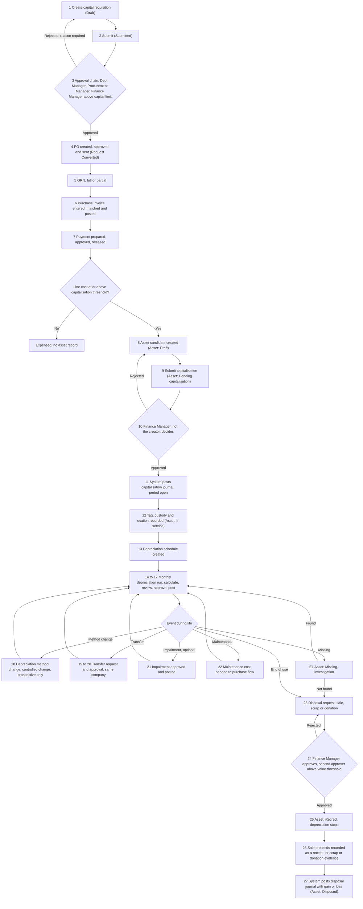
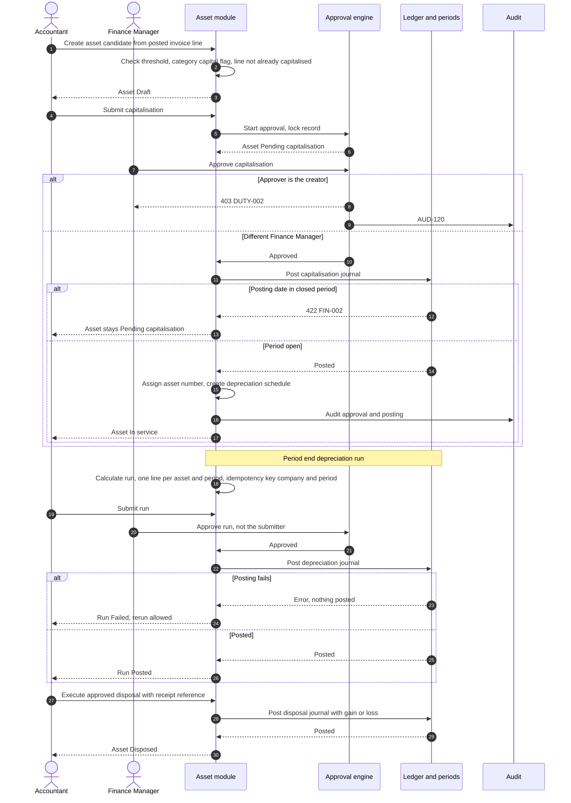
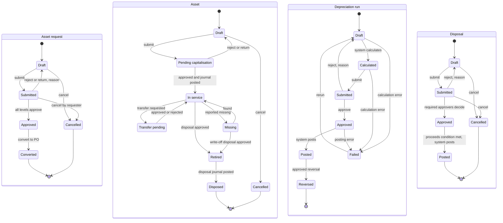

# WF-09 Asset Acquisition-to-Disposal

Document status: Draft v0.2 (Phase 2 remediation). Proposed. Outline promoted to implementation-ready documentation, not approved.
This file replaces the outline row for WF-09 in [Cross-Module Workflows](../Cross-Module-Workflows.md).
Release: R2 (M-042 Fixed Asset Accounting) and R3 (M-110 Asset Management).
Every value, method, threshold and useful life written here is proposed, PENDING APPROVAL.
Nothing in this file is a business decision.
Test cases: [Lifecycle WF-09 Test Cases](../../08-QA-and-Testing/test-cases/Lifecycle-WF-09-Test-Cases.md).

## 1. Purpose and scope

Purpose: define one end-to-end flow for a capital asset, from the request to buy it to its disposal with a gain or loss posted to the ledger.
BR-054 requires that assets are acquired, depreciated, transferred and disposed with ledger postings.
The flow reuses the MVP purchase flow (WF-01), the approval engine (M-013), the ledger (M-032, M-035) and period control (M-043) without change.
Asset modules add the register, the depreciation schedule and the disposal document.

In scope:

| Area | Included |
|---|---|
| Request and approval | Capital purchase requisition and its approval chain |
| Acquisition | PO, goods receipt, vendor invoice and payment through the existing purchase flow |
| Capitalisation and registration | Asset candidate, maker-checker approval, ledger posting, asset number, custody and location |
| Depreciation | Schedule, monthly run, review, approval, posting, method change as a controlled change |
| Life events | Transfer inside one company, maintenance cost hand-off, asset found missing, impairment or revaluation (optional) |
| Retirement and disposal | Sale, scrap and donation, with gain or loss posting |

Out of scope:

| Area | Reason |
|---|---|
| Transfer between companies | Every record belongs to one company (BRL-001). Group functions are outside the MVP (FR-019). See section 12 |
| Lease accounting, asset insurance, tax depreciation books | Not in the module inventory for M-042 or M-110. Not specified |
| Maintenance work orders and scheduling | M-110 keeps only the maintenance history and the cost hand-off. Work-order management is not specified |
| Tax treatment of disposals | Depends on OQ-007 |
| Approval of the requirements themselves | There are no R2 or R3 asset FRs yet (section 15) |

Gaps this document does not close:

1. The capital flag on item categories is not specified in the FRS (see [Asset Test Cases](../../08-QA-and-Testing/test-cases/Asset-Test-Cases.md), section on reserved capabilities).
2. No asset permission codes, API paths, audit event ids or data entities exist yet. This file names roles, not permission codes, and designs no API.
3. Depreciation methods, useful lives, thresholds and the accounting framework are open (OQ-018, OQ-013).

## 2. Actors and responsibilities

Only the 18 default roles (FR-014) and the system act in this workflow.
Tiers follow [RBAC Matrix](../../06-RBAC-and-Security/RBAC-Matrix.md) section 8A.1.
Scope follows RBAC Matrix section 3.
Responsibilities are proposed. Asset permissions do not exist yet.

| Role | Tier | Responsibility in WF-09 |
|---|---|---|
| Super Admin | T0 | None in the business flow. Platform administration only. Cannot approve asset or finance documents |
| Organization Admin | T1 | Approves a controlled change (depreciation method, PENDING APPROVAL). Approves a period reopen when the reopen is needed (OQ-034, PENDING APPROVAL). Never the requester |
| Branch Admin | T2 | Records asset location and custody for own branch. Reports an asset missing in own branch. Approves a transfer that moves an asset into own branch |
| Department Manager | T2 | Requests the capital purchase for own department. Approves capital requisitions of own department. Requests transfer, retirement and disposal of own department assets. Logs maintenance events |
| HR Manager | T2 | No duty in this workflow |
| HR Executive | T3 | No duty in this workflow |
| Finance Manager | T2 | Approves capitalisation, depreciation runs, impairment, disposal and sale receipts. Approves capital requisitions above the capital limit. Requests a depreciation method change and a period reopen. Approves above-threshold disposal as a second, different Finance Manager (PENDING APPROVAL) |
| Accountant | T3 | Enters the vendor invoice. Creates the asset candidate and submits it. Prepares and submits the depreciation run. Records the sale receipt and executes the approved disposal. Proposes impairment |
| Procurement Manager | T2 | Approves capital requisitions and high-value POs |
| Procurement Officer | T3 | Converts the approved requisition to a PO. Edits own drafts only |
| Inventory Manager | T2 | Approves the stock issue when a stock item is converted to an asset (PENDING APPROVAL) |
| Warehouse Staff | T3 | Posts the GRN. Posts the goods issue when a stock item is converted. Cannot also create the PO (SOD-04) |
| Sales Manager | T2 | No duty in this workflow. A sale to an existing customer uses the customer master of M-079 |
| Sales Executive | T3 | No duty in this workflow |
| Project Manager | T3 | May initiate a capital requisition for project assets |
| Employee | T4 | May initiate a capital requisition and report an asset missing |
| Auditor | Oversight | Read-only review of the register, runs, journals and disposals. Never in the chain |
| Read-only User | T4 | Reads the asset register within scope. No ledger access |
| System | n/a | Applies the checks, locks documents, routes approvals, posts journals at final approval, runs the depreciation schedule, writes audit records and sends notifications |

## 3. Preconditions

1. The company has an open fiscal year and the posting period is open (BRL-018, FR-058).
2. The item or service category carries a capital flag. This flag is not yet specified. PENDING APPROVAL (section 16).
3. Posting rules map asset cost, accumulated depreciation, depreciation expense, asset clearing, disposal proceeds and gain or loss to accounts. A missing mapping blocks posting (FR-085, FIN-005).
4. Approval chains for the capital requisition, capitalisation, depreciation run and disposal are defined. Limits are TBD (OQ-013).
5. The capitalisation threshold, useful lives, residual values and depreciation methods per asset category are configured. All are proposed, PENDING APPROVAL.
6. The vendor is active (BRL-032). The buyer on a sale is an active customer in M-079.
7. Users hold the roles in section 2 inside the company and branch scope of the asset. SoD is checked on permissions across all assignments (BRL-074).
8. The depreciation schedule job is enabled for the company.

## 4. Step-by-step workflow

Objects and statuses: Asset request (AR), Asset (AS), Depreciation run (DR), Disposal (DS).
The statuses are those in section 8.
Step ids match the diagrams in section 14.
Step E1 is conditional and is not part of the main path.
Step 21 is optional.

| Step | Actor | Action | System behaviour | Resulting status |
|---|---|---|---|---|
| 1 | Employee, Project Manager or Department Manager | Creates a capital purchase requisition with justification, estimated cost, category and needed-by date | Validates quantity above zero (FR-089). Flags the request as capital from the category capital flag (flag not yet specified) | AR: Draft |
| 2 | Same user | Submits the request | Starts the approval instance and locks the document (FR-040). Notifies the first approver | AR: Submitted |
| 3 | Department Manager, then Procurement Manager, then Finance Manager above the capital limit | Each approver decides | Routes to the first approver whose authority covers the value (FR-043). Skips the creator (FR-042, BRL-008). Reject needs a reason and returns to Draft (FR-041, FR-046). A step with no eligible approver pauses and alerts. It never auto-approves | AR: Approved, or AR: Draft after a rejection |
| 4 | Procurement Officer | Converts the approved request to a PO for an active vendor. PO is approved by value and sent (WF-01 steps 3 and 4) | Refuses a vendor that is blocked or inactive (BRL-032). A value change after approval restarts approval (FR-092) | AR: Converted |
| 5 | Warehouse Staff | Posts the GRN for the capital item, in full or in part (WF-01 step 5) | Records the received quantity within tolerance (BRL-035). Capital lines do not increase stock quantity. This treatment is proposed, PENDING APPROVAL | None on the asset. Receipt recorded |
| 6 | Accountant | Enters the vendor invoice linked to PO and GRN | Duplicate check, three-way match, variance held for the Finance Manager (AWD-02, FR-097 to FR-099). A posted invoice posts capital lines to the asset clearing account named in the posting rule (FR-079, FR-085) | Invoice: Posted |
| 7 | Accountant, Finance Manager approver, a different Finance Manager releaser | Pays the invoice (WF-01 steps 9 to 11, AWD-01) | Three different users, step-up on release (BRL-068, FR-135, FR-145) | Payment: Released, then Settled |
| 8 | Accountant | Creates an asset candidate from the posted invoice line or lines. Enters category, cost, in-service date, useful life, residual value and depreciation method | Proposes cost as net invoice amount plus non-recoverable tax plus directly attributable cost. Warns when cost is below the capitalisation threshold (WF09-R1) and the line stays an expense. Blocks a line already linked to an asset | AS: Draft |
| 9 | Accountant | Submits the candidate for capitalisation | Locks the record. Starts the approval instance (FR-040). Notifies the Finance Manager | AS: Pending capitalisation |
| 10 | Finance Manager (not the creator) | Approves or rejects. Reject needs a reason | Refuses the creator with DUTY-002 (BRL-008, FR-042). A rejection returns to Draft | AS: Draft after a rejection |
| 11 | System | Posts the capitalisation journal at final approval: debit asset cost, credit asset clearing | The journal balances (BRL-016) and is immutable (BRL-017). Posting in a closed period is refused with FIN-002 and the asset stays Pending capitalisation (BRL-018). The system, not a person, posts (BRL-069 pattern) | AS: Pending capitalisation until posted |
| 12 | Department Manager or Branch Admin | Records asset tag, serial number, location, custodian, cost centre and attachments such as the invoice and warranty | Assigns a unique asset number per company (FR-025 pattern). Attachments follow the parent record rules (BRL-060) | AS: In service |
| 13 | System | Creates the depreciation schedule from method, life, residual value and in-service date | One schedule line per asset and period. Rounding follows BRL-020. Total of lines equals cost less residual | AS: In service (schedule created) |
| 14 | System | At period end creates the depreciation run for the company and period for every In service and Missing asset | Excludes Retired, Disposed, Cancelled and not yet in service assets. Run key is company plus period (idempotent). Calculates a preview | DR: Draft, then Calculated |
| 15 | Accountant | Reviews the preview and submits the run | Locks the run. Notifies the Finance Manager | DR: Submitted |
| 16 | Finance Manager (not the submitter) | Approves or rejects the run. Reject needs a reason | Refuses the submitter (DUTY-002). Rejection returns to Draft | DR: Approved, or DR: Draft after a rejection |
| 17 | System | Posts the depreciation journal: debit depreciation expense, credit accumulated depreciation | Refuses a closed period (FIN-002) and posts nothing. On an error the run is Failed and nothing is posted. Posted lines cannot be edited (BRL-017) | DR: Posted, or DR: Failed |
| 18 | Finance Manager requests, Organization Admin approves (PENDING APPROVAL) | Changes the depreciation method, useful life or residual value of a category or an asset | Treated as a controlled change (BRL-070 pattern, FR-138). The old value stays active until approval. The change is prospective only. Posted depreciation is never recalculated. The approver is never the requester (SOD-26) | AS: In service (new schedule from the effective period) |
| 19 | Department Manager of the current department | Requests a transfer of location, department, branch or custodian inside the same company | Refuses another company (BRL-001). Locks the asset against disposal while a transfer is open | AS: Transfer pending |
| 20 | Department Manager of the receiving department, or Branch Admin of the receiving branch | Approves or rejects. Reject needs a reason | Refuses the requester (BRL-008). On approval updates location, custodian and cost centre from the effective date and keeps the history. Depreciation expense follows the new cost centre from the next period | AS: In service |
| 21 (optional) | Accountant proposes, Finance Manager approves | Records an impairment, or a revaluation if the framework allows it (OQ-018) | Approver differs from proposer. The system posts an impairment loss journal and recalculates the schedule prospectively. Revaluation is not supported until OQ-018 is answered | AS: In service (reduced carrying amount) |
| 22 | Department Manager | Logs a maintenance event on the asset and links the vendor invoice | Maintenance invoices run through WF-01 and post to an expense account. The asset keeps a cost-to-date total for reporting. A cost that extends life or capacity above the threshold is a new capitalisation candidate under step 8 (PENDING APPROVAL) | AS: In service |
| E1 | Branch Admin, Department Manager or Employee reports. Finance Manager confirms | Reports an asset missing. Searches. Marks it found or approves its write-off | The asset is excluded from transfer and disposal until resolved. Write-off is a disposal with method write-off, see step 23 and section 12 | AS: Missing, then In service or Retired |
| 23 | Department Manager | Creates a disposal request for the asset: method (sale, scrap, donation, write-off), reason, disposal date, proposed value | Shows carrying amount and estimated gain or loss before approval. Refuses an asset that is Pending capitalisation or Transfer pending | DS: Draft |
| 24 | Finance Manager (not the creator). A second, different Finance Manager above the proposed-value threshold | Approves or rejects. Reject needs a reason | Value equal to the threshold needs one approver. Above it needs two distinct approvers (AWD-03 pattern, RBAC Matrix 8A.5). Creator, submitter and last editor are skipped (BRL-008). Rejection returns to Draft | DS: Submitted, then Approved |
| 25 | System | On final approval withdraws the asset from use | Stops depreciation from the disposal date (WF09-R6). The asset stays on the register at carrying amount until posting | AS: Retired. DS: Approved |
| 26 | Accountant records, Finance Manager verifies (different user) | Sale: records the buyer and the proceeds as a receipt to the bank account (BR-020, FR-073). Scrap: attaches the scrap certificate and any scrap proceeds. Donation: attaches the recipient and acceptance | A sale cannot post without a verified receipt linked to the disposal (WF09-R10). The receipt allocation never exceeds the amount due (FIN-006). Donation has no proceeds | DS: Approved (waiting for the condition) |
| 27 | System | Posts the disposal journal: debit accumulated depreciation, debit bank or receivable for proceeds, debit loss or credit gain, credit asset cost | Gain or loss equals proceeds less carrying amount (WF09-R9). The journal balances and is immutable. Refuses a disposal date in a closed period (FIN-002) | DS: Posted. AS: Disposed |
| 28 | System | Closes the lifecycle | Keeps the asset record read-only with its schedule, journals and audit trail for the retention period (BRL-063, OQ-022). Notifies Finance | AS: Disposed (terminal) |

## 5. Approval hierarchy

Approval limits are company data and remain TBD (OQ-013).
The structure is proposed here and follows RBAC Matrix sections 6 and 8A.
Every approval is performed by a different user from the maker.

| Document | Maker | Checker (level 1) | Level 2 | Hard rule |
|---|---|---|---|---|
| Capital requisition | Employee, Project Manager or Department Manager | Department Manager | Procurement Manager, then Finance Manager above the capital limit (PENDING APPROVAL) | Approver is never the creator (BRL-008). Value limits are configurable (BRL-009) |
| PO and invoice | Procurement Officer, Accountant | As WF-01 and AWD-02 | | Capital purchases use the purchase flow unchanged |
| Payment | Accountant | Finance Manager | A second Finance Manager above limit A | Three different users (BRL-068, AWD-01) |
| Capitalisation | Accountant | Finance Manager | None proposed | Maker-checker. The Finance Manager is not the creator of the candidate. Posting by the system only |
| Depreciation run | System calculates, Accountant submits | Finance Manager | None proposed | The approver is not the submitter. Posting by the system only |
| Depreciation method change | Finance Manager | Organization Admin (PENDING APPROVAL) | | Controlled change (BRL-070 pattern, FR-138, SEC-061). Prospective only. Not yet in the controlled key list of RBAC Matrix 8A.10 |
| Transfer | Department Manager | Receiving Department Manager or Branch Admin | | Requester never approves. Same company only |
| Impairment (optional) | Accountant | Finance Manager | | Proposer never approves |
| Disposal | Department Manager | Finance Manager | A second, different Finance Manager above the disposal threshold (PENDING APPROVAL) | Value equal to the threshold needs one approver. Creator, submitter and last editor never approve |
| Sale proceeds | Accountant records the receipt | Finance Manager verifies | | Preparer and verifier differ. The receipt must exist before posting |
| Period reopen for a late posting | Finance Manager | Organization Admin (PENDING APPROVAL, OQ-032, OQ-034) | | Never the requester. Step-up. Window closes automatically (BRL-071, FR-140) |

Rules that apply to every row:

1. A user never approves a document they created, submitted or last edited (BRL-008, FR-042, SOD-32 extended).
2. Where only one eligible approver exists the document waits. It never falls back to self-approval (RBAC Matrix 8A.4, OQ-034).
3. A change of value, category, vendor or cost after approval restarts the chain (FR-092 pattern, RBAC Matrix 8A.5 rule 3).
4. Delegation follows BRL-073. A delegate cannot approve a document the delegator created.
5. No service account holds approve, release, reverse or reopen permission (FR-149).

## 6. Business rules

Existing rules reused:

| Rule | Statement used here |
|---|---|
| BR-054 | Assets are acquired, depreciated, transferred and disposed with ledger postings. Depreciation posts per schedule. Disposal posts gain or loss |
| BR-014, BRL-016 | Every posting balances in transaction and base currency |
| BRL-017 | Posted entries are immutable. Corrections use a reversing entry |
| BR-016, BRL-018 | Posting is allowed only in open periods of an open fiscal year |
| BRL-021 | A period closes only when in-scope documents are posted, cancelled or carried forward |
| BRL-022, BRL-071 | Reopening a closed period needs a reason and a different approving authority. It closes again automatically |
| BR-021, BRL-008, BRL-069 | Different approver from the creator. The system posts at final approval |
| BRL-009 | An approver holds authority at or above the document value |
| BRL-020 | Fixed decimal precision and a configured rounding rule apply to every depreciation line |
| BRL-023 | A foreign-currency purchase uses the rate on the document date, stored on the document |
| BRL-031 to BRL-037 | Purchase flow rules for the capital PO, GRN and invoice |
| BRL-057, BRL-068 | Segregation on payables and payments |
| BRL-070 | Controlled changes need a request and an approval by different users |
| BRL-001, BRL-002 | Each record belongs to one company. A user acts only in assigned companies |
| BRL-065 | A second save of a changed record is refused |
| BRL-062 | A failed external call does not roll back a committed event. It is queued |

Proposed new rules, not confirmed, with no BRL id:

| Label | Proposed rule | Status |
|---|---|---|
| Proposed new rule WF09-R1 | Capitalisation threshold: a purchase line is capitalised only when its cost is at or above a company threshold. Below the threshold it is expensed. The threshold value is configurable and has no default | Proposed, PENDING APPROVAL |
| Proposed new rule WF09-R2 | Each asset category has a default useful life, residual value and depreciation method. An asset may override them with approval. Values have no default | Proposed, PENDING APPROVAL |
| Proposed new rule WF09-R3 | Depreciation methods are TBD. Candidates only: straight line, declining balance, units of production. The first release supports the methods the business approves (OQ-018) | Proposed, PENDING APPROVAL |
| Proposed new rule WF09-R4 | No depreciation is posted into a closed period. A run for a closed period is refused. A missed month is posted only in an open or a reopened period (BRL-018, BRL-071) | Proposed, PENDING APPROVAL |
| Proposed new rule WF09-R5 | Depreciation start convention (full month, from in-service date, or next month) is configurable. No default | Proposed, PENDING APPROVAL |
| Proposed new rule WF09-R6 | Depreciation stops on the disposal date. Treatment of the disposal month (partial month or none) follows the start convention | Proposed, PENDING APPROVAL |
| Proposed new rule WF09-R7 | Capitalisation needs a maker and a different checker. The system posts only at final approval | Proposed, PENDING APPROVAL |
| Proposed new rule WF09-R8 | Disposal needs Finance Manager approval for every method. Above a proposed-value threshold a second distinct Finance Manager also approves. A value equal to the threshold needs one approver. The threshold has no default | Proposed, PENDING APPROVAL |
| Proposed new rule WF09-R9 | Gain or loss on disposal equals proceeds less carrying amount, where carrying amount is cost less accumulated depreciation less accumulated impairment. Scrap and donation have proceeds of zero unless scrap proceeds are received | Proposed, PENDING APPROVAL |
| Proposed new rule WF09-R10 | A sale disposal posts only after the sale proceeds exist as a receipt verified by a user other than the preparer | Proposed, PENDING APPROVAL |
| Proposed new rule WF09-R11 | Depreciation is idempotent. There is at most one posted line per asset and period. A rerun of a Failed run posts only lines not yet posted and never duplicates | Proposed, PENDING APPROVAL |
| Proposed new rule WF09-R12 | A change of depreciation method, life or residual value is a controlled change and applies from the effective period onward. Posted periods are not recalculated | Proposed, PENDING APPROVAL |
| Proposed new rule WF09-R13 | Each invoice line is capitalised at most once. A posted invoice that has a linked asset cannot be cancelled until the asset is cancelled or adjusted | Proposed, PENDING APPROVAL |
| Proposed new rule WF09-R14 | The item or service category carries a capital flag. A capital line cannot post to the expense account directly | Proposed, PENDING APPROVAL |
| Proposed new rule WF09-R15 | An asset cannot be transferred between companies. Use disposal in the source company and acquisition in the target company | Proposed, PENDING APPROVAL |

## 7. Input and output data

Entity names below are descriptive. No asset entity exists yet in the [Data Dictionary](../../04-System-Architecture/Data-Dictionary.md).
Field lists are proposed and will be fixed with the R2 and R3 requirements.

| Stage | Input data | Output data |
|---|---|---|
| Request | Requester, department, justification, category, estimated cost, needed-by date, attachments | Capital requisition, approval record, notifications |
| Acquisition | Vendor, quantity, price, tax code, warehouse or site, invoice number and amounts, bank account | PO with revisions, GRN, invoice, match result, payable, payment, ledger entries |
| Capitalisation | Invoice line reference, category, cost components, in-service date, useful life, residual value, method | Asset record, approval record, capitalisation journal, depreciation schedule, audit |
| Registration | Tag, serial number, location, custodian, cost centre, warranty, attachments | Register entry with asset number and custody history |
| Depreciation | Company, period, method settings, asset schedule | Run, run lines, depreciation journal, accumulated depreciation, audit, reports |
| Method change | Category or asset, new method, life or residual, effective period, reason | Change request, approval, new schedule from effective period |
| Transfer | Asset, new location, department, branch or custodian, effective date, reason | Transfer record, history, new cost centre, audit |
| Impairment (optional) | Evidence, recoverable amount, reason | Impairment journal, revised schedule |
| Maintenance | Asset, date, description, vendor invoice link, cost | Maintenance history, cost-to-date total, expense journal through WF-01 |
| Disposal | Asset, method, reason, disposal date, proposed value, buyer, receipt, scrap certificate or donation recipient | Disposal document, approvals, receipt, disposal journal with gain or loss, final register entry |

## 8. Status transitions

Statuses and transitions are proposed. They extend the generic lists in the Data Dictionary section 2 and follow the pattern of [State Transition Diagrams](../State-Transition-Diagrams.md).
Rejected returns to Draft, as for requisitions and journals.
Terminal states: Converted, Cancelled (asset request). Disposed, Cancelled (asset). Reversed (depreciation run). Posted, Cancelled (disposal).
The outline status Transferred in [Cross-Module Workflows](../Cross-Module-Workflows.md) is replaced by Transfer pending and a return to In service, with the transfer kept as history.

Asset request (a capital purchase requisition, same states as a PR):

| From | To | Condition | Actor |
|---|---|---|---|
| Draft | Submitted | Required fields complete, quantity above zero | Requester |
| Submitted | Approved | All required approvers decide, none is the creator | Department Manager, Procurement Manager, Finance Manager above limit |
| Submitted | Draft | Rejected or returned, reason given | Any approver |
| Approved | Converted | Procurement Officer converts to PO for an active vendor | Procurement Officer |
| Draft | Cancelled | Cancel | Requester |
| Submitted | Cancelled | Cancel by the requester | Requester |

Asset:

| From | To | Condition | Actor |
|---|---|---|---|
| Draft | Pending capitalisation | Candidate complete, cost at or above threshold, invoice line not already capitalised | Accountant |
| Pending capitalisation | Draft | Rejected or returned, reason given | Finance Manager |
| Pending capitalisation | In service | Approved by a different Finance Manager and journal posted in an open period | Finance Manager approves, system posts |
| Draft | Cancelled | Cancel before submission | Accountant |
| In service | Transfer pending | Transfer requested | Department Manager |
| Transfer pending | In service | Approved or rejected | Receiving Department Manager or Branch Admin |
| In service | Missing | Reported missing | Branch Admin, Department Manager or Employee, confirmed by Finance Manager |
| Missing | In service | Asset found and verified | Branch Admin or Department Manager |
| In service | Retired | Disposal approved | Finance Manager, plus second Finance Manager above threshold |
| Missing | Retired | Write-off disposal approved | Finance Manager, plus second Finance Manager above threshold |
| Retired | Disposed | Disposal journal posted in an open period, sale receipt verified for a sale | System |

Depreciation run:

| From | To | Condition | Actor |
|---|---|---|---|
| Draft | Calculated | Period open, schedule lines found | System |
| Calculated | Submitted | Preview reviewed | Accountant |
| Submitted | Approved | Approver is not the submitter | Finance Manager |
| Submitted | Draft | Rejected, reason given | Finance Manager |
| Approved | Posted | Period still open, mapping present, journal balances | System |
| Draft | Failed | Calculation error | System |
| Calculated | Failed | Calculation error | System |
| Approved | Failed | Posting error, nothing posted | System |
| Failed | Draft | Rerun, idempotency rule WF09-R11 | Accountant |
| Posted | Reversed | Reversal requested and approved by a different Finance Manager, in an open period | Finance Manager |

Disposal:

| From | To | Condition | Actor |
|---|---|---|---|
| Draft | Submitted | Method, reason, date and proposed value entered. Asset is In service or Missing | Department Manager |
| Submitted | Approved | Finance Manager approves. A second distinct Finance Manager approves above the threshold | Finance Manager |
| Submitted | Draft | Rejected, reason given | Finance Manager |
| Approved | Posted | For a sale, verified receipt linked. Disposal date in an open period. System posts | System |
| Draft | Cancelled | Cancel | Department Manager |
| Submitted | Cancelled | Cancel by the creator | Department Manager |

## 9. Notifications

Notifications use M-012 (in-app and email, FR-035, FR-036). Approval notices cannot be switched off (FR-038). Failed sends are retried (FR-037, BRL-061).

| Event | Recipient | Channel |
|---|---|---|
| Capital requisition submitted | Next approver | In-app, email |
| Requisition decided | Requester | In-app, email |
| Asset candidate submitted | Finance Manager | In-app, email |
| Capitalisation approved, rejected or refused for a closed period | Accountant | In-app, email |
| Asset number assigned | Department Manager, Accountant | In-app |
| Depreciation run submitted | Finance Manager | In-app, email |
| Depreciation run posted or Failed | Accountant, Finance Manager | In-app, email (Failed is mandatory) |
| Method change requested and decided | Requester, approver | In-app, email |
| Transfer requested and decided | Receiving manager, requester | In-app |
| Asset reported missing | Finance Manager, Department Manager | In-app, email |
| Disposal submitted, decided | Finance Manager, creator | In-app, email |
| Sale receipt verified | Accountant, Finance Manager | In-app |
| Disposal posted | Finance Manager, Accountant, Department Manager | In-app |
| Period reopen requested and decided | Approver, requester, Auditor | In-app, email |

## 10. Related modules

| Module | Name | Role in WF-09 |
|---|---|---|
| M-042 | Fixed Asset Accounting | Capitalisation, depreciation, disposal postings (R2) |
| M-110 | Asset Management | Operational register, custody, transfer, maintenance history (R3) |
| M-049 | Purchase Requisition (PR) | Capital requisition |
| M-050 | Purchase Request Approval | Requisition approval |
| M-053 | Purchase Order (PO) | Commitment |
| M-054 | Vendor Management | Active vendor |
| M-057 | Goods Receipt Note (GRN) | Receipt, full or partial |
| M-058 | Purchase Invoice | Invoice, match and posting |
| M-059 | Vendor Payments | Payment entry point |
| M-047 | Payment & Refund Management | Vendor payment and sale receipt |
| M-033 | Accounts Payable | Payable posting |
| M-034 | Accounts Receivable | Buyer and receipt on a sale |
| M-079 | Customer Management | Buyer master |
| M-031 | Chart of Accounts | Asset, accumulated depreciation, expense, gain and loss accounts |
| M-032 | General Ledger | System of record |
| M-035 | Journal Entries | Capitalisation, depreciation, impairment and disposal journals |
| M-043 | Financial Period Management | Open and closed periods, reopen |
| M-044 | Fiscal Year Management | Fiscal calendar |
| M-045 | Financial Closing | Close checklist |
| M-040 | Tax & VAT Management | Non-recoverable tax in cost, tax on sale (OQ-007) |
| M-041 | Multi-Currency Management | Foreign-currency purchase |
| M-061, M-062 | Product & Service Catalog, Product Categories | Items and the proposed capital flag |
| M-064, M-072, M-073 | Stock Management, Inventory Valuation, Goods Issue & Goods Receipt | Stock item converted to an asset |
| M-013 | Workflow & Approval Engine | Chains, locks, decisions |
| M-012 | Notification & Communication Management | Notices |
| M-010 | Audit Logs & Activity Tracking | Audit trail |
| M-011 | Document Management | Invoice, warranty, scrap certificate, donation acceptance |
| M-004, M-005, M-006 | Role & Permission Management (RBAC), Organization & Company Management, Branch & Department Management | Roles, company scope, branch and department |
| M-046 | Financial Statements | Balance sheet and income statement effect |
| M-038 | Budget Management | Capital budget check (R2, not specified) |

## 11. Integration dependencies

| Dependency | What WF-09 needs | Behaviour |
|---|---|---|
| Purchase invoice (M-058, AWD-02) | A posted invoice line is the source of an asset candidate | A cancelled or unposted invoice cannot be capitalised. An invoice with a linked asset is protected by WF09-R13 |
| Ledger (M-032, M-035) | Balanced, immutable journals with mapped accounts | Posting refused when a mapping is missing (FR-085) or the journal is unbalanced (FIN-001). Corrections are reversing entries (FR-065) |
| Periods (M-043, M-045) | Open period for every posting | Closed period returns FIN-002. A close is blocked while a depreciation run is Submitted or Approved and not posted (BRL-021, FR-060). Reopen runs through API-173 to API-175 |
| Payments (M-047, AWD-01) | Payment of the capital invoice and the sale receipt | Payment uses three users. A receipt is allocated within the amount due (FIN-006) |
| Inventory (M-064, M-072, M-073) | A stock item converted to an asset leaves stock at its valuation cost | Goods issue to the asset clearing account approved by the Inventory Manager. Valuation method per OQ-009. PENDING APPROVAL |
| Approval engine (M-013) | Chains, locks, no self-approval | Pauses with no eligible approver. No auto-approval |
| Notification (M-012) | Alerts for each hand-off | Failed notices retried, no rollback of the business event (BRL-062) |
| Audit (M-010) | Every approval, posting, refusal and status change | No business change without its audit record (FR-032). Period reopen events exist as AUD-114 to AUD-117. Record-level SoD refusal exists as AUD-120. Asset event ids do not exist yet |
| Migration | Existing asset register and accumulated depreciation at go-live | Not specified. OQ-012 |

## 12. Exception scenarios

| Scenario | Proposed handling | Status |
|---|---|---|
| Invoice reversal after capitalisation | A posted invoice with a linked asset cannot be cancelled (WF09-R13, STATE-001). If no depreciation is posted, the asset is cancelled by a reversing capitalisation journal approved by another user, then the invoice reversal proceeds (AWD-02, FR-077 after payment reversal). If depreciation is posted, the cost correction is made through a vendor credit note and an approved cost adjustment | PENDING APPROVAL |
| Partial capitalisation | A mixed invoice is split by line: capital lines are capitalised, others are expensed. A partial GRN capitalises only received units. Each unit is a separate asset when the item has a tag. A later GRN creates a new candidate. The capitalised amount plus the expensed amount equals the invoice line total | PENDING APPROVAL |
| Asset sold below book value | The system posts a loss equal to carrying amount less proceeds (WF09-R9). The reason is mandatory. The disposal needs the same approvals as any disposal. A loss above the value threshold needs the second Finance Manager | PENDING APPROVAL |
| Disposal in a closed period | The disposal journal is refused with FIN-002 (BRL-018). The disposal stays Approved. Options: set the posting date to the first open period and keep the real disposal date on the document, or request a period reopen under the controlled process (FR-140, BRL-071). The option is a business decision | PENDING APPROVAL |
| Transfer between companies | Not supported (WF09-R15, BRL-001, FR-019). The asset is disposed in the source company and acquired in the target company, each with its own approvals. Intercompany accounts are not specified | PENDING APPROVAL |
| Asset found missing | The asset becomes Missing. Transfer and disposal are blocked. Depreciation continues until the write-off is approved (PENDING APPROVAL). A write-off is a disposal with method write-off, proceeds zero, loss equal to carrying amount. If the asset is found, it returns to In service with the audit record kept | PENDING APPROVAL |
| Candidate cost below threshold | The system warns and the line stays an expense. A Finance Manager may approve a capitalisation below the threshold only through a recorded exception (PENDING APPROVAL) | PENDING APPROVAL |
| Stock item converted to asset | Goods issue from stock at valuation cost to asset clearing, then the capitalisation steps 8 to 13 | PENDING APPROVAL |
| Foreign-currency purchase | Cost in base currency uses the rate stored on the invoice (BRL-023). Later depreciation is in base currency | Proposed |

## 13. Failure and recovery scenarios

| Failure | Detection | Recovery |
|---|---|---|
| Depreciation run fails during calculation | Run status Failed, notification to Accountant and Finance Manager, audit record | Nothing is posted. The Accountant reruns. Rerun is idempotent: one posted line per asset and period (WF09-R11). Lines posted before the failure are not posted again |
| Depreciation run fails during posting | Journal not committed. Run status Failed (FR-032: no business change without its audit record) | Same as above. A partial journal never exists because the journal posts in one transaction |
| Depreciation rerun after the run is Posted | Refused with STATE-001 | A wrong posted run is corrected with an approved reversing journal in an open period (BRL-017, FR-065), then a new run |
| Duplicate run for the same company and period | Refused by the run key | The first run stands. No second posting |
| Capitalisation or disposal posting fails | Asset remains Pending capitalisation, or disposal remains Approved. Error and audit record | Retry by the system. The approval is not asked again unless the cost, value or date changes (RBAC Matrix 8A.5 rule 3). An external failure is queued (BRL-062) |
| Posting date falls in a closed period | FIN-002 | Post in the first open period if the business allows it, or request a reopen (API-173), approved by a different authority with step-up (API-174, FR-140). The period closes again automatically and every posting inside the window is audited (AUD-117) |
| Missed months of depreciation after a reopen | Run for a closed period refused (WF09-R4) | Catch-up runs are posted inside the reopened window, oldest period first, each approved by a Finance Manager who is not the submitter |
| Concurrent edit of the same asset | Second save refused (BRL-065) | The user reloads and repeats |
| Notification outage | Retry then flag (FR-037) | Approvals remain visible in the inbox (FR-047). No business event is rolled back |
| Approver unavailable | Step pauses and alerts. Escalation after the configured time (FR-045) | Delegation within BRL-073 limits. Never self-approval |

## 14. Diagrams

The four diagrams use the same step ids and statuses as sections 4 and 8.
Syntax was checked by rendering each diagram with the Mermaid command-line renderer.

### 14.1 Process flow

### 14.2 Swimlane

```mermaid
flowchart LR
    subgraph REQ["Requester (Employee, Project Manager, Department Manager)"]
        R1["Create and submit capital requisition"]
        R2["Request transfer, report missing, request disposal"]
    end
    subgraph APR["Approvers (Department Manager, Procurement Manager, Finance Manager)"]
        A1["Approve capital requisition"]
    end
    subgraph PRC["Procurement and Warehouse"]
        P1["PO created, approved, sent"]
        P2["GRN full or partial"]
    end
    subgraph ACC["Accountant"]
        C1["Invoice, match, payment prepare"]
        C2["Create and submit asset candidate"]
        C3["Prepare and submit depreciation run"]
        C4["Record sale receipt, execute disposal"]
    end
    subgraph FIN["Finance Manager, different user at each check"]
        F1["Approve capitalisation"]
        F2["Approve depreciation run"]
        F3["Approve disposal, second FM above threshold"]
    end
    subgraph SYS["System"]
        S1["Post capitalisation journal, create schedule"]
        S2["Calculate and post depreciation"]
        S3["Post disposal journal, gain or loss"]
    end
    R1 --> A1
    A1 --> P1
    P1 --> P2
    P2 --> C1
    C1 --> C2
    C2 --> F1
    F1 -->|Rejected| C2
    F1 -->|Approved| S1
    S1 --> C3
    C3 --> F2
    F2 -->|Rejected| C3
    F2 -->|Approved| S2
    S2 --> R2
    R2 --> F3
    F3 -->|Rejected| R2
    F3 -->|Approved| C4
    C4 --> S3
```

### 14.3 Sequence

### 14.4 State transition

## 15. Requirement cross-reference

There are no R2 or R3 asset functional requirements yet.
The FRS contains no FR for M-042 or M-110, no user story for asset flows, no asset API path, no asset permission code and no asset audit event.
The IDs below are existing requirements the workflow depends on. Asset requirements will be added with the R2 and R3 requirements.

| Area | Existing IDs | Test cases (this file set) |
|---|---|---|
| Asset lifecycle | BR-054, GAP-14, M-042, M-110 | TC-0935 to TC-0984. End-to-end: TC-0978, TC-0979, TC-0980 |
| Ledger integrity | BR-014, BRL-016, BRL-017, FR-064, FR-065, FIN-001 | TC-0939, TC-0942, TC-0973, TC-0974 |
| Period and posting control | BR-016, BRL-018, BRL-021, BRL-022, BRL-071, FR-058, FR-059, FR-060, FR-140, SEC-063, FIN-002 | TC-0954, TC-0955, TC-0956, TC-0960, TC-0967, TC-0975 |
| Maker-checker and SoD | BR-021, BRL-008, BRL-009, BRL-069, BRL-070, BRL-074, FR-042, FR-043, FR-138, SEC-059, SEC-061, SOD-24, SOD-25, SOD-26 | TC-0937, TC-0947, TC-0948, TC-0949, TC-0950, TC-0951, TC-0952, TC-0953, TC-0960, TC-0961 |
| Purchase flow | BRL-031 to BRL-037, FR-089 to FR-099, FR-079, AWD-01, AWD-02 | TC-0935, TC-0936, TC-0962, TC-0963, TC-0970 |
| Payments and receipts | BR-020, BRL-068, FR-073, FR-135, FIN-006 | TC-0942, TC-0953, TC-0978 |
| Approval engine | FR-040, FR-041, FR-044, FR-045, FR-046, BRL-073 | TC-0935, TC-0950, TC-0951 |
| Tenancy and scope | BRL-001, BRL-002, BRL-003, FR-015, FR-019 | TC-0957, TC-0958, TC-0959, TC-0984 |
| Audit and notification | FR-030, FR-032, FR-035, FR-037, FR-038, BRL-062, AUD-114 to AUD-117, AUD-120 | TC-0973, TC-0976, TC-0983 |
| Money precision | BRL-020, BRL-023 | TC-0939, TC-0946, TC-0965 |

Test case ids in this table refer to the file [Lifecycle WF-09 Test Cases](../../08-QA-and-Testing/test-cases/Lifecycle-WF-09-Test-Cases.md).

## 16. Open decisions

All items need a stakeholder decision. None is approved.
Existing open questions are referred to by their OQ id only where they apply.
New questions have no OQ number yet and will be numbered when added to [Open Questions](../../02-Business-Analysis/Open-Questions.md).

| Item | Question | Status |
|---|---|---|
| OQ-013 | What approval thresholds and authority limits apply to the capital requisition and to disposal? | PENDING APPROVAL |
| OQ-018 | Which accounting framework applies? It decides depreciation methods, componentisation, impairment and whether revaluation is allowed | PENDING APPROVAL |
| OQ-021 | What is the fiscal calendar? It sets the depreciation periods | PENDING APPROVAL |
| OQ-032, OQ-034 | Who approves a period reopen (Organization Admin or a role above Finance Manager) and is there a role above Finance Manager for level 2 approvals | PENDING APPROVAL |
| OQ-007 | Which tax rules apply to non-recoverable tax in asset cost and to tax on a sale | PENDING APPROVAL |
| OQ-009 | Which valuation method sets the cost of a stock item converted to an asset | PENDING APPROVAL |
| OQ-012 | How is the existing asset register and accumulated depreciation migrated | PENDING APPROVAL |
| OQ-022 | What retention period applies to asset records after disposal | PENDING APPROVAL |
| New question A | Capital flag on item categories: is it required, who sets it, and does it block a direct expense posting (WF09-R14)? This gap is also listed in the Asset Test Cases | PENDING APPROVAL |
| New question B | What capitalisation threshold applies, per company or per category (WF09-R1)? | PENDING APPROVAL |
| New question C | Which depreciation methods, useful lives and residual values apply per category (WF09-R2, WF09-R3)? | PENDING APPROVAL |
| New question D | Which depreciation start and stop convention applies (WF09-R5, WF09-R6)? | PENDING APPROVAL |
| New question E | What proposed-value threshold requires a second approver on disposal, and does a donation or write-off always need one (WF09-R8)? | PENDING APPROVAL |
| New question F | Is a depreciation method change a controlled change approved by the Organization Admin, and should it be added to the controlled key list of RBAC Matrix 8A.10? | PENDING APPROVAL |
| New question G | Does depreciation continue while an asset is Missing, and who confirms a write-off? | PENDING APPROVAL |
| New question H | Is a transfer between companies needed before the group functions of FR-019 exist (WF09-R15)? | PENDING APPROVAL |
| New question I | How is an invoice reversal handled after depreciation has posted (section 12)? | PENDING APPROVAL |
| New question J | For a disposal in a closed period, is the posting moved to the first open period or is a reopen required? | PENDING APPROVAL |
| New question K | Is a sale billed through a sales invoice to the buyer or recorded as a direct receipt only? | PENDING APPROVAL |
| New question L | Does a cost that extends life or capacity capitalise as an addition to the existing asset or as a new asset? | PENDING APPROVAL |
| New question M | Do capital lines increase stock quantity on GRN, or are they received without a stock movement? | PENDING APPROVAL |
| New question N | Can an Approved disposal be cancelled after the asset is Retired, and how is the retirement reversed? Not specified, so no such transition exists in this file | PENDING APPROVAL |
