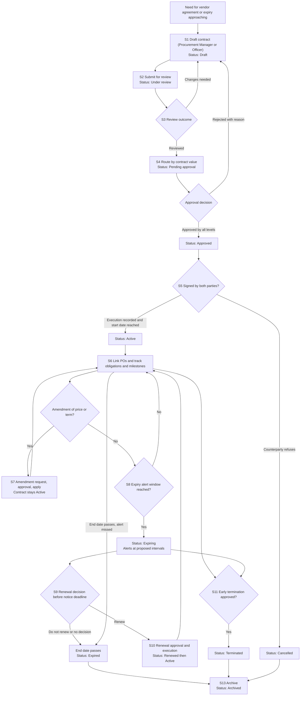
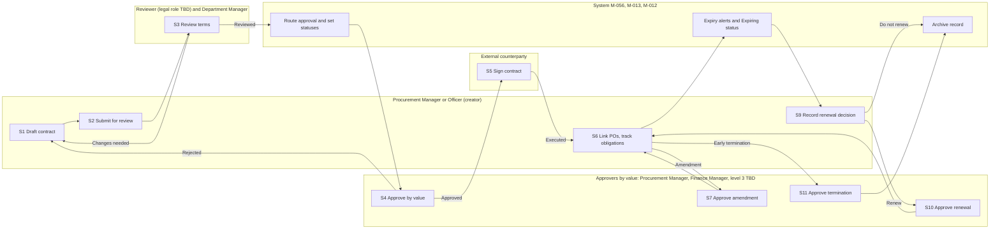
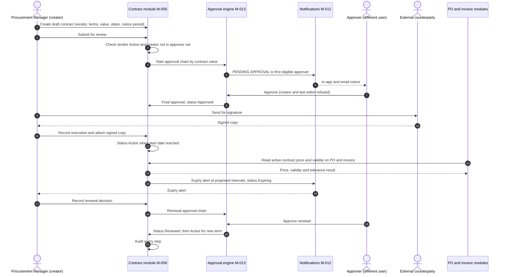
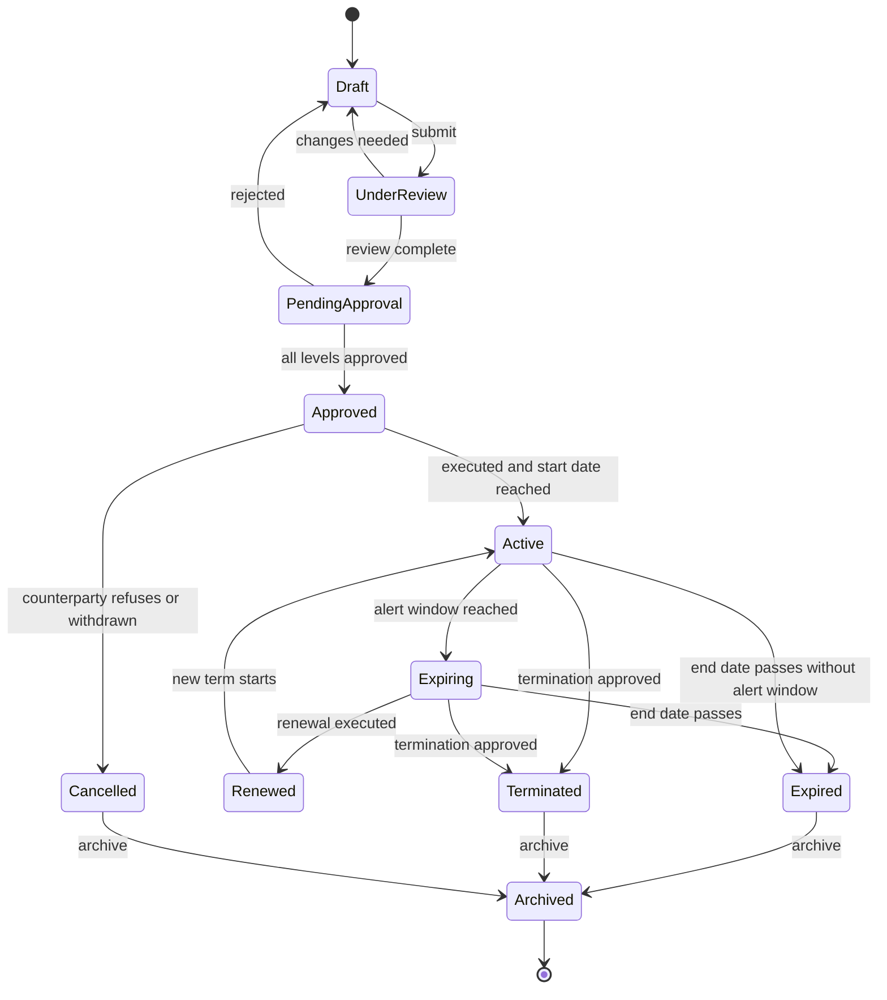

# WF-13 Contract-to-Renewal

Document status: Draft v0.2 (Phase 2 remediation). Proposed. Outline promoted to implementation-ready documentation, not approved.
Release: R3 (module M-056 Contract Management, priority P1).
This lifecycle replaces the outline row in [Cross-Module Workflows](../Cross-Module-Workflows.md).
Every value written as "proposed" is PENDING APPROVAL and is not a business decision.
Approval limits are TBD (OQ-013, OQ-034).
No R3 contract functional requirements exist yet.
Test cases for this lifecycle: [Lifecycle WF-13 Test Cases](../../08-QA-and-Testing/test-cases/Lifecycle-WF-13-Test-Cases.md).

## 1. Purpose and scope

The purpose is to govern a contract from first request to renewal, termination or archive.
The aim is that no contract expires unnoticed, no price or term changes without approval, and no purchase is made on an expired or unapproved agreement.

This document covers vendor and procurement contracts first.
The reason is that BR-032 (contract management) and module M-056 sit in the procurement group and depend on BR-025 (vendor master control).
BR-032 states that contracts have terms, dates, renewal alerts and links to POs.

Customer contracts and subscriptions are not defined by the module inventory.
The only related module is M-114 Subscription Management (P2, R4, recurring billing for specific models), and no customer contract module exists.
Whether customer contracts are in scope of M-056 is an open decision (see section 16).
Nothing in this document designs customer contracts.

In scope:
- Drafting, review, approval by value, signature or execution of a vendor contract.
- Linking POs and invoices to the contract.
- Obligations and milestones.
- Amendment of price or term.
- Expiry alerts, renewal decision, renewal, early termination, expiry and archive.

Out of scope:
- Legal drafting content and clause libraries.
- Customer contracts and subscriptions (open decision).
- Vendor payment (see [Authoritative Workflow Definitions](../Authoritative-Workflow-Definitions.md) AWD-01).
- Changes to the vendor master bank record (controlled change under BRL-033 and FR-139).

## 2. Actors and responsibilities

Only the 18 default roles of the [RBAC Matrix](../../06-RBAC-and-Security/RBAC-Matrix.md) are used, plus the system and the external counterparty.
Tier names follow RBAC Matrix 8A.1.
No contract permission codes exist in the RBAC Matrix yet.
Contract permissions per role are TBD and must be added before implementation.

| Actor | Tier | Responsibility in this lifecycle |
|---|---|---|
| Super Admin | T0 | No business role. Holds no contract rights. Manages platform configuration only. |
| Organization Admin | T1 | Maintains approval chains and limits as controlled data (with Finance Manager as checker, BRL-070). Holds no contract approval role by default. |
| Branch Admin | T2 | No contract role by default. Scope of branch data only. |
| Department Manager | T2 | Requests a contract for the department need. Takes part in review. Receives obligation tasks for the department. |
| HR Manager | T2 | No contract role by default. May be a reviewer for HR service contracts (proposed, PENDING APPROVAL). |
| Finance Manager | T2 | Approver above limit A. Checker for price or bank term amendments. Approves termination. Gives input to the renewal decision. |
| Procurement Manager | T2 | Initiating actor per the outline. Creates, submits and owns the contract. Approver at level 1 when not the creator. Records the renewal decision. |
| Inventory Manager | T2 | Receives obligation tasks tied to deliveries (proposed). |
| Sales Manager | T2 | No contract role (customer contracts are an open decision). |
| HR Executive | T3 | No contract role. |
| Accountant | T3 | Checks contract price on invoices. Verifies bank terms in a bank change (FR-139). |
| Procurement Officer | T3 | May draft a contract and link POs. Never approves. |
| Warehouse Staff | T3 | Confirms receipt against milestone deliveries (read of contract references only). |
| Sales Executive | T3 | No contract role. |
| Project Manager | T3 | May request a contract for project needs and view the linked contract. |
| Employee | T4 | No contract role. |
| Auditor | Oversight | Read-only view of contracts, approvals and audit trail. Never creates or approves. |
| Read-only User | T4 | Reads contracts inside own scope only, if granted. |
| System | n/a | Routes approvals, sets statuses, runs expiry jobs, sends notifications, checks PO and invoice references, writes audit. |
| External counterparty (vendor) | n/a | Negotiates and signs. Has no ERP login. Appears only as a vendor master record and as signature evidence. |

A legal reviewer role does not exist among the 18 default roles.
The outline says "legal (TBD)".
How legal review is staffed is an open decision (section 16).

## 3. Preconditions

1. The counterparty exists in the vendor master (M-054) with status Active (BR-025, BRL-032).
2. The company, branch and department scope of the contract is set (BRL-001, BRL-002).
3. The approval chain for contract value bands is configured in M-013, with limits as company data (OQ-013, BRL-009).
4. At least two eligible approvers exist for the highest level, otherwise the contract waits (RBAC Matrix 8A.4).
5. Notification channels (in-app, email) are configured (M-012, FR-035, FR-037).
6. The attachment store is available for the draft and the signed copy (M-011, FR-033).
7. The contract number series, currency and tax settings are configured (M-008, M-009).
8. The user has the contract permissions in scope (TBD, default deny BRL-004).

## 4. Step-by-step workflow

Status names are proposed and extend the outline list (Draft, Under review, Active, Expiring, Renewed, Expired, Terminated) with Pending approval, Approved, Cancelled and Archived.

| Step | Actor | Action | System behaviour | Resulting status |
|---|---|---|---|---|
| S1 | Procurement Manager or Procurement Officer (Department Manager and Project Manager may request) | Create the contract draft: vendor, title, scope, start and end dates, value, currency, notice period, renewal terms, price list or rates, payment terms, attach the draft document. | Checks the vendor is Active. Assigns a contract number. Records the creator. Validates dates (end after start). Audits creation. | Draft |
| S2 | Creator | Submit for review. | Locks the main terms against silent edit. Notifies reviewers. Audits. | Under review |
| S3 | Reviewer (legal role TBD), Department Manager, Procurement Manager | Review terms, value, dates and risks. Return with comments or complete the review. | A return reopens the draft with reasons. A completed review starts the approval chain. The reviewer's decision is audited. | Draft (returned) or Pending approval |
| S4 | Procurement Manager (not creator), Finance Manager above limit A, level 3 role above limit B (TBD) | Approve or reject by contract value. | Routes by total contract value (FR-043, BRL-009). Skips creator and last editor (BRL-008). Sends PENDING APPROVAL notice. Pauses if no eligible approver. A value, vendor or bank term change after approval restarts the chain. | Pending approval, then Approved or Draft (rejected with reason) |
| S5 | Procurement Manager, external counterparty | Obtain signatures and record execution. Attach the signed copy. Optional e-signature provider (TBD). | Requires an Approved contract. Requires the signed attachment (malware scanned, FR-033). Becomes Active when the start date is reached. A withdrawn contract is Cancelled. | Active (or Approved until start date, or Cancelled) |
| S6 | Procurement Manager, Procurement Officer, Department Manager | Link POs. Record obligations and milestones with owners and due dates. | PO creation checks the contract is Active and the price is within the contract (see section 11). Milestone due dates raise tasks. Linked POs and invoices are listed on the contract. | Active |
| S7 | Procurement Manager (request), Finance Manager (approve) | Amend price or term: raise an amendment with reason, new values and effective date. | Creates an amendment record. Price and bank term changes follow the controlled change path (request, approve by another user). Approval by value on the new total. The amendment takes effect only after approval. Open POs keep their prices (rule WF13-R6). Audits before and after values. | Contract stays Active. Amendment: Draft, Pending approval, Approved, Applied |
| S8 | System | Run the daily expiry job. Send alerts at proposed intervals before the end date. | Marks the contract Expiring when the first alert interval is reached. Notifies owner, Procurement Manager and Finance Manager. Records each alert. | Expiring |
| S9 | Procurement Manager (with Finance Manager input) | Record the renewal decision before the notice deadline: renew, renegotiate, let expire or terminate. | Decision, reason and date are stored. A "renew" decision opens a renewal record. No decision before the deadline raises an escalation alert (rule WF13-R1). | Expiring |
| S10 | Procurement Manager (request), approvers by value, counterparty | Approve the renewal, sign, and extend the term. | The renewal is approved by value like a new contract. On execution the end date moves and the status becomes Renewed, then Active when the new term starts. Price changes in a renewal are price amendments (S7 rules). | Renewed, then Active |
| S11 | Procurement Manager (request), Finance Manager (approve), another approver above the limit | Terminate early with reason, effective date and notice evidence. | Requires approval by someone other than the requester. Warns of open POs and unbilled obligations. Blocks new POs from the effective date. Existing receipts and invoices stay valid. | Terminated |
| S12 | System | End date passes with no executed renewal. | Sets Expired. Blocks new POs on the contract. Alerts the owner. | Expired |
| S13 | Procurement Manager or System (retention) | Archive the contract record. | Moves to the archive after the retention rule allows (BRL-063, retention TBD, OQ-022). Keeps history, attachments and audit readable. Archived records are never deleted by users. | Archived |

## 5. Approval hierarchy

The approval engine is M-013.
The structure follows the multi-level approval framework of RBAC Matrix 8A.5.
All limits are TBD (OQ-013, OQ-034).

| Item | Maker | Level 1 | Level 2 (above limit A, TBD) | Level 3 (above limit B, TBD) |
|---|---|---|---|---|
| New contract or renewal | Procurement Manager or Procurement Officer | Procurement Manager (never the creator or last editor) | Finance Manager (different user) | A role above Finance Manager, PENDING APPROVAL (OQ-034) |
| Price amendment | Procurement Manager | Finance Manager (checker, controlled change) | Second Finance Manager above limit A | Same as level 3 above |
| Term amendment (dates, scope, notice) | Procurement Manager | Procurement Manager (different user) | Finance Manager above limit A | Same as level 3 above |
| Bank terms in a contract | Procurement Officer or Procurement Manager | Accountant verifies (FR-139) | Finance Manager approves (never requester or verifier) | n/a |
| Termination | Procurement Manager | Finance Manager | Second approver above limit A | Same as level 3 above |

Rules:
1. The creator never approves, including through delegation (BRL-008, FR-042, SEC-020, BRL-073).
2. The last editor never approves (same approach as PO under SOD-32).
3. The value used for routing is the total contract value including approved amendments, in the contract currency and converted to the company currency (proposed, PENDING APPROVAL).
4. An approval at a level needs a user who holds authority at or above the value (BRL-009, FR-043).
5. Each level is a different user (RBAC Matrix 8A.5 rule 1).
6. Where only one person holds the approving role, the document waits. It never falls back to self-approval (RBAC Matrix 8A.4). The SoD override path is FR-142.
7. A step with no eligible approver pauses and alerts. It never auto-approves and never skips (RBAC Matrix 8A.5 rule 4).
8. A change of value, vendor or bank terms after approval restarts the chain (same principle as FR-092).
9. Price and bank term amendments are treated as controlled changes: requested by one user, approved by another, effective only after approval (BRL-070 principle). BRL-070 names vendor bank details explicitly. Extending it to contract prices is a proposal, PENDING APPROVAL.
10. Step-up authentication for approving a termination or a price amendment is proposed, PENDING APPROVAL. RBAC Matrix 8A.6 does not list contract actions today.
11. Approval limits themselves are controlled data (BRL-070).
12. The vendor creator cannot approve payments to that vendor (BRL-058). The contract workflow never grants or removes payment rights.

## 6. Business rules

Existing rules used:

| Rule | Statement (summary) | Use in WF-13 |
|---|---|---|
| BR-032 | Contracts have terms, dates, renewal alerts and links to POs. An expiring contract raises a notice before expiry. | Core requirement. |
| BR-025 | Vendors have tax and bank details and an active status. Bank changes are approved. | Counterparty must be Active. |
| BR-026 | POs are approved by authority matrix on value. | PO linked to a contract still follows PO approval. |
| BR-024 | Unapproved requisition cannot become a PO. | A contract does not bypass the requisition rule. |
| BRL-009 | An approver holds authority at or above the document value. | Approval by contract value. |
| BRL-012 | A delegate acts with the delegator's authority for the period and document types, and the audit shows both names. | Delegation of contract approval. |
| BRL-008 | A user cannot approve a document they created. | Creator never approves. |
| BRL-032 | A blocked or inactive vendor cannot be used on new documents. | Blocked counterparty. |
| BRL-033 | A change to vendor bank details needs approval from someone other than the editor. | Bank terms in a contract. |
| BRL-058 | The same user cannot both create a vendor and approve payments to that vendor. | Separation of vendor and payment duties. |
| BRL-070 | Controlled data changes are requested by one user, approved by another, effective after approval. | Price and bank term amendments. |
| BRL-073 | A delegate cannot approve a document the delegator created and passes the SoD check. | Delegated approval. |
| BRL-061 | A failed notification is retried, then flagged. | Expiry alert delivery. |
| BRL-062 | A failed external call does not roll back a committed event and is queued for retry. | E-signature provider calls. |
| BRL-063 | Records are retained for the longest legal period (default TBD, OQ-022). | Archive. |
| BRL-007 | Audit records cannot be edited or deleted. | Audit trail of every step. |
| BRL-060 | Attachments inherit the access rules of the parent record. | Signed copy access. |
| BRL-065 | A second save is refused if the record changed since it was opened. | Concurrent contract edits. |

Proposed new rules (no BRL id yet, all PENDING APPROVAL):

| Proposed rule | Statement |
|---|---|
| Proposed new rule WF13-R1 (notice period) | Each contract carries a notice period in days (proposed default 30 days, proposed, PENDING APPROVAL). The renewal decision deadline is the end date minus the notice period. If no decision is recorded by the deadline, the system escalates to the Procurement Manager and Finance Manager and flags the contract. |
| Proposed new rule WF13-R2 (auto-renew) | The system never extends a contract silently. A contract whose terms say it auto-renews is still flagged and alerted. The renewal is recorded only with an approved renewal record. Whether a deemed renewal under counterparty terms must be recorded retroactively is PENDING APPROVAL. |
| Proposed new rule WF13-R3 (cooling off) | Where law or the contract gives a cooling-off period, a configurable number of days after execution (proposed default 0 days, PENDING APPROVAL) lets the contract be cancelled with Finance Manager approval and without the early termination steps. |
| Proposed new rule WF13-R4 (expired contract) | A new PO or invoice cannot reference an Expired, Terminated or Cancelled contract. Existing documents stay valid. A user with approval authority may record an exception with a reason (PENDING APPROVAL). |
| Proposed new rule WF13-R5 (price tolerance) | A PO or invoice line price above the contract price by more than a configured tolerance (proposed 0 percent for contracted items, PENDING APPROVAL) is blocked or held for approval by the Procurement Manager. |
| Proposed new rule WF13-R6 (amendment and open POs) | An approved amendment applies to POs created after its effective date. Open POs keep their price unless revised through PO revision with approval (FR-093). |
| Proposed new rule WF13-R7 (alert intervals) | Expiry alerts go out at 90, 60, 30, 14 and 7 days before the end date (proposed intervals, PENDING APPROVAL). The first interval sets status Expiring. |
| Proposed new rule WF13-R8 (counterparty blocked) | If the vendor becomes blocked, the contract stays visible, new POs are refused (BRL-032), and the owner and Finance Manager are alerted to decide on termination. |

## 7. Input and output data

Field names are conceptual and are not added to the [Data Dictionary](../../04-System-Architecture/Data-Dictionary.md) yet.

| Group | Data |
|---|---|
| Input: contract | Vendor reference, title, type, scope description, start date, end date, total value, currency, payment terms, notice period, renewal terms, auto-renew flag, owner, department, attachments |
| Input: price and terms | Price list or rates by item or service, discount terms, price validity, price tolerance, bank terms reference (vendor master), service levels, penalties |
| Input: obligations | Description, owner, due date, linked deliverable, status |
| Input: decisions | Review comments, approval decisions with reason, renewal decision with reason, termination reason and effective date, notice evidence |
| Input: signature | Signature date, signatories, signed copy, optional e-signature reference |
| Output: records | Contract with version history, amendment records, renewal record, termination record, obligation and milestone list, PO and invoice links |
| Output: control | Approval trail, audit events (FR-030), expiry alert log, status history |
| Output: notifications | PENDING APPROVAL, decision, expiry alerts, milestone due, escalation |
| Output: reports | Contracts expiring in 30, 60, 90 days (proposed), spend against contract value, contracts without a renewal decision |

## 8. Status transitions

Contract:

| From | To | Condition | Actor |
|---|---|---|---|
| (new) | Draft | Vendor Active, required fields valid | Procurement Manager or Officer |
| Draft | Under review | Submitted by creator | Creator |
| Under review | Draft | Reviewer returns with reasons | Reviewer |
| Under review | Pending approval | Review completed | Reviewer, system |
| Pending approval | Draft | Any approver rejects with reason | Approver |
| Pending approval | Approved | All value levels approved by distinct users, none the creator or last editor | Approvers |
| Approved | Active | Execution recorded with signed copy and start date reached | Procurement Manager, system |
| Approved | Cancelled | Counterparty refuses or the contract is withdrawn, or cooling off cancel (WF13-R3) | Procurement Manager, Finance Manager for cooling off |
| Active | Expiring | First alert interval reached (WF13-R7) | System |
| Expiring | Renewed | Renewal executed | Procurement Manager, system |
| Renewed | Active | New term starts | System |
| Expiring | Expired | End date passes with no executed renewal | System |
| Active | Expired | End date passes and the alert job had not run (see section 13) | System |
| Active | Terminated | Termination approved, effective date reached | Approvers, system |
| Expiring | Terminated | Termination approved, effective date reached | Approvers, system |
| Expired | Archived | Archive action or retention rule | Procurement Manager, system |
| Terminated | Archived | Archive action or retention rule | Procurement Manager, system |
| Cancelled | Archived | Archive action or retention rule | Procurement Manager, system |

Amendment (proposed):

| From | To | Condition | Actor |
|---|---|---|---|
| (new) | Draft | Contract is Active or Expiring, reason and new values given | Procurement Manager |
| Draft | Pending approval | Submitted | Procurement Manager |
| Pending approval | Draft | Rejected with reason | Approver |
| Pending approval | Approved | Approved by value by users other than the requester | Approvers |
| Approved | Applied | Effective date reached | System |
| Draft | Cancelled | Withdrawn by requester | Procurement Manager |

Renewal (proposed):

| From | To | Condition | Actor |
|---|---|---|---|
| (new) | Proposed | Decision "renew" recorded on an Expiring contract | Procurement Manager |
| Proposed | Pending approval | Renewal terms entered and submitted | Procurement Manager |
| Pending approval | Proposed | Rejected with reason | Approver |
| Pending approval | Approved | Approved by value, none the creator | Approvers |
| Approved | Executed | Signed copy recorded and the contract end date extended | Procurement Manager, system |
| Proposed | Declined | Decision changed to let expire or terminate | Procurement Manager |
| Executed | Reversed | Wrong renewal reversed with approval (see section 13) | Finance Manager, second approver |

Termination (proposed):

| From | To | Condition | Actor |
|---|---|---|---|
| (new) | Requested | Reason, effective date, notice evidence | Procurement Manager |
| Requested | Approved | Approved by user other than requester | Finance Manager |
| Requested | Rejected | Approver rejects with reason | Finance Manager |
| Approved | Executed | Effective date reached, contract becomes Terminated | System |

## 9. Notifications

| Event | Recipient | Channel | Note |
|---|---|---|---|
| Contract submitted for approval | Next eligible approver | In-app and email | Subject marked PENDING APPROVAL (FR-035) |
| Approval decision | Creator and owner | In-app and email | Includes reason on rejection |
| Approval step has no eligible approver | Procurement Manager and Organization Admin | In-app and email | The document waits, no auto-approval |
| Contract executed and Active | Owner, department, Finance Manager | In-app | |
| Expiry alert at 90, 60, 30, 14 and 7 days | Owner, Procurement Manager, Finance Manager | In-app and email | Proposed intervals, PENDING APPROVAL |
| Notice deadline passed with no renewal decision | Procurement Manager, Finance Manager | In-app and email | Escalation (WF13-R1) |
| Milestone or obligation due | Obligation owner | In-app | Proposed lead time 7 days, PENDING APPROVAL |
| Amendment approved or applied | Owner, Accountant, Procurement Officer | In-app | So invoice checks use the new price |
| Termination approved | Owner, Finance Manager, Accountant | In-app and email | |
| Counterparty blocked | Owner and Finance Manager | In-app | WF13-R8 |
| Notification failed | Flagged to Procurement Manager | In-app | Retried first (FR-037, BRL-061) |

## 10. Related modules

| Module | Name | Relation |
|---|---|---|
| M-056 | Contract Management | Owner of this lifecycle |
| M-054 | Vendor Management | Counterparty status, tax and bank details |
| M-055 | Supplier Evaluation | Performance input to the renewal decision (R3, depends on history) |
| M-053 | Purchase Order (PO) | POs reference the contract and its price |
| M-057 | Goods Receipt Note (GRN) | Receipts confirm milestone deliveries |
| M-058 | Purchase Invoice | Invoice price checked against the contract |
| M-059 | Vendor Payments | Payment to the vendor, not changed by this lifecycle |
| M-049 | Purchase Requisition (PR) | Source of the need |
| M-013 | Workflow & Approval Engine | Approval chains by value |
| M-012 | Notification & Communication Management | Alerts and retry |
| M-011 | Document Management | Draft and signed copy |
| M-010 | Audit Logs & Activity Tracking | Audit trail |
| M-004 | Role & Permission Management (RBAC) | Roles, SoD, scope |
| M-008 | System Configuration | Numbering, alert intervals, notice defaults |
| M-114 | Subscription Management | Possible overlap with customer subscriptions (open decision, R4) |

## 11. Integration dependencies

| Dependency | Direction | Requirement |
|---|---|---|
| PO (M-053) | Contract to PO | A PO created for a contracted vendor can reference an Active contract. The PO price is checked against the contract price (WF13-R5). An expired contract is refused (WF13-R4). PO approval still follows BR-026. |
| Purchase invoice (M-058) | Contract to invoice | The invoice line price is compared with the contract price during matching. A difference follows the invoice variance path of WF-01. |
| Vendor master (M-054) | Both | The vendor must be Active (BRL-032). Bank details are never changed from the contract. A bank term change goes through FR-139. |
| Approval engine (M-013) | Contract to engine | Chain by value, delegation (BRL-012), pause on no approver. |
| Notification service (M-012) | Contract to service | Alerts with retry (FR-037) and outbound queue (FR-128). |
| Document Management (M-011) | Both | Attachments with malware scan (FR-033). |
| E-signature provider | Optional, TBD | Whether an e-signature provider is used, and which one, is not decided. If used, calls go through the outbound queue and a failure does not roll back committed data (FR-128, BRL-062). Without it, the signed copy is uploaded manually. |
| API paths | None designed | The API Documentation has no contract endpoints. They must be proposed before R3. |

## 12. Exception scenarios

| Scenario | Behaviour |
|---|---|
| Expired contract still referenced by a PO | Open PO stays valid and is flagged. New POs and PO revisions that add value are refused against an Expired contract (WF13-R4). The owner is alerted. |
| Price deviation against the contract | A PO or invoice price above contract price beyond tolerance is blocked or held for the Procurement Manager (WF13-R5). The override reason is recorded. |
| Amendment during open POs | Open POs keep their prices. The amendment applies to new POs from the effective date (WF13-R6). A listed warning shows the open POs. |
| Early termination | Requires approval by another user. Open POs and unbilled obligations are listed. New POs are refused from the effective date. Received goods and posted invoices stay valid. |
| Dispute with the counterparty | The owner marks a dispute flag with reason (proposed, PENDING APPROVAL). The flag does not change the status. New POs may be held by policy. The dispute is audited and can lead to amendment or termination. |
| Counterparty blocked | New POs are refused (BRL-032). The contract stays visible. Owner and Finance Manager decide on termination (WF13-R8). |
| Rejected approval | Returns to Draft with reason. Resubmission starts a new round. |
| Creator tries to approve | Refused (BRL-008). No approve action is shown and an API attempt is refused (SEC-020). |
| Approver lacks authority for the value | Routed to the next level (FR-043). |
| Concurrent edit | The second save is refused (BRL-065). |
| Cross-company access | Refused by scope (BRL-002, SEC-014). |

## 13. Failure and recovery scenarios

| Scenario | Recovery |
|---|---|
| Missed expiry alert (job did not run or all alerts failed) | The daily job is idempotent and catches up on the next run, sending the highest overdue alert once. A contract past its end date is set Expired. A report lists contracts with no recorded renewal decision. The Procurement Manager is notified. |
| Notification failure | Retried a configurable number of times, then flagged for the Procurement Manager (FR-037, BRL-061). The business event is not lost. |
| E-signature or other external call failure | The event stays committed and the call is queued with retry (FR-128, BRL-062). A user may retry or cancel the queued item. |
| Approver unavailable | Delegation within BRL-012 and BRL-073 limits, or escalation to the next eligible approver. If none exists the document waits. It is never auto-approved. |
| Wrong renewal recorded | A renewal record can be reversed by a request and approval of different users with a reason. The end date returns to its prior value and the status follows it (Active or Expiring, or Expired if the date has passed). The original and the reversal stay in the audit trail. |
| Wrong amendment applied | A correcting amendment is raised and approved. The applied record is not edited. |
| Failed status update | The update is atomic. The user retries. Retries are idempotent. |
| Expiry job outage over the end date | On restart the job sets the status by date and raises the missed alert report. |

## 14. Diagrams

### 14.1 Process flow

### 14.2 Swimlane

### 14.3 Sequence

### 14.4 State transition

The diagram shows the contract statuses.
Amendment, renewal and termination records use the tables in section 8.

## 15. Requirement cross-reference

There are no R3 contract functional requirements (FR) yet.
BR-032 is the only business requirement written for contracts.
The FR ids below are existing MVP requirements that this lifecycle reuses.
New contract FRs, APIs and user stories must be proposed before R3 starts.

| Item | Existing id | Relation | Test cases |
|---|---|---|---|
| Business requirement | BR-032 | Contract terms, dates, renewal alerts, PO links | TC-0985, TC-0986, TC-0990, TC-0991, TC-0993, TC-0994, TC-1018, TC-1019, TC-1021, TC-1032, TC-1033, TC-1034 |
| Business requirement | BR-025 | Vendor master control, active vendor | TC-0985, TC-1005, TC-1033 |
| Business requirement | BR-026, BR-024 | PO approval and requisition remain in force | TC-0991, TC-1007 |
| Business rule | BRL-008 | Creator never approves | TC-0998, TC-0999, TC-1001, TC-1013, TC-1030, TC-1032 |
| Business rule | BRL-009 | Approval by value | TC-0987, TC-0988, TC-0989, TC-1008, TC-1020, TC-1028, TC-1032 |
| Business rule | BRL-012, BRL-073 | Delegation | TC-0997, TC-1015 |
| Business rule | BRL-032 | Blocked vendor | TC-1005 |
| Business rule | BRL-033 | Vendor bank change approval | TC-1014 |
| Business rule | BRL-058 | Vendor and payment duty separation (not changed here) | No case. Covered by SoD tests in the RBAC suites |
| Business rule | BRL-070 | Controlled change | TC-0992, TC-1000, TC-1001, TC-1013 (termination approval), TC-1033 |
| Business rule | BRL-061, BRL-062 | Notification retry, external call queue | TC-1026, TC-1029 |
| Business rule | BRL-063, BRL-007, BRL-065 | Retention, audit, concurrency | TC-0996, TC-1017, TC-1031 |
| Functional requirement | FR-043 | Authority limit routing | TC-0987, TC-0989, TC-1020, TC-1028 |
| Functional requirement | FR-092 | PO approval restarts on value change (same principle used) | TC-1008 |
| Functional requirement | FR-128 | Outbound integration queue | TC-1029 |
| Functional requirement | FR-037, FR-035 | Notification retry and inbox | TC-0993, TC-1026, TC-1027 |
| Functional requirement | FR-042, SEC-020 | No self-approval | TC-0998 |
| Functional requirement | FR-033, SEC-032 | Attachments and file type list | TC-0990, TC-1009, TC-1010 |
| Functional requirement | FR-138, FR-139 | Controlled change workflow, vendor bank change control | TC-0992, TC-1000, TC-1014 |
| Functional requirement | FR-091, FR-093 | PO creation and revision | TC-0991, TC-1006, TC-1007, TC-1034 |
| Security requirement | SEC-013, SEC-014, SEC-018, BRL-004 | Authorisation, object scope, Auditor read-only | TC-1002, TC-1003, TC-1004, TC-1011, TC-1012 |
| Security requirement | SEC-040 | Idempotent safe retry | TC-1031 |
| Module | M-056, M-054, M-053, M-058, M-013, M-012, M-011, M-010, M-004 | See section 10 | All cases in the test file |
| Open question | OQ-013, OQ-034 | Approval limits and level 3 role | TC-0989, TC-1020 |

## 16. Open decisions

All items are PENDING APPROVAL.
Where an existing open question applies it is cited.
Items without an OQ number are proposed new questions and have no id yet.

| Item | Decision needed | Owner (proposed) | Existing question |
|---|---|---|---|
| Approval limits A and B by contract value | Values and currency conversion rule | Finance manager | OQ-013, OQ-034 |
| Role above Finance Manager for level 3 | Whether it exists (for example a Finance Director) | Sponsor, Finance manager | OQ-034 |
| Delegation of contract approval | Whether chained delegation is allowed | Finance manager | OQ-026 |
| MFA method for step-up on termination and price amendment | Whether contract actions join the step-up list | Security officer | OQ-023 |
| Retention and archive period for contracts | Legal period | Compliance officer | OQ-022 |
| Customer contracts and subscriptions | Whether M-056 covers customer contracts, or M-114 does, or neither (proposed new question) | Sponsor | None |
| Legal review role | Who reviews: an external adviser, a custom role, or an existing manager (proposed new question) | Sponsor | None |
| Notice period default | Proposed 30 days (proposed new question) | Procurement manager | None |
| Expiry alert intervals | Proposed 90, 60, 30, 14, 7 days (proposed new question) | Procurement manager | None |
| Auto-renew handling | Proposed rule WF13-R2, including deemed renewals under counterparty terms (proposed new question) | Procurement manager, legal | None |
| Cooling-off period | Proposed 0 days default (proposed new question) | Legal | None |
| Price tolerance on PO and invoice | Proposed 0 percent for contracted items (proposed new question) | Procurement manager, Finance manager | None |
| Price amendment as controlled change | Extend BRL-070 to contract prices (proposed new question) | Finance owner | None |
| E-signature provider | Whether one is used and which (proposed new question) | Sponsor, IT manager | None |
| Contract permissions and API | Permission codes per role and API paths are not designed (proposed new question) | Architecture | None |
| Dispute flag | Whether a formal dispute status is needed (proposed new question) | Procurement manager | None |
