# Process Flow Diagrams

Document status: Draft v0.1 (Stage 2 part 2). Proposed. Diagram syntax was checked with a Mermaid 10.9.1 parser (all diagram blocks in the package were re-rendered with Mermaid CLI 10.9.1 in Phase 2 (101 blocks, 0 errors)). The diagrams have **not been visually rendered or reviewed for layout**.
One flow per workflow in [Cross-Module Workflows](Cross-Module-Workflows.md) (WF-01 to WF-14). These flows include exception paths and replace the simpler sketches in the [To-Be Analysis](../02-Business-Analysis/To-Be-Analysis.md).
Post-MVP flows (WF-04, 05, 08, 09, 10, 11, 13, 14) are outlines.

## WF-01 Procure-to-Pay

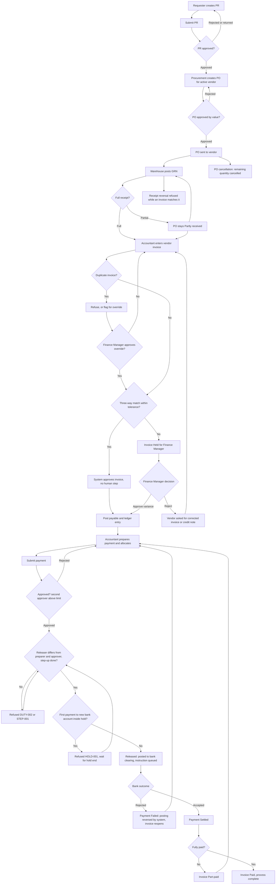

## WF-02 Order-to-Cash

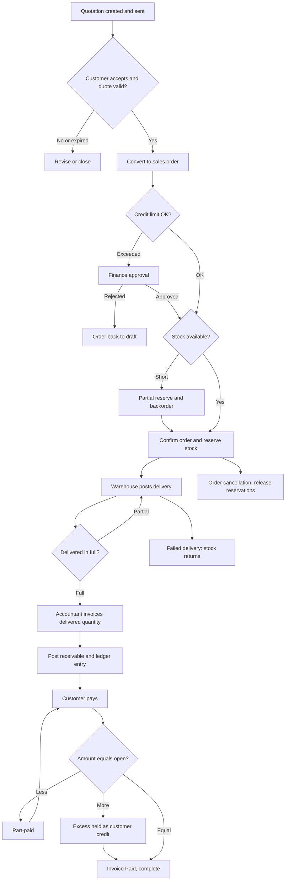

## WF-03 Record-to-Report

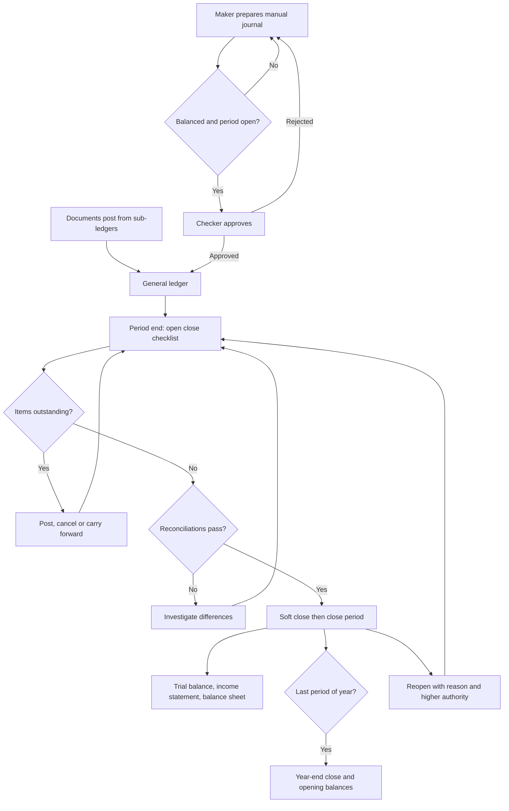

## WF-04 Hire-to-Retire (outline)

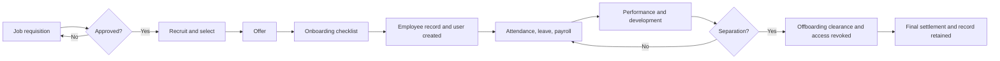

## WF-05 Plan-to-Produce (outline)

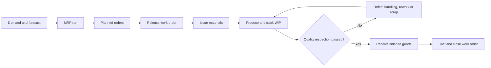

## WF-06 Inventory-to-Fulfillment

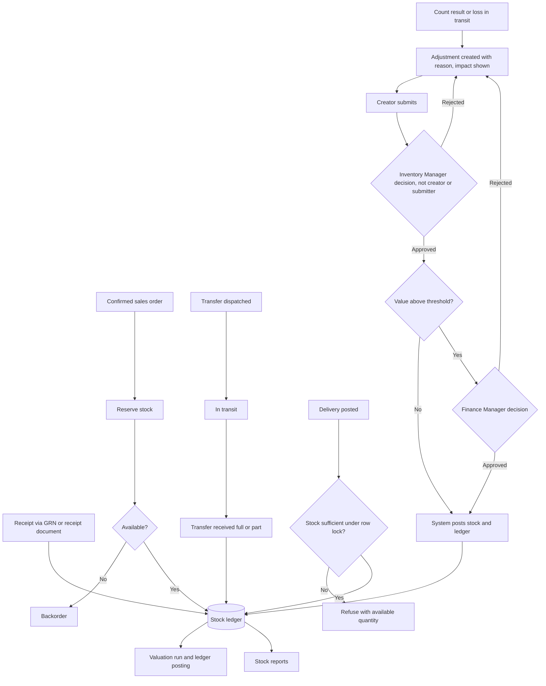

## WF-07 Request-to-Approval

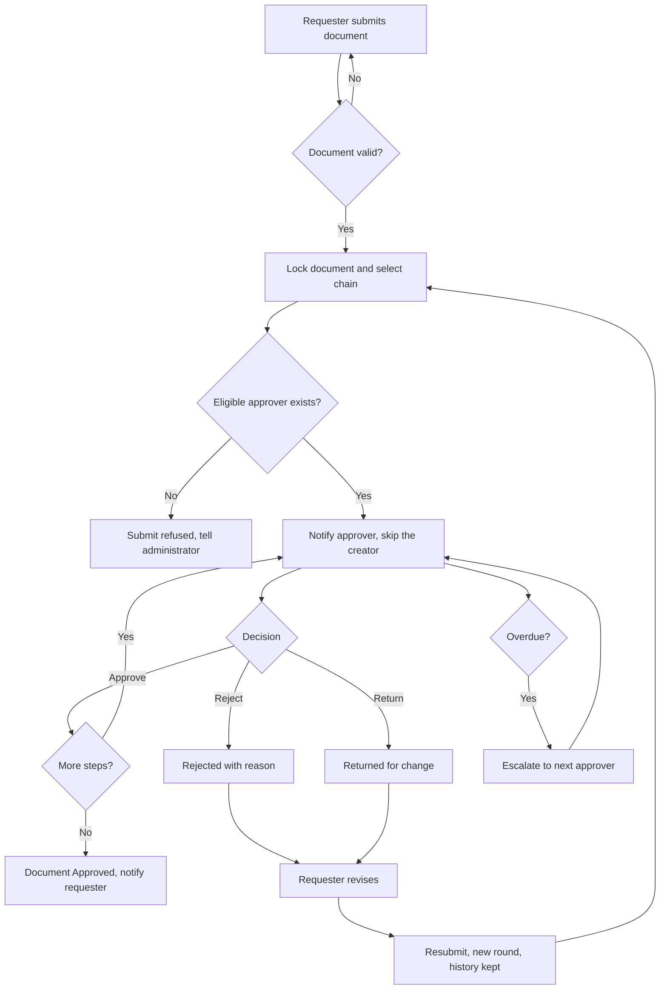

## WF-08 Expense-to-Reimbursement (outline)

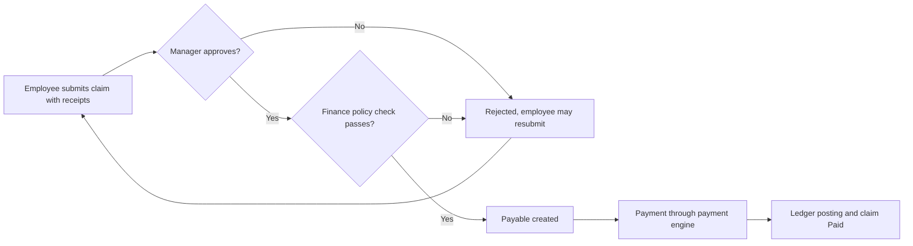

## WF-09 Asset Acquisition-to-Disposal (outline)

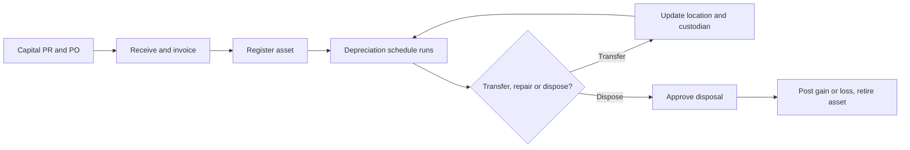

## WF-10 Lead-to-Customer (outline)

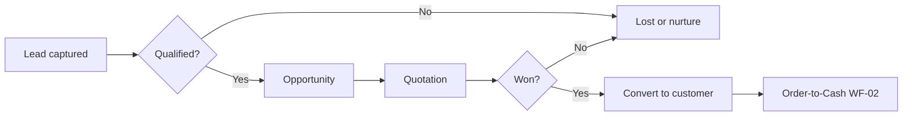

## WF-11 Budget-to-Actual (outline)

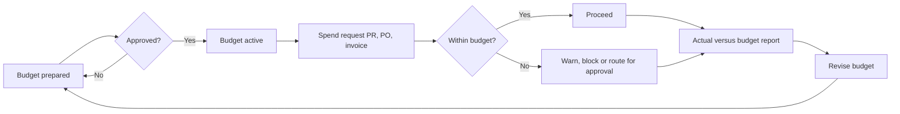

## WF-12 Return-to-Refund

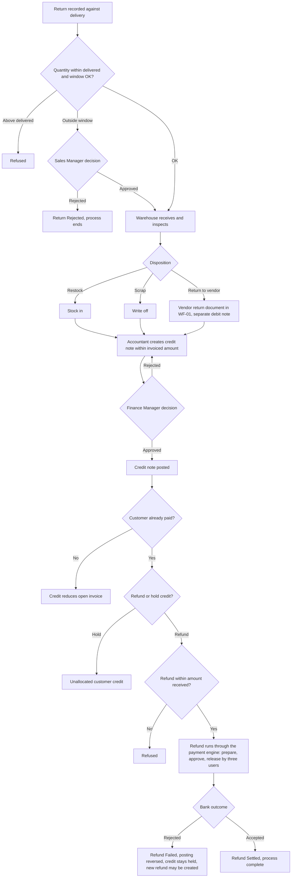

## WF-13 Contract-to-Renewal (outline)

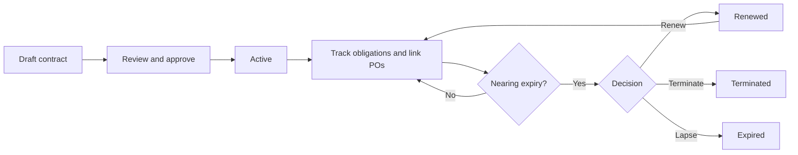

## WF-14 Issue-to-Resolution (outline)

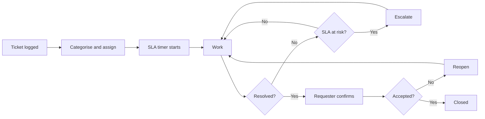

## Phase 2 note (v0.2)

The process flows for WF-04, WF-05, WF-08, WF-09 and WF-13 are in the Lifecycles folder (`Lifecycles/WF-nn-*.md`). WF-01, WF-06 and WF-12 diagrams follow the [Authoritative Workflow Definitions](Authoritative-Workflow-Definitions.md).
