# Sequence Diagrams

Document status: Draft v0.1 (Stage 2 part 2). Proposed. Diagram syntax was checked with a Mermaid 10.9.1 parser (all diagram blocks in the package were re-rendered with Mermaid CLI 10.9.1 in Phase 2 (101 blocks, 0 errors)). The diagrams have **not been visually rendered or reviewed for layout**.
Participants use the components from [System Architecture](../04-System-Architecture/System-Architecture.md). Product names are not used because the stack is undecided (OQ-024).

Contents: SEQ-01 authentication, SEQ-02 RBAC authorization, SEQ-03 approval, SEQ-04 goods receipt, SEQ-05 payment release, SEQ-06 sales order confirmation, SEQ-07 API integration with outbox, SEQ-08 error handling and recovery, SEQ-09 period close, SEQ-10 stock transfer, SEQ-11 return, credit note and refund.

## SEQ-01 Authentication (with lockout, MFA and refresh)

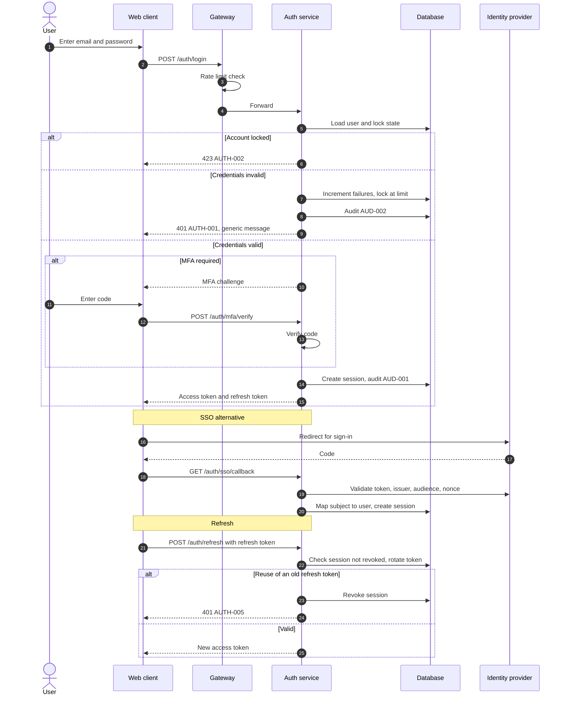

## SEQ-02 RBAC authorization of a request

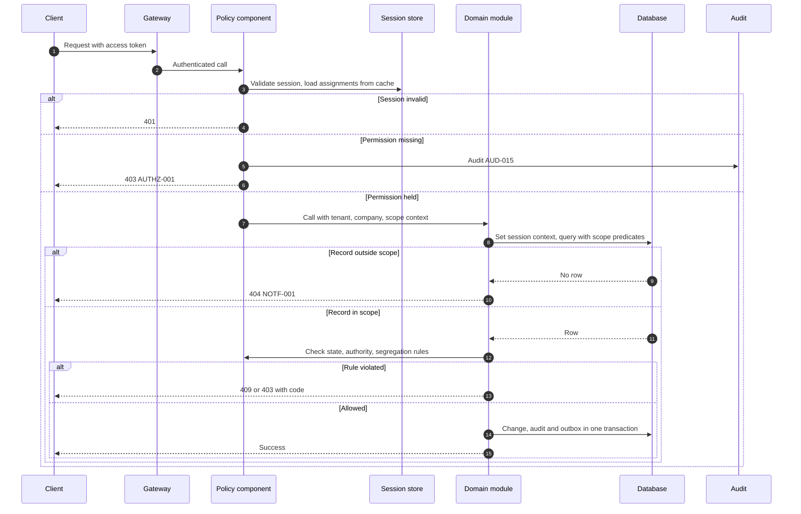

## SEQ-03 Document approval with delegation and escalation

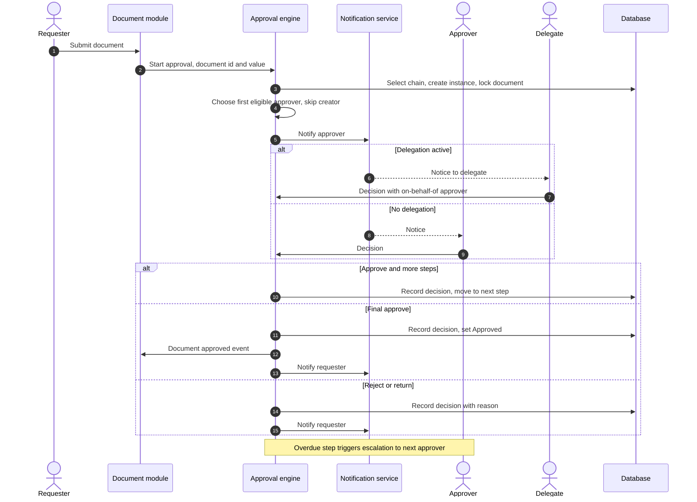

## SEQ-04 Goods receipt posting

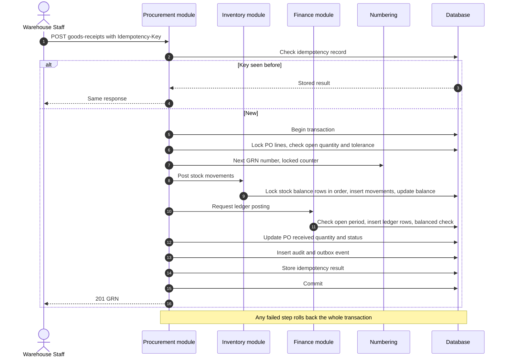

## SEQ-05 Vendor payment release

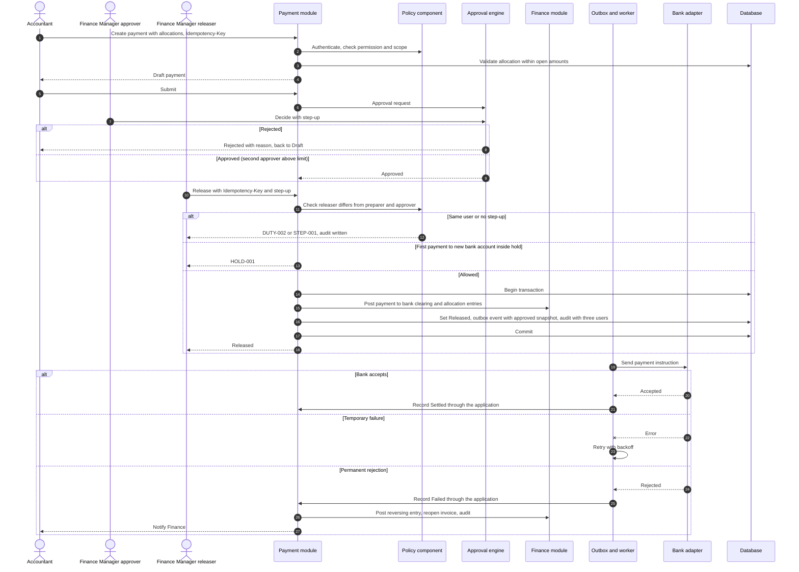

## SEQ-06 Sales order confirmation with credit check and reservation

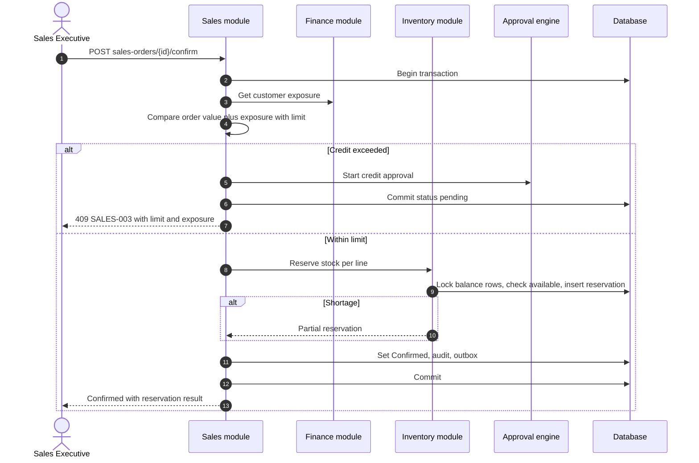

## SEQ-07 API integration with outbox and retry

See also the outbound flow in [Integration Architecture](../04-System-Architecture/Integration-Architecture.md) section 3. The sequence below adds inbound webhook handling.

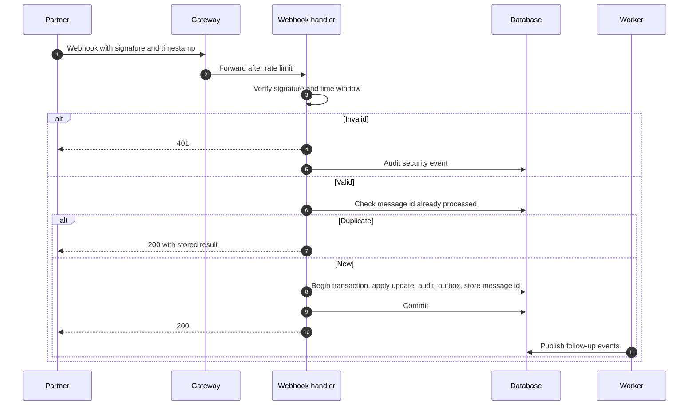

## SEQ-08 Error handling and recovery

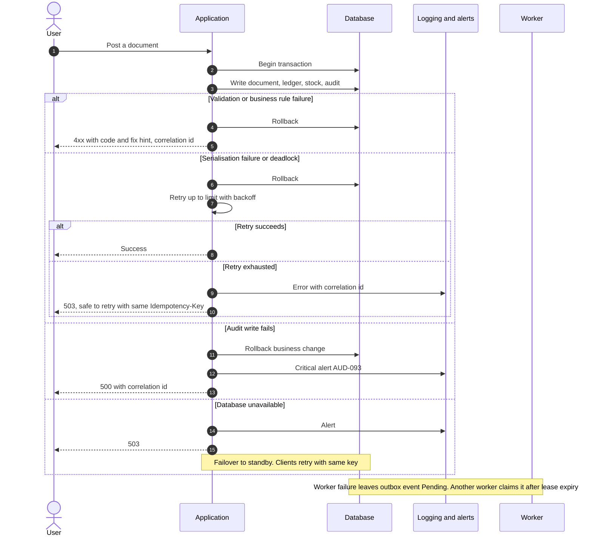

## SEQ-09 Period close

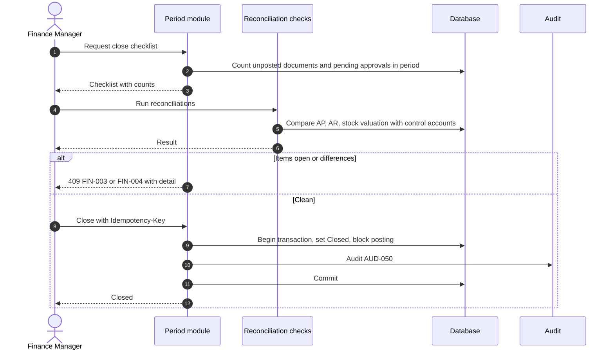

## SEQ-10 Stock transfer with in-transit and partial receipt

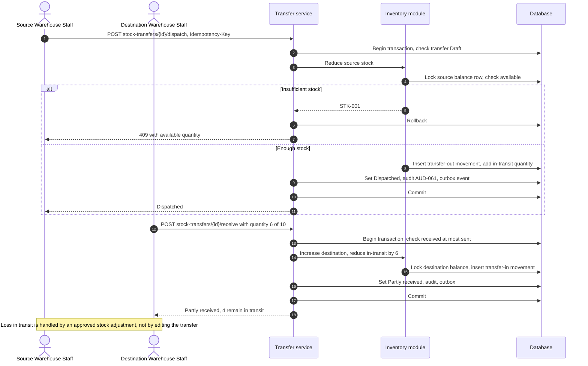

## SEQ-11 Return, credit note and refund

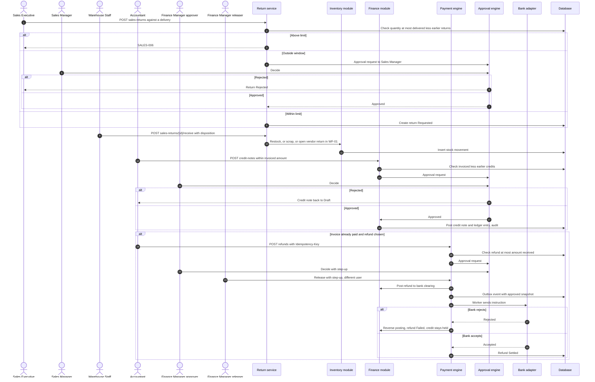

## Phase 2 note (v0.2)

The sequence diagrams for WF-04, WF-05, WF-08, WF-09 and WF-13 are in the Lifecycles folder (`Lifecycles/WF-nn-*.md`). WF-01, WF-06 and WF-12 diagrams follow the [Authoritative Workflow Definitions](Authoritative-Workflow-Definitions.md).
