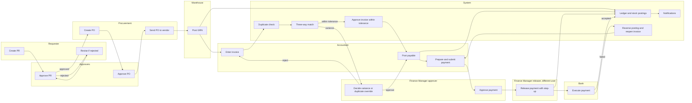
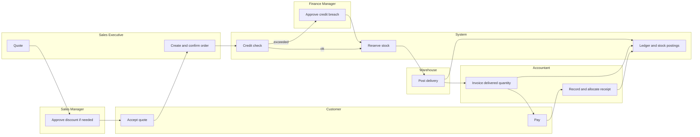
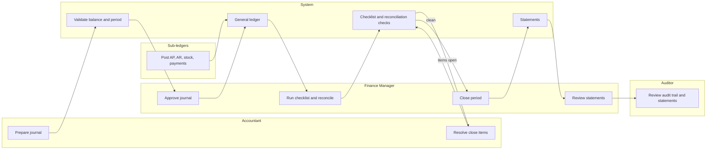
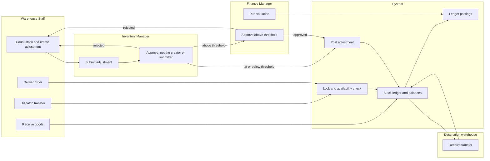
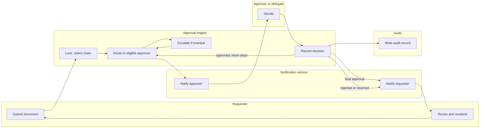
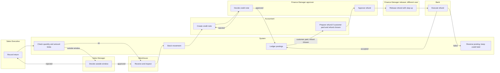

# Swimlane Diagrams

Document status: Draft v0.1 (Stage 2 part 2). Proposed. Diagram syntax was checked with a Mermaid 10.9.1 parser (all diagram blocks in the package were re-rendered with Mermaid CLI 10.9.1 in Phase 2 (101 blocks, 0 errors)). The diagrams have **not been visually rendered or reviewed for layout**.
Mermaid has no native swimlane type. Each lane is a subgraph named after the actor or system. Arrows show hand-offs between lanes.
Six critical MVP workflows are covered: WF-01, WF-02, WF-03, WF-06, WF-07, WF-12. Steps match [Cross-Module Workflows](Cross-Module-Workflows.md).

## WF-01 Procure-to-Pay

## WF-02 Order-to-Cash

## WF-03 Record-to-Report

## WF-06 Inventory-to-Fulfillment

## WF-07 Request-to-Approval

## WF-12 Return-to-Refund

## Notes

1. Lanes show responsibility, not organisational reporting. A user may hold more than one role, but segregation rules still apply (RBAC Matrix section 5).
2. Where a diagram shows one System lane, the individual system steps are in the [Sequence Diagrams](Sequence-Diagrams.md).

## Phase 2 note (v0.2)

The swimlanes for WF-04, WF-05, WF-08, WF-09 and WF-13 are in the Lifecycles folder (`Lifecycles/WF-nn-*.md`). WF-01, WF-06 and WF-12 diagrams follow the [Authoritative Workflow Definitions](Authoritative-Workflow-Definitions.md).
