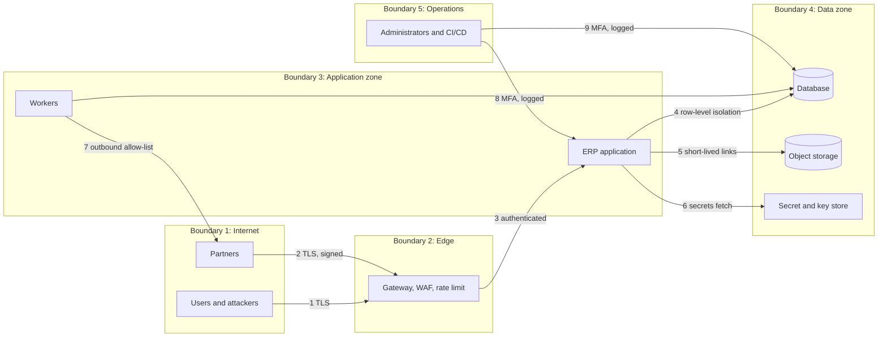

# Threat Model

Document status: Draft v0.1 (Stage 2 part 2). Proposed. Based on the proposed architecture, which is provisional ([ARD](../04-System-Architecture/ARD.md)). It must be redone when OQ-016, OQ-019 and OQ-024 are answered and again after design review.
Method: asset identification, trust boundaries, STRIDE per component, OWASP Top 10 (2021) mapping, and ERP-specific abuse cases.
Ratings: likelihood (L) and impact (I) from 1 to 5, score = L x I. They are the analyst's judgement, not measured values.
Related: [Security Requirements](Security-Requirements.md), [Risk Register](../00-Project-Management/Risk-Register.md) (R-005).

## 1. Assets

| ID | Asset | Why it matters | Class (see [Data Protection](Data-Protection.md)) |
|---|---|---|---|
| AST-01 | General ledger, journals, payments | Financial truth, fraud target | Restricted |
| AST-02 | Vendor and customer master data including bank and tax details | Payment diversion, privacy | Restricted |
| AST-03 | Stock ledger and valuation | Theft concealment, misstatement | Confidential |
| AST-04 | User accounts, credentials, sessions, tokens | Account takeover | Restricted |
| AST-05 | Roles, permissions, approval chains | Privilege escalation | Restricted |
| AST-06 | Audit log | Evidence, must be trustworthy | Restricted |
| AST-07 | Employee personal data | Privacy law | Restricted |
| AST-08 | Attachments and exports | Data leakage | Confidential |
| AST-09 | Integration credentials and secrets | Lateral movement | Restricted |
| AST-10 | Backups | Full data exposure | Restricted |
| AST-11 | Availability of posting and approvals | Business continuity | n/a |

## 2. Actors

| Actor | Description |
|---|---|
| External attacker | No account |
| Malicious or compromised user | Valid account, any role |
| Malicious insider with admin rights | Administrator or database operator |
| Tenant user attacking another tenant or company | Valid account in one tenant |
| Compromised integration or supply chain | Partner, library, build tool |
| Careless user | Mistakes, phishing victim |

## 3. Trust boundaries

## 4. STRIDE analysis by component

| ID | Component | Category | Threat | Mitigation (see SEC) | L | I | Score |
|---|---|---|---|---|---|---|---|
| THR-001 | Sign-in | Spoofing | Credential stuffing and password guessing | SEC-002, SEC-003, SEC-044, SEC-006 | 4 | 4 | 16 |
| THR-002 | Sign-in | Spoofing | Account enumeration through different messages or timing | SEC-004 | 3 | 2 | 6 |
| THR-003 | Password reset | Spoofing | Token theft, reuse or guessing | SEC-005 | 2 | 4 | 8 |
| THR-004 | Session | Spoofing | Token theft from client or logs, session fixation | SEC-008, SEC-009, SEC-012 | 3 | 4 | 12 |
| THR-005 | SSO | Spoofing | Forged or replayed identity assertion | SEC-007 | 2 | 5 | 10 |
| THR-006 | API | Tampering | Mass assignment sets status, company or amounts | SEC-015 | 3 | 5 | 15 |
| THR-007 | Ledger and stock ledger | Tampering | Direct edit or delete of posted rows | SEC-016, TR-003, DBC-03 | 2 | 5 | 10 |
| THR-008 | Audit log | Tampering | Alteration or deletion to hide actions | DBC-03, Audit Trail hash chain | 2 | 5 | 10 |
| THR-009 | Approval engine | Tampering | Change value after approval | SEC-043, FR-092 | 3 | 4 | 12 |
| THR-010 | Import | Tampering | Malicious file, formula injection, scope violation rows | SEC-031, FR-048 | 3 | 3 | 9 |
| THR-011 | User actions | Repudiation | User denies posting or approving | FR-030, FR-032, Audit Trail | 3 | 4 | 12 |
| THR-012 | Delegation | Repudiation | Action under delegation blamed on delegator | BRL-012, audit records both names | 2 | 3 | 6 |
| THR-013 | API and UI | Information disclosure | Object-level authorisation failure (IDOR) | SEC-014 | 4 | 5 | 20 |
| THR-014 | Lists and reports | Information disclosure | Counts, totals or search leaks out-of-scope data | SEC-013, FR-126 | 3 | 4 | 12 |
| THR-015 | Tenant boundary | Information disclosure | Cross-tenant or cross-company access by bug | SEC-016, SEC-017 | 2 | 5 | 10 |
| THR-016 | Exports | Information disclosure | Mass export by insider | SEC-045, FR-050 | 3 | 4 | 12 |
| THR-017 | Errors and logs | Information disclosure | Stack traces, personal data in logs | SEC-030, SEC-039 | 3 | 3 | 9 |
| THR-018 | Attachments | Information disclosure | Direct link guessing, public bucket | SEC-034 | 2 | 4 | 8 |
| THR-019 | Backups | Information disclosure | Stolen or exposed backup | SEC-036 | 2 | 5 | 10 |
| THR-020 | Database | Information disclosure | Injection to read other data | SEC-024 | 2 | 5 | 10 |
| THR-021 | Login and search | Denial of service | Request flooding, expensive queries | SEC-044, NFR-017 | 3 | 3 | 9 |
| THR-022 | Reports and exports | Denial of service | Heavy report ties up database | Background jobs, replica, NFR-002 | 3 | 3 | 9 |
| THR-023 | Integrations | Denial of service | Partner outage blocks posting | ADR-008, FR-128 | 3 | 3 | 9 |
| THR-024 | Numbering and stock locks | Denial of service | Lock contention used to stall posting | ADR-012, short transactions | 2 | 3 | 6 |
| THR-025 | Roles | Elevation of privilege | User grants self higher role | SEC-018, SEC-021, SEC-022, RBAC assignment limits | 3 | 5 | 15 |
| THR-026 | Admin console | Elevation of privilege | Compromised admin grants broad access | SEC-006, SEC-022, SEC-019 | 2 | 5 | 10 |
| THR-027 | Client | Elevation of privilege | Hidden UI actions called directly | SEC-013 | 4 | 4 | 16 |
| THR-028 | Build pipeline | Elevation of privilege | Malicious dependency or tampered artifact | SEC-049, SEC-050 | 2 | 5 | 10 |
| THR-029 | Webhooks | Spoofing | Forged payment or bank callback | Integration Architecture section 7, signature check, FR-128, SEC-047 | 3 | 5 | 15 |
| THR-030 | Server requests | Information disclosure | Server-side request forgery to internal services | SEC-029 | 2 | 5 | 10 |

## 5. ERP-specific abuse cases (fraud and misuse)

| ID | Abuse case | Path | Controls | L | I | Score |
|---|---|---|---|---|---|---|
| THR-031 | Fake vendor and payment | Create vendor, raise PO, invoice, approve payment | SoD hard conflicts SOD-01, SOD-05, vendor approval, bank change approval, duplicate tax id | 3 | 5 | 15 |
| THR-032 | Vendor bank diversion | Change a real vendor's bank details before a payment run | SEC-042, FR-088, notification | 3 | 5 | 15 |
| THR-033 | Duplicate invoice payment | Resubmit an invoice with a changed number or date | FR-099, normalised duplicate check, SEC-041 | 4 | 4 | 16 |
| THR-034 | Order splitting | Split spend below approval limits | SEC-043 report, same-vendor aggregation | 3 | 3 | 9 |
| THR-035 | Collusion between approver and requester | Two users agree | Detectable only by analytics. Audit reports (AUR-005), SEC-046, rotation. Residual risk | 2 | 4 | 8 |
| THR-036 | Backdated or period-boundary posting | Post to manipulate results | Period control FR-058, soft close roles, reopen with step-up and reason FR-059, SEC-022 | 3 | 4 | 12 |
| THR-037 | Inventory theft concealed by adjustment | Adjust stock down to hide loss | Reason, approval threshold FR-109, BRL-043, valuation impact shown, adjustment report to Auditor | 3 | 4 | 12 |
| THR-038 | Credit note abuse | Issue credit to a friendly party | Credit note limits FR-123, BRL-050, approval, SoD record-level SEC-019 | 3 | 4 | 12 |
| THR-039 | Manual journal abuse | Hide expense through a journal to control accounts | Control account restriction BRL-019, maker-checker, journal audit report | 3 | 5 | 15 |
| THR-040 | Approval bypass through delegation | Delegate to an accomplice | Delegate must hold scope FR-044, BRL-012, audit both names, SEC-020, report on delegations | 2 | 4 | 8 |
| THR-041 | Replay of payment release | Replay or double click a request | Idempotency keys FR-076, SEC-040, ADR-009, status check | 3 | 4 | 12 |
| THR-042 | Race condition on last stock unit or credit limit | Concurrent confirmations | FR-113, ADR-012, credit check in the transaction | 3 | 3 | 9 |
| THR-043 | Data exfiltration at departure | Leaver exports data | Deactivation within 60 seconds FR-009, SEC-010, export audit SEC-045, alerts SEC-047 | 3 | 4 | 12 |
| THR-044 | Privileged database access outside the application | Operator edits data directly | Access by exception with MFA, session logging SEC-051, revoked write rights on ledger tables TR-003, DBC-03, audit of operator access | 2 | 5 | 10 |

### 5A. Authorisation hardening threats (v0.2)

Added by the Phase 2 remediation. They close the "missing or weak" threat list of the RBAC audit. Scores are likelihood times impact on the same 1 to 5 scale.

| ID | Component | STRIDE | Threat | Mitigation | L | I | Score |
|---|---|---|---|---|---|---|---|
| THR-045 | Identity service | Elevation of privilege | Branch Admin or Organization Admin grants a role above their authority, or to themselves | SEC-054, SEC-055, SEC-057, FR-131, FR-132, FR-134 | 4 | 5 | 20 |
| THR-046 | Identity service | Elevation of privilege | Collusion: two administrators approve each other's grants | SEC-056, SEC-055, SOD-28, SOD-29, AUD-101 to AUD-105 reviewed by the Auditor | 2 | 5 | 10 |
| THR-047 | Payments | Tampering | One person prepares, approves and releases a fraudulent payment | SEC-058, SEC-060, SOD-14 to SOD-16, FR-135, FR-137 | 3 | 5 | 15 |
| THR-048 | Journals | Tampering | Finance Manager approves own journal or reversal to hide an entry | SEC-059, SOD-17, SOD-18, FR-136 | 3 | 5 | 15 |
| THR-049 | Vendor master | Spoofing | Fake vendor bank change (business email compromise) diverts payment | SEC-062, SOD-20 to SOD-22, FR-139, THR-031 | 4 | 5 | 20 |
| THR-050 | Periods | Tampering | Backdated posting through an unapproved period reopen | SEC-063, SOD-24, SOD-25, FR-140, AUD-114 to AUD-117 | 3 | 4 | 12 |
| THR-051 | Customers | Tampering | Credit limit raised to push an order through | SEC-064, SOD-23, FR-141 | 3 | 4 | 12 |
| THR-052 | Identity service | Elevation of privilege | SoD override used to keep a conflicting duty | SEC-065, SOD-27, FR-142, AUD-119 | 3 | 5 | 15 |
| THR-053 | Workflow engine | Elevation of privilege | Delegation chain or delegation of release to evade approval | SEC-066, FR-143, BRL-073 | 3 | 4 | 12 |
| THR-054 | Identity service | Elevation of privilege | Break-glass account abused or left open | SEC-067, FR-144, AUD-122 to AUD-124 | 2 | 5 | 10 |
| THR-055 | Identity service | Elevation of privilege | Custom role assembled from document approve codes to bypass an SoD rule that names a different code | BRL-074, SEC-056, FR-142 | 3 | 5 | 15 |
| THR-056 | Attachments | Repudiation | Staff user deletes evidence on an approved document | SEC-070, FR-147, BRL-060 | 3 | 4 | 12 |
| THR-057 | Integration | Elevation of privilege | Service account or API token used to approve or release | SEC-072, FR-149 | 3 | 5 | 15 |
| THR-058 | Authorisation | Elevation of privilege | Stale permission or revoked session still accepted | SEC-009, SEC-010, Authentication and Authorization section 3 (v0.2: 5 minute token, per-request check) | 3 | 4 | 12 |
| THR-059 | Audit | Information disclosure | Business-scope reader obtains security events | SEC-073, FR-150 | 2 | 3 | 6 |

## 6. OWASP Top 10 (2021) mapping

| Category | Relevant threats | Main requirements | Status |
|---|---|---|---|
| A01 Broken access control | THR-013, 014, 015, 025, 027, 016 | SEC-013 to SEC-022 | Designed |
| A02 Cryptographic failures | THR-019, 003 | SEC-001, SEC-035 to SEC-038 | Designed |
| A03 Injection | THR-020, 010 | SEC-023 to SEC-025, SEC-031 | Designed |
| A04 Insecure design | THR-006, 031 to 042 | SEC-015, SEC-019, SEC-040 to SEC-043 | Designed, needs design review |
| A05 Security misconfiguration | THR-017 | SEC-027, SEC-030, SEC-051, SEC-052 | Designed |
| A06 Vulnerable components | THR-028 | SEC-033, SEC-049 | Designed |
| A07 Identification and authentication failures | THR-001 to 005 | SEC-001 to SEC-012 | Designed |
| A08 Software and data integrity failures | THR-028, 007, 008 | SEC-050, TR-003 | Designed |
| A09 Logging and monitoring failures | THR-008, 011 | SEC-046 to SEC-048 | Designed |
| A10 Server-side request forgery | THR-030 | SEC-029 | Designed |

"Designed" means a requirement exists. It does not mean the control is built or tested.

## 7. Top risks by score

THR-013, THR-045, THR-049 (20), THR-001, THR-027, THR-033 (16), THR-006, THR-025, THR-029, THR-031, THR-032, THR-039 (15).

## 8. Residual risks and assumptions

| Item | Note |
|---|---|
| Collusion | Cannot be fully prevented. Needs detective controls and audit analytics |
| Insider with database rights | Reduced by access controls but not removed. Needs organisational controls |
| Client device compromise | Out of control of the system. Mitigated by short tokens and step-up |
| Third-party provider breach | Depends on provider selection (OQ-016, OQ-017) |
| Model currency | Re-run the model at each release that changes trust boundaries |

## 9. Next steps

1. Review with the security officer and architect.
2. Convert threats to security test cases (Stage 3 security test plan).
3. Add a data-flow level threat analysis once the physical design exists.
