# Navigation Structure

Document status: Draft v0.1 (Stage 3 part 2). Proposed. **No visual design or mock-ups.** Menu visibility is generated from the [RBAC Matrix](../06-RBAC-and-Security/RBAC-Matrix.md) data: a menu item is shown to a role if the role holds read or view permission on its area. Showing an item never grants access, because every call is authorised again on the server (SEC-013).
Related: [Screen Specifications](Screen-Specifications.md), [User Journeys](User-Journeys.md), [Accessibility Requirements](Accessibility-Requirements.md), [Permission Matrix](../06-RBAC-and-Security/Permission-Matrix.md).

## 1. Principles

1. Navigation follows business processes (Procure-to-Pay, Order-to-Cash, Record-to-Report), not database tables.
2. Roles see only what they can use. Empty menu groups are hidden.
3. Frequent tasks are reachable in at most three clicks from sign-in: create document, find document, approve.
4. The current company and branch scope are always visible.
5. Every list and detail page has a stable address, so links in notifications and emails open the right record.
6. The structure works at desktop, tablet and phone widths (see Screen Specifications section 5).

## 2. Global elements

| Element | Behaviour | Source |
|---|---|---|
| Company switcher | Shown if the user is assigned to more than one company. Changing it reloads in the new scope and is audited | FR-010, FR-019 |
| Branch and scope indicator | Shows the active scope. Cannot show data outside it | FR-015 |
| Global search | Searches documents and master records within scope by number, name, reference | FR-126 |
| Approvals badge | Count of pending approvals for the user, opens the inbox | FR-047 |
| Notifications bell | Unread count, dropdown, link to full list | FR-035 |
| Create menu | Quick create for documents the role may create | FR-089, FR-091, FR-116 |
| User menu | Profile and preferences, sessions, language and time zone, sign-out | FR-004, FR-052 |
| Breadcrumbs | Module, list, record | |
| Help and feedback | Link to knowledge base (R4) and support contact (OQ pending) | |

## 3. Site map

```mermaid
flowchart LR
    ROOT["ERP"] --> HOME["Home"]
    ROOT --> PRC["Procurement"]
    ROOT --> SAL["Sales"]
    ROOT --> INV["Inventory"]
    ROOT --> FIN["Finance"]
    ROOT --> PPL["People"]
    ROOT --> ADM["Administration"]
    ROOT --> AUD["Audit"]
    HOME --> DASH["Dashboard"]
    HOME --> INBOX["Approval inbox"]
    HOME --> NOTIF["Notifications"]
    PRC --> PR["Purchase requisitions"]
    PRC --> PO["Purchase orders"]
    PRC --> GRN["Goods receipts"]
    PRC --> VENDORS["Vendors"]
    PRC --> PINV["Purchase invoices"]
    PRC --> PROC_REPORTS["Procurement reports"]
    SAL --> CUSTOMERS["Customers"]
    SAL --> QUOTES["Quotations"]
    SAL --> ORDERS["Sales orders"]
    SAL --> DELIVERIES["Deliveries"]
    SAL --> SINV["Sales invoices"]
    SAL --> RETURNS["Returns and credit notes"]
    SAL --> SALES_REPORTS["Sales reports and ageing"]
    INV --> ITEMS["Items and categories"]
    INV --> WAREHOUSES["Warehouses"]
    INV --> STOCK["Stock inquiry"]
    INV --> TRANSFERS["Stock transfers"]
    INV --> ADJUSTMENTS["Stock adjustments"]
    INV --> STOCKDOCS["Goods issue and receipt documents"]
    INV --> VALUATION["Valuation and inventory reports"]
    FIN --> JOURNALS["Journals"]
    FIN --> PAYMENTS["Payments and receipts"]
    FIN --> OPENITEMS["Open items and ageing"]
    FIN --> LEDGER["Ledger inquiry"]
    FIN --> FIN_REPORTS["Trial balance and statements"]
    FIN --> ACCOUNTS["Chart of accounts"]
    FIN --> PERIODS["Fiscal years, periods and close"]
    FIN --> BANKS["Bank accounts"]
    FIN --> RATES["Currency rates and tax codes"]
    FIN --> POSTINGRULES["Posting rules"]
    PPL --> EMPLOYEES["Employees and directory"]
    ADM --> USERS["Users"]
    ADM --> ROLES["Roles and permissions"]
    ADM --> COMPANIES["Companies"]
    ADM --> ORG["Branches, departments, cost centres"]
    ADM --> CHAINS["Approval chains and delegations"]
    ADM --> NUMBERING["Numbering and settings"]
    ADM --> MASTERDATA["Master data"]
    ADM --> TEMPLATES["Print templates and custom fields"]
    ADM --> IMPORT["Import and export"]
    ADM --> INTEGRATION["Integration queue and retention"]
    AUD --> AUDIT["Audit log"]
```

## 4. Sidebar structure and visibility

Role codes: SA Super Admin, OA Organization Admin, BA Branch Admin, DM Department Manager, HM HR Manager, HE HR Executive, FM Finance Manager, AC Accountant, PM Procurement Manager, PO Procurement Officer, IM Inventory Manager, WS Warehouse Staff, SM Sales Manager, SE Sales Executive, PJ Project Manager, EM Employee, AU Auditor, RO Read-only User. "All" means every signed-in user.

| Group | Menu item | Screen group | Permission area | Visible to roles |
|---|---|---|---|---|
| Home | Dashboard | SCR-001 | authenticated | All |
| Home | Approval inbox | SCR-002 | `workflow.approval` | DM, HM, FM, PM, IM, SM |
| Home | Notifications | SCR-003 | authenticated | All |
| Procurement | Purchase requisitions | SCR-029 | `proc.pr` | DM, FM, PM, PO, PJ, EM, AU |
| Procurement | Purchase orders | SCR-030 | `proc.po` | FM, AC, PM, PO, IM, WS, AU |
| Procurement | Goods receipts | SCR-031 | `proc.grn` | AC, PO, IM, WS, AU |
| Procurement | Vendors | SCR-028 | `proc.vendor` | DM, FM, AC, PM, PO, WS, AU |
| Procurement | Purchase invoices | SCR-032 | `proc.invoice` | FM, AC, PM, PO, AU |
| Procurement | Procurement reports | SCR-033 | `proc.report` | FM, PM, PO, IM, AU |
| Sales | Customers | SCR-041 | `sales.customer` | FM, AC, WS, SM, SE, AU, RO |
| Sales | Quotations | SCR-042 | `sales.quotation` | SM, SE, AU, RO |
| Sales | Sales orders | SCR-043 | `sales.order` | FM, AC, WS, SM, SE, AU, RO |
| Sales | Deliveries | SCR-044 | `sales.delivery` | AC, IM, WS, SM, SE, AU |
| Sales | Sales invoices | SCR-045 | `sales.invoice` | FM, AC, SM, SE, AU |
| Sales | Returns and credit notes | SCR-046 | `sales.return` | WS, SM, SE, AU |
| Sales | Sales reports and ageing | SCR-047 | `sales.report` | FM, AC, SM, SE, AU |
| Inventory | Items and categories | SCR-034 | `inv.item` | DM, FM, AC, PM, PO, IM, WS, SM, SE, EM, AU, RO |
| Inventory | Warehouses | SCR-035 | `inv.warehouse` | BA, AC, PO, IM, WS, SM, AU, RO |
| Inventory | Stock inquiry | SCR-036 | `inv.stock` | FM, AC, PO, IM, WS, SM, SE, AU, RO |
| Inventory | Stock transfers | SCR-037 | `inv.transfer` | IM, WS, AU |
| Inventory | Stock adjustments | SCR-038 | `inv.adjustment` | FM, IM, WS, AU |
| Inventory | Goods issue and receipt documents | SCR-039 | `inv.document` | IM, WS, AU |
| Inventory | Valuation and inventory reports | SCR-040 | `inv.valuation` | FM, AC, IM, AU |
| Finance | Journals | SCR-020 | `finance.journal` | FM, AC, AU |
| Finance | Payments and receipts | SCR-024 | `finance.payment` | FM, AC, AU |
| Finance | Open items and ageing | SCR-025 | `finance.openitem` | FM, AC, PM, SM, AU |
| Finance | Ledger inquiry | SCR-021 | `finance.ledger` | FM, AC, AU |
| Finance | Trial balance and statements | SCR-026 | `finance.report` | OA, FM, AC, AU |
| Finance | Chart of accounts | SCR-018 | `finance.account` | OA, FM, AC, AU |
| Finance | Fiscal years, periods and close | SCR-019 | `finance.period` | FM, AC, AU |
| Finance | Bank accounts | SCR-023 | `finance.bank` | FM, AC, AU |
| Finance | Currency rates and tax codes | SCR-022 | `finance.currency` | FM, AC, PM, PO, SM, SE, AU |
| Finance | Posting rules | SCR-027 | `finance.postingrule` | FM, AC, AU |
| People | Employees and directory | SCR-010 | `org.employee` | All |
| Administration | Users | SCR-006 | `identity.user` | SA, OA, BA, HM, AU |
| Administration | Roles and permissions | SCR-007 | `identity.role` | SA, OA, BA, AU |
| Administration | Companies | SCR-008 | `org.company` | All |
| Administration | Branches, departments, cost centres | SCR-009 | `org.branch` | All |
| Administration | Approval chains and delegations | SCR-014 | `workflow.chain` | SA, OA, FM, PM, AU |
| Administration | Numbering and settings | SCR-011 | `platform.settings` | SA, OA, FM, AU |
| Administration | Master data | SCR-012 | `platform.masterdata` | OA, BA, DM, FM, AC, PM, PO, IM, WS, SM, SE, AU, RO |
| Administration | Print templates and custom fields | SCR-013 | `platform.template` | OA, FM, AU |
| Administration | Import and export | SCR-015 | `platform.import` | OA, HM, FM, PM, IM, SM |
| Administration | Integration queue and retention | SCR-017 | `platform.integration` | SA, OA |
| Audit | Audit log | SCR-016 | `platform.audit` | SA, OA, BA, FM, AU |

Notes:

1. Dashboard, notifications and profile use the `authenticated` rule. The approvals inbox is shown to users who hold an approve permission or are delegates.
2. Project, manufacturing, asset, helpdesk and portal menus do not exist in the MVP. They appear when those modules are released.
3. Super Admin sees no Procurement, Sales, Inventory or Finance menu because it holds no business permission (RBAC Matrix, SEC-018).
4. The Employee role sees Procurement requisitions (its own), the directory, dashboard, approvals if delegated, and profile.

## 5. Menu items per role (counts, generated)

| Role | Menu items visible |
|---|---|
| SA Super Admin | 11 of 45 |
| OA Organization Admin | 16 of 45 |
| BA Branch Admin | 10 of 45 |
| DM Department Manager | 10 of 45 |
| HM HR Manager | 8 of 45 |
| HE HR Executive | 5 of 45 |
| FM Finance Manager | 35 of 45 |
| AC Accountant | 29 of 45 |
| PM Procurement Manager | 17 of 45 |
| PO Procurement Officer | 16 of 45 |
| IM Inventory Manager | 19 of 45 |
| WS Warehouse Staff | 19 of 45 |
| SM Sales Manager | 20 of 45 |
| SE Sales Executive | 16 of 45 |
| PJ Project Manager | 6 of 45 |
| EM Employee | 7 of 45 |
| AU Auditor | 42 of 45 |
| RO Read-only User | 12 of 45 |

Items shown as "All" are counted for every role. Counts include read-only screens.

## 6. Open points

| Point | Question |
|---|---|
| Menu labels and language | OQ-011 |
| Mobile navigation pattern | OQ-025 |
| Help and support entry | SLA and support design (folder 10) |
