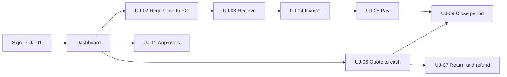

# User Journeys

Document status: Draft v0.1 (Stage 3 part 2). Proposed. Journeys start at sign-in and end at the business outcome. Screens are referenced by the IDs in [Screen Specifications](Screen-Specifications.md). Message IDs (MSG-nnn) are in [Form Validation Rules](Form-Validation-Rules.md).
Related: [Cross-Module Workflows](../05-Workflows-and-Diagrams/Cross-Module-Workflows.md), [Use Cases](../03-Product-and-System-Requirements/Use-Cases.md), [E2E Test Cases](../08-QA-and-Testing/E2E-Test-Cases.md), [UAT Test Cases](../08-QA-and-Testing/UAT-Test-Cases.md).

Every journey begins with: sign in (UJ-01), choose company if several, land on the dashboard, then use the sidebar or the Create menu.

| Journey | Name | Roles | Workflow | Use cases | Screens used |
|---|---|---|---|---|---|
| UJ-01 | First sign-in and daily start | Any new user | WF-04 | UC-001, UC-002 | SCR-005, SCR-001 |
| UJ-02 | Raise a purchase requisition and see it become a purchase order | Employee, Department Manager, Procurement Officer, Procurement Manager | WF-01 | UC-006, UC-003 | SCR-001, SCR-029, SCR-002, SCR-030 |
| UJ-03 | Receive goods in full or in part | Warehouse Staff | WF-01 | UC-007 | SCR-031, SCR-030 |
| UJ-04 | Enter a vendor invoice, match and post it | Accountant, Finance Manager | WF-01 | UC-008 | SCR-032, SCR-002 |
| UJ-05 | Pay a vendor | Accountant (prepare), Finance Manager (approve and release) | WF-01 | UC-009 | SCR-024, SCR-002, SCR-025 |
| UJ-06 | Quote to cash | Sales Executive, Warehouse Staff, Accountant | WF-02 | UC-010, UC-011 | SCR-042, SCR-043, SCR-044, SCR-045, SCR-024 |
| UJ-07 | Return, credit note and refund | Sales Executive, Warehouse Staff, Accountant, Finance Manager | WF-12 | UC-012 | SCR-046, SCR-002, SCR-024 |
| UJ-08 | Manual journal | Accountant (maker), Finance Manager (checker) | WF-03 | UC-004 | SCR-020, SCR-002 |
| UJ-09 | Close a period | Finance Manager, Accountant | WF-03 | UC-005 | SCR-019, SCR-020, SCR-026 |
| UJ-10 | Transfer and adjust stock | Warehouse Staff, Inventory Manager | WF-06 | UC-013, UC-014 | SCR-037, SCR-038, SCR-002 |
| UJ-11 | Set up a user and role | Organization Admin | WF-04 | UC-002 | SCR-007, SCR-006 |
| UJ-12 | Approver daily work and delegation | Department Manager, Finance Manager | WF-07 | UC-003, UC-016 | SCR-002, SCR-014 |
| UJ-13 | Import master data | Organization Admin or data owner | WF-03 | UC-015 | SCR-015 |
| UJ-14 | Auditor traces a figure to its source | Auditor | WF-07 | n/a (UAT scenario) | SCR-026, SCR-021, SCR-032, SCR-016 |

## UJ-01 First sign-in and daily start

| Item | Content |
|---|---|
| Roles | Any new user |
| Workflow and use cases | WF-04, UC-001, UC-002 |
| Requirements | FR-001, FR-002, FR-005, FR-006, FR-008, FR-051 |
| Related test cases | TC-0491, TC-0546, TC-0552 |

| Step | Screen | User action | System response and checks |
|---|---|---|---|
| 1. Receive invitation email | n/a (email) | Open activation link | Link valid once and within 7 days |
| 2. Set password | SCR-005 | Enter and confirm password | Policy check with reasons (MSG-007) |
| 3. Sign in | SCR-005 | Email and password | Generic error on failure, lockout after limit |
| 4. Complete MFA if required | SCR-005 | Enter code | Wrong code refused and counted |
| 5. Choose company if several | SCR-001 | Company switcher | Scope reloads |
| 6. Land on dashboard | SCR-001 | Review pending items | Widgets show only in-scope data |

Alternate and error paths: Wrong credentials, locked account, expired link, SSO failure.

Outcome: User is signed in with correct scope and sees their tasks.

## UJ-02 Raise a purchase requisition and see it become a purchase order

| Item | Content |
|---|---|
| Roles | Employee, Department Manager, Procurement Officer, Procurement Manager |
| Workflow and use cases | WF-01, UC-006, UC-003 |
| Requirements | FR-089, FR-090, FR-091, FR-092 |
| Related test cases | TC-0482, TC-0483, TC-0534, TC-0535, TC-0536, TC-0537, TC-0538, TC-0541 |

| Step | Screen | User action | System response and checks |
|---|---|---|---|
| 1. Sign in, open Create menu | SCR-001 | Choose Purchase requisition | Only permitted creates are listed |
| 2. Create PR | SCR-029 | Add lines, quantity, needed-by date, attach quote | Quantity above zero (MSG-003) |
| 3. Submit PR | SCR-029 | Submit | Document locks; approver notified |
| 4. Manager decides | SCR-002 | Approve or reject with reason | Reject needs reason (MSG-012) |
| 5. Officer converts to PO | SCR-030 | Convert approved lines, choose vendor | Vendor must be active (MSG-014) |
| 6. Approval by value | SCR-002 | Approver decides | Routes by value |
| 7. Send PO | SCR-030 | Mark sent | Status Sent |

Alternate and error paths: PR rejected and resubmitted; vendor blocked; value change restarts approval.

Outcome: Approved PO linked to its PR.

## UJ-03 Receive goods in full or in part

| Item | Content |
|---|---|
| Roles | Warehouse Staff |
| Workflow and use cases | WF-01, UC-007 |
| Requirements | FR-095, FR-096 |
| Related test cases | TC-0482, TC-0483, TC-0534, TC-0535, TC-0536, TC-0537, TC-0538, TC-0541 |

| Step | Screen | User action | System response and checks |
|---|---|---|---|
| 1. Open Goods receipts | SCR-031 | New receipt | Warehouse in scope |
| 2. Select PO | SCR-031 | Search by PO number or vendor | Only open, non-cancelled POs |
| 3. Enter received and rejected quantities | SCR-031 | Per line | Over-receipt beyond tolerance refused (MSG-015) |
| 4. Post | SCR-031 | Post receipt | Stock and PO status update in one step |
| 5. Check result | SCR-030 | View receipt progress | Open quantity shown |

Alternate and error paths: PO cancelled; partial delivery; reversal that would make stock negative.

Outcome: Stock increased, PO Partly received or Received.

## UJ-04 Enter a vendor invoice, match and post it

| Item | Content |
|---|---|
| Roles | Accountant, Finance Manager |
| Workflow and use cases | WF-01, UC-008 |
| Requirements | FR-097, FR-098, FR-099, FR-079 |
| Related test cases | TC-0482, TC-0483, TC-0534, TC-0535, TC-0536, TC-0537, TC-0538, TC-0541 |

| Step | Screen | User action | System response and checks |
|---|---|---|---|
| 1. Open Purchase invoices | SCR-032 | New invoice | Vendor active |
| 2. Enter header and lines | SCR-032 | Invoice number, date, lines linked to PO and GRN | Duplicate check on invoice number (MSG-016) |
| 3. View match panel | SCR-032 | Review variances | Quantity and price compared within tolerance |
| 4. Hold or submit | SCR-032 | Submit for approval or request credit note | Variance beyond tolerance needs approver |
| 5. Approve and post | SCR-002 | Finance Manager approves, post | Period must be open (MSG-017) |

Alternate and error paths: Duplicate invoice, no GRN yet, tax mismatch, closed period.

Outcome: Posted payable with balanced ledger entry.

## UJ-05 Pay a vendor

| Item | Content |
|---|---|
| Roles | Accountant (prepare), Finance Manager (approve and release) |
| Workflow and use cases | WF-01, UC-009 |
| Requirements | FR-073, FR-074, FR-075, FR-076 |
| Related test cases | TC-0482, TC-0483, TC-0534, TC-0535, TC-0536, TC-0537, TC-0538, TC-0541 |

| Step | Screen | User action | System response and checks |
|---|---|---|---|
| 1. Open Payments, new payment | SCR-024 | Choose vendor and bank account | Bank account active, currency matches |
| 2. Allocate to invoices | SCR-024 | Enter amounts per invoice | Allocation above open refused (MSG-018) |
| 3. Submit | SCR-024 | Submit once | Double click creates one payment (idempotency) |
| 4. Approve and release | SCR-002 | Finance Manager approves and releases | Preparer cannot approve (MSG-013) |
| 5. Check outcome | SCR-025 | View invoice status | Part-paid or Paid |

Alternate and error paths: Bank rejection; advance payment; partial payment.

Outcome: Payment released and allocated, open items updated.

## UJ-06 Quote to cash

| Item | Content |
|---|---|
| Roles | Sales Executive, Warehouse Staff, Accountant |
| Workflow and use cases | WF-02, UC-010, UC-011 |
| Requirements | FR-116, FR-117, FR-118, FR-120, FR-121, FR-073 |
| Related test cases | TC-0485, TC-0486, TC-0539, TC-0540 |

| Step | Screen | User action | System response and checks |
|---|---|---|---|
| 1. Create quotation | SCR-042 | Add lines and validity | Valid until date required |
| 2. Convert to order | SCR-043 | Convert accepted quote | Expired quote refused |
| 3. Confirm order | SCR-043 | Confirm | Credit and stock checks, reservation result shown (MSG-019) |
| 4. Deliver | SCR-044 | Post delivery full or part | Quantity within order plus tolerance |
| 5. Invoice | SCR-045 | Create from deliveries, post | Invoice quantity within delivered |
| 6. Receive payment | SCR-024 | Record receipt and allocate | Excess held as credit |

Alternate and error paths: Credit approval; stock short; cancellation; partial delivery.

Outcome: Invoice paid, stock reduced, ledger balanced.

## UJ-07 Return, credit note and refund

| Item | Content |
|---|---|
| Roles | Sales Executive, Warehouse Staff, Accountant, Finance Manager |
| Workflow and use cases | WF-12, UC-012 |
| Requirements | FR-122, FR-123, FR-078 |
| Related test cases | TC-0490, TC-0542 |

| Step | Screen | User action | System response and checks |
|---|---|---|---|
| 1. Record return | SCR-046 | Select delivery, quantities, reason | Quantity within delivered (MSG-020) |
| 2. Receive and inspect | SCR-046 | Choose disposition | Restock, scrap or vendor return |
| 3. Issue credit note | SCR-046 | Create note | Within invoiced amount (MSG-021) |
| 4. Approve | SCR-002 | Finance Manager approves | Approval recorded |
| 5. Refund if paid | SCR-024 | Create refund, approve, release | Within amount received (MSG-022) |

Alternate and error paths: Outside return window; refund fails at bank.

Outcome: Stock, receivable and cash corrected.

## UJ-08 Manual journal

| Item | Content |
|---|---|
| Roles | Accountant (maker), Finance Manager (checker) |
| Workflow and use cases | WF-03, UC-004 |
| Requirements | FR-062, FR-063, FR-064, FR-065 |
| Related test cases | TC-0487, TC-0488, TC-0492, TC-0543, TC-0544, TC-0549 |

| Step | Screen | User action | System response and checks |
|---|---|---|---|
| 1. New journal | SCR-020 | Date, narration, lines | At least two lines; balance indicator |
| 2. Submit | SCR-020 | Submit | Unbalanced refused (MSG-023) |
| 3. Checker approves | SCR-002 | Approve (not own) | Maker cannot approve (MSG-013) |
| 4. Post | SCR-020 | Post in open period | Closed period refused (MSG-017) |
| 5. Correct later | SCR-020 | Reverse | Linked reversing entry |

Alternate and error paths: Foreign currency; control account refused; reversal of a reversal.

Outcome: Immutable posted entry.

## UJ-09 Close a period

| Item | Content |
|---|---|
| Roles | Finance Manager, Accountant |
| Workflow and use cases | WF-03, UC-005 |
| Requirements | FR-058, FR-059, FR-060, FR-061 |
| Related test cases | TC-0487, TC-0488, TC-0492, TC-0543, TC-0544, TC-0549 |

| Step | Screen | User action | System response and checks |
|---|---|---|---|
| 1. Open Periods | SCR-019 | Select period, open checklist | Counts of unposted and pending items |
| 2. Resolve items | SCR-020 | Post, cancel or carry forward | Each item cleared or carried |
| 3. Run reconciliations | SCR-019 | AP, AR, stock checks | Differences listed (MSG-024) |
| 4. Close | SCR-019 | Close period | Closing refused while items remain |
| 5. Run statements | SCR-026 | Trial balance, income statement, balance sheet | Totals reconcile |

Alternate and error paths: Reopen with reason and step-up; year-end.

Outcome: Closed period and final statements.

## UJ-10 Transfer and adjust stock

| Item | Content |
|---|---|
| Roles | Warehouse Staff, Inventory Manager |
| Workflow and use cases | WF-06, UC-013, UC-014 |
| Requirements | FR-108, FR-109, FR-106 |
| Related test cases | TC-0489, TC-0545, TC-0553 |

| Step | Screen | User action | System response and checks |
|---|---|---|---|
| 1. New transfer | SCR-037 | Choose source, destination, items | Insufficient stock refused (MSG-025) |
| 2. Dispatch | SCR-037 | Dispatch | Source reduced, in transit shown |
| 3. Receive | SCR-037 | Receive full or partial | Remainder stays in transit |
| 4. Count and adjust | SCR-038 | Enter counted quantities and reason | Value impact shown before submit |
| 5. Approve above threshold | SCR-002 | Approver decides | Stock changes only after approval |

Alternate and error paths: Loss in transit; negative stock.

Outcome: Stock matches count, ledger entry posted.

## UJ-11 Set up a user and role

| Item | Content |
|---|---|
| Roles | Organization Admin |
| Workflow and use cases | WF-04, UC-002 |
| Requirements | FR-008, FR-010, FR-012, FR-017 |
| Related test cases | TC-0491, TC-0546, TC-0552 |

| Step | Screen | User action | System response and checks |
|---|---|---|---|
| 1. Create custom role if needed | SCR-007 | Select permissions from catalogue | Cannot include permissions the admin lacks |
| 2. Invite user | SCR-006 | Name, email, company | Duplicate email refused (MSG-010) |
| 3. Assign role with scope | SCR-007 | Role, branch, department, validity | SoD conflict warning or block (MSG-026) |
| 4. Verify | SCR-006 | Check effective access | User sees only assigned scope |

Alternate and error paths: Conflicting roles; temporary access ending.

Outcome: User active with correct scope.

## UJ-12 Approver daily work and delegation

| Item | Content |
|---|---|
| Roles | Department Manager, Finance Manager |
| Workflow and use cases | WF-07, UC-003, UC-016 |
| Requirements | FR-041, FR-043, FR-044, FR-045, FR-047 |
| Related test cases | TC-0484, TC-0493, TC-0547, TC-0548, TC-0550 |

| Step | Screen | User action | System response and checks |
|---|---|---|---|
| 1. Open inbox from badge | SCR-002 | Review pending list | Only in-scope items |
| 2. Open item, review history | SCR-002 | Read rounds and comments | Earlier rounds visible |
| 3. Decide | SCR-002 | Approve, reject or return with reason | Reason required for reject and return |
| 4. Delegate before leave | SCR-014 | Create delegation | Chained delegation refused (MSG-027) |

Alternate and error paths: Escalation; delegate is creator.

Outcome: Decisions recorded with history.

## UJ-13 Import master data

| Item | Content |
|---|---|
| Roles | Organization Admin or data owner |
| Workflow and use cases | WF-03, UC-015 |
| Requirements | FR-048, FR-049 |
| Related test cases | TC-0487, TC-0488, TC-0492, TC-0543, TC-0544, TC-0549 |

| Step | Screen | User action | System response and checks |
|---|---|---|---|
| 1. Open Import | SCR-015 | Choose template and download | Template per entity |
| 2. Upload and validate | SCR-015 | Validate only | Row errors listed, nothing saved |
| 3. Fix and revalidate | SCR-015 | Re-upload | Errors cleared |
| 4. Commit | SCR-015 | Choose all-or-nothing or valid rows | Result summary and audit entry |

Alternate and error paths: Wrong template, duplicate keys, scope violation.

Outcome: Records loaded and audited.

## UJ-14 Auditor traces a figure to its source

| Item | Content |
|---|---|
| Roles | Auditor |
| Workflow and use cases | WF-07, n/a (UAT scenario) |
| Requirements | FR-030, FR-031, FR-066 |
| Related test cases | TC-0484, TC-0493, TC-0547, TC-0548, TC-0550 |

| Step | Screen | User action | System response and checks |
|---|---|---|---|
| 1. Open Trial balance | SCR-026 | Run for period | Read-only |
| 2. Drill to account | SCR-021 | Open account lines | Each line links to source |
| 3. Open source document | SCR-032 | View document and approval history | History of rounds |
| 4. Open audit log | SCR-016 | Filter by document | Who, when, before and after; search itself is audited |

Alternate and error paths: Out-of-scope company not visible.

Outcome: Figure traced end to end without changing anything.

## Journey diagram (core commercial flows)

## Coverage

Journeys: 14. Process flows covered: WF-01, WF-02, WF-03, WF-04 (user setup), WF-06, WF-07, WF-12. Not covered: outline workflows (WF-05, 08, 09, 10, 11, 13, 14). Journeys are proposals until validated with users (UX research is not done).
