# CI/CD Strategy

Document status: Draft v0.1 (Stage 3 part 2). Proposed. **Tool-neutral.** No pipeline product or hosting is chosen (OQ-016, OQ-024).
Related: [Deployment Architecture](../04-System-Architecture/Deployment-Architecture.md), [Development Guidelines](Development-Guidelines.md), [Test Strategy](../08-QA-and-Testing/Test-Strategy.md), [Security Test Plan](../08-QA-and-Testing/Security-Test-Plan.md), [Release Management](Release-Management.md), [Environment Setup](../10-Deployment-and-Operations/Environment-Setup.md).

## 1. Goals

1. Every change is built, tested and scanned automatically.
2. One artifact is built once and promoted through environments (TR-017).
3. Releases are repeatable, auditable and reversible.
4. Security and quality gates cannot be bypassed.

## 2. Pipeline stages

```mermaid
flowchart LR
    A["Commit or pull request"] --> B["Build and compile"]
    B --> C["Lint, format, dependency rules"]
    C --> D["Unit tests and coverage"]
    D --> E["Static analysis and secret scan"]
    E --> F["Dependency and licence scan"]
    F --> G["Build container image and SBOM"]
    G --> H["Image scan"]
    H --> I["Deploy to Dev"]
    I --> J["Integration and API tests"]
    J --> K["Deploy to Test"]
    K --> L["E2E smoke and regression"]
    L --> M["Promote to Staging on release candidate"]
    M --> N["Full regression, performance, security scans"]
    N --> O{"Release gates"}
    O -- "Pass and approved" --> P["Deploy to Production, rolling"]
    P --> Q["Smoke tests and monitoring"]
    O -- "Fail" --> R["Stop, report, fix"]
```

## 3. Quality gates

| Gate | Stage | Rule |
|---|---|---|
| Build and format | Pull request | Must build. Formatter and linter clean |
| Dependency rules | Pull request | No cross-module violations (NFR-035) |
| Unit tests | Pull request | All pass. Coverage not below targets for critical modules |
| Static analysis | Pull request | No new high findings |
| Secret scan | Pull request | No secrets (SEC-038). Fails the build |
| Dependency scan | Pull request and nightly | No known Critical vulnerability (SEC-049). SBOM produced |
| Image scan | Build | No known Critical vulnerability. Approved base image |
| Integration and API | Dev, Test | Pass. Includes permission matrix and error code tests |
| Smoke | After each deployment | The 13-case smoke suite passes ([Regression Test Plan](../08-QA-and-Testing/Regression-Test-Plan.md)) |
| Regression | Nightly and on release candidate | Core suite on merge to main and nightly, full on candidate |
| Security and performance | Staging | As the plans. Penetration test report reviewed |
| Approval | Before production | Release readiness review and approver (Release Management) |

Numbers in this table are targets. Sizes of suites come from the Regression Test Plan and will change.

## 4. Branching and triggers

| Trigger | Action |
|---|---|
| Pull request | Build, lint, unit, static analysis, scans, preview deployment if available |
| Merge to main | Pipeline to Dev and Test, core regression |
| Nightly | Full dependency scan, API regression, migrations check on sized data |
| Release candidate tag | Build release artifact, deploy to Staging, full suites |
| Production approval | Deploy promoted artifact |
| Hotfix | Fast path: fix branch from the release tag, reduced suite (smoke, module core, defect regression), approval by incident commander |

## 5. Artifacts and provenance

Container images tagged by version and build id, stored in a private registry, scanned, with SBOM and build provenance (SEC-050). The artifact deployed to production is the same bytes tested in Staging. Retention of artifacts follows the release records policy.

## 6. Database migrations in the pipeline

Migrations are applied by the pipeline, before the application rollout in expand steps and after in contract steps. Each migration is rehearsed on Staging with sized data. A migration that exceeds a time or lock limit fails the rehearsal. Posted data is never altered by migrations (Development Guidelines section 7).

## 7. Deployment strategy

Rolling deployment behind the load balancer, workers drained before replacement, health checks gate each step, automatic rollback to the previous image if health checks fail. Feature flags separate deployment from release. Blue-green is considered if rolling proves insufficient. Production deployment windows are defined in the Deployment Plan.

## 8. Environment promotion and configuration

Same image through all environments. Configuration and secrets injected per environment from versioned configuration and the secret store. Infrastructure is code, reviewed through the same pipeline (NFR-038).

## 9. Test data and stubs in pipeline

Baseline data sets are created by scripts for each run. Partner stubs run as containers. Time control is injected. See [Test Data Management](../08-QA-and-Testing/Test-Data-Management.md).

## 10. Reporting

Pipeline dashboard with build status, test results by suite, coverage, scan findings, deployment history, lead time and change failure rate. Failures notify the author and the channel for the owning module. Flaky tests are tracked and quarantined (Regression Test Plan section 5).

## 11. Security of the pipeline

Least-privilege service accounts, secrets only from the secret store, protected branches, required reviews, signed commits optional, no deployment from developer machines, audit log of pipeline actions, isolated build runners.

## 12. Open points

Tool choice (OQ-024), hosting of runners (OQ-016), required approvals and windows (OQ-028), artifact retention (OQ-022).
