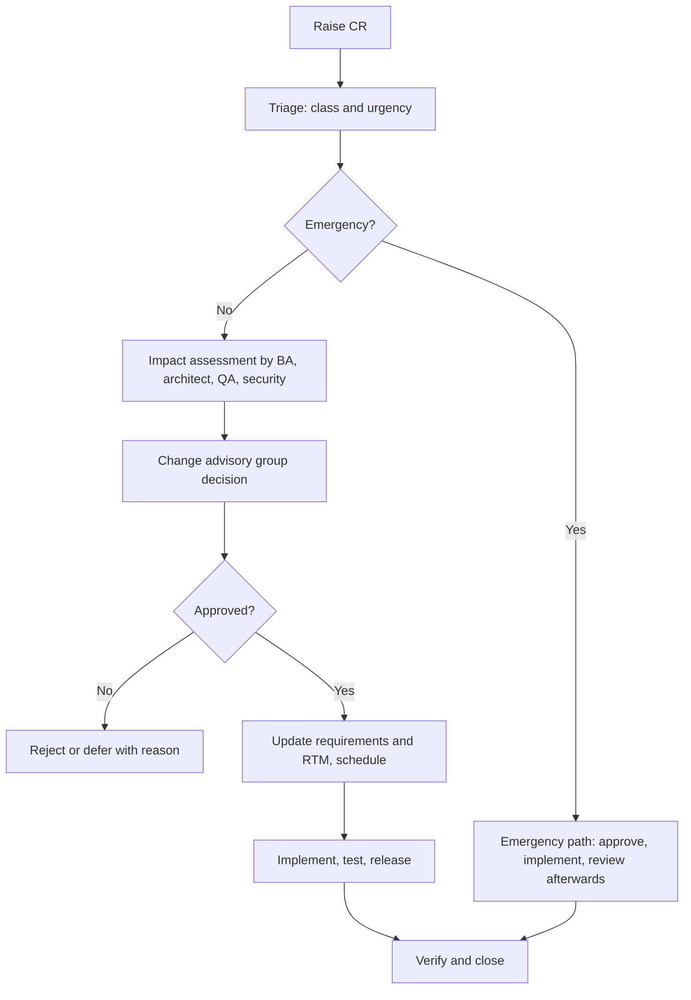

# Change Management

Document status: Draft v0.1 (Stage 3 part 2). Proposed. Names, committee members and thresholds are TBD (OQ-001).
Related: [Gap Analysis](../02-Business-Analysis/Gap-Analysis.md) (scope creep watch), [Project Scope](../00-Project-Management/Project-Scope.md), [RACI Matrix](../00-Project-Management/RACI-Matrix.md), [Release Management](Release-Management.md).

## 1. Purpose

Control changes to scope, requirements, architecture, configuration, production systems and documents so that each change is assessed, approved, traceable and tested.

## 2. Types of change

| Class | Examples | Approver |
|---|---|---|
| Scope change | Moving a module into the MVP, adding a module | Sponsor |
| Requirement change | Changing a BR, BRL, FR, NFR or priority | Product owner with the requirement owner. Sponsor if cost, date or MVP scope changes |
| Architecture change | Changing an ADR or technology | Architect and sponsor delegate |
| Production change (standard) | Pre-approved low-risk change with a runbook, for example adding a user, rotating a certificate | Pre-approved, logged |
| Production change (normal) | Release, configuration change, infrastructure change | Change advisory group |
| Emergency change | Fix for a Critical incident | Incident commander and one approver, reviewed after |
| Document change | Edits to controlled documents | Document owner, see section 8 |
| Business configuration change | Approval limits, tolerances, tax rates, numbering | Owner of the policy (for example Finance Manager), audited in the system (AUD-021, AUD-022) |

## 3. Change request (CR) fields

| Field | Content |
|---|---|
| CR ID | CR-0001 sequential |
| Title, requester, date | |
| Description and reason | Business justification |
| Type and class | From section 2 |
| Affected items | Requirement, story, module, API, data, test, document IDs |
| Impact assessment | Scope, schedule, cost, risk, security, data, performance, test effort, documentation, users |
| Alternatives | Including "do nothing" |
| Priority and urgency | |
| Decision | Approved, rejected, deferred, more information |
| Approver and date | |
| Implementation plan | Stories, owners, release |
| Verification | Test cases and acceptance |
| Status | Raised, Assessed, Approved, Scheduled, In progress, Implemented, Verified, Closed, Rejected, Deferred |

## 4. Process

## 5. Impact assessment checklist

| Question | Where to look |
|---|---|
| Which requirements, stories, rules and tests change? | RTM |
| Does it change data model, API, permissions, audit events? | Database Design, API Documentation, RBAC Matrix, Audit Trail |
| Does it change a trust boundary or add personal data? | Threat Model, Data Protection |
| Does it change approval or SoD behaviour? | RBAC Matrix section 5, Business Rules |
| Does it affect posted financial data or reports? | Finance requirements, invariants INV-01 to INV-15 |
| Does it affect open decisions? | Open Questions |
| Effect on MVP scope and release gates | MVP Strategy |

## 6. Change advisory group (proposed)

Members: product owner (chair), business analyst, architect, QA lead, security officer, IT manager, release manager, finance representative for finance changes. Quorum and meeting cadence TBD. Decisions are recorded in the CR log.

## 7. Scope control

1. The MVP list is fixed at 58 modules (MVP Strategy). Adding a module to the MVP needs a CR approved by the sponsor with a stated trade-off (what leaves or what slips).
2. Requests for P1 or P2 modules go to the roadmap backlog, not the sprint.
3. Mid-sprint changes are not accepted except emergencies. They enter the next sprint through refinement.
4. Cumulative scope change is reported to the sponsor each month.

## 8. Controlled documents

All documents in this package are controlled. A change to a document: edit, update the status line and change log in [Documentation Progress](../00-Project-Management/Documentation-Progress.md), rerun the audit script (see Final Audit) and keep IDs stable. IDs are never reused. Retired items are marked, not deleted.

## 9. Production change rules

Changes go through the pipeline, never by hand on production. Windows and freeze periods are defined in the [Deployment Plan](../10-Deployment-and-Operations/Deployment-Plan.md). Every production change has a rollback plan and a named implementer and approver. Failed changes are reviewed.

## 10. Metrics

Number of CRs by class, approval rate, average turnaround, emergency changes per month, changes that caused incidents. Reported only from the CR log.

## 11. Open points

Group membership and cadence, sponsor delegation, thresholds for sponsor approval (OQ-001, OQ-014).
