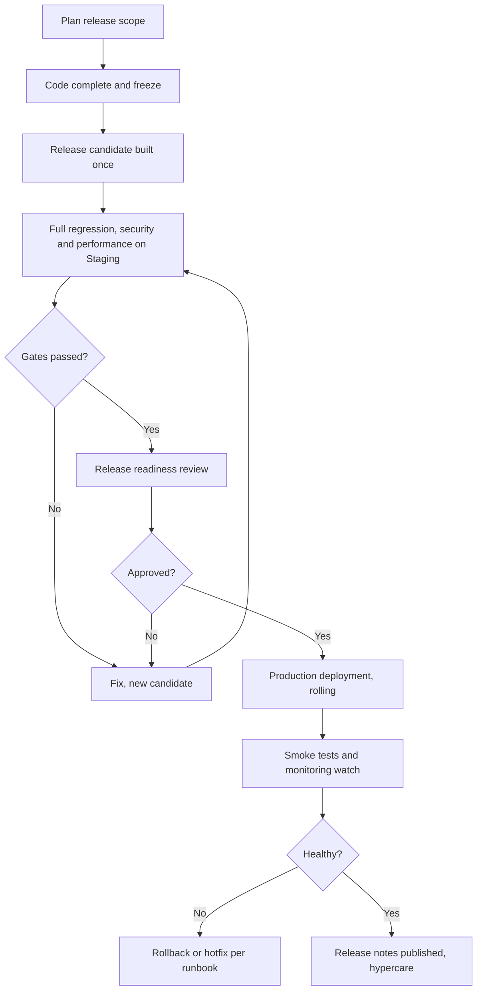

# Release Management

Document status: Draft v0.1 (Stage 3 part 2). Proposed. No release dates exist (OQ-014).
Related: [MVP Strategy](../00-Project-Management/MVP-Strategy.md) (gates G1 to G9), [Project Roadmap](../00-Project-Management/Project-Roadmap.md), [CI/CD Strategy](CICD-Strategy.md), [Change Management](Change-Management.md), [Deployment Plan](../10-Deployment-and-Operations/Deployment-Plan.md).

## 1. Release types

| Type | Content | Cadence (proposed) | Approval |
|---|---|---|---|
| Major release | New module set (MVP, R2, R3, R4) | By roadmap | Sponsor |
| Minor release | New features within released modules | Every few sprints, TBD | Product owner and QA lead |
| Patch release | Defect fixes, no new features | As needed | QA lead and release manager |
| Hotfix | Urgent fix for Critical or High production defect | Immediately | Incident commander, QA lead, sponsor informed |
| Configuration release | Settings and data only | As needed | Owner of the setting through change management |

## 2. Versioning

Semantic version: MAJOR.MINOR.PATCH. The API version (`/api/v1`) changes only for breaking API changes (TR-013). Database migrations are numbered and tied to the release. Every release has a tag, build id, release notes and a list of included stories and defects.

## 3. Release gates for the MVP

| Gate | Criterion | Evidence |
|---|---|---|
| G1 | All P0 business requirements for MVP modules have passing tests | RTM with results (today all Not Run) |
| G2 | No open Critical or High defects. Medium defects have a plan | Defect report |
| G3 | Data isolation tests pass for company, branch and role scope | Isolation matrix results |
| G4 | Security test plan executed, no open High findings | Security report, penetration test |
| G5 | Financial integrity checks pass (INV-01 to INV-15) | Cross-module results |
| G6 | Performance targets met (targets TBD) | Performance report |
| G7 | Backup restore rehearsed, RPO and RTO met | Restore report |
| G8 | UAT signed by business owners | UAT sign-off |
| G9 | Data migration rehearsal reconciles (if in scope) | Reconciliation report |

For later releases the same gates apply, scoped to the changed areas plus the full regression.

## 4. Release process

## 5. Release readiness review

Attendees: product owner, QA lead, architect, IT manager, security officer, release manager, sponsor delegate. Agenda: gate evidence, open defects and waivers, migration plan and rollback, communication, support readiness, risks. Decision recorded: Go, Go with conditions, No-go.

## 6. Freeze and branching

Code freeze at release candidate. Only release-blocking fixes enter the candidate after freeze, each reviewed and re-tested. Feature flags keep unfinished work disabled.

## 7. Rollback and recovery

| Scenario | Action |
|---|---|
| Faulty application release without data change | Redeploy previous image. Tested in staging |
| Release with backward-compatible migration | Roll application back. Leave expanded schema in place |
| Release with destructive or data-changing migration | Avoided by design. If unavoidable, a restore point is taken and the rollback decision is made with the sponsor |
| Business data created after go-live on a faulty release | Corrective records by support. No deletion of posted data |

## 8. Communication

Release notes (users): new, changed, fixed, known issues, configuration changes, training notes. Technical notes (operations): migrations, flags, new alerts, runbook changes. Notices in advance for downtime windows and breaking API changes (at least the notice period in the SLA, TBD).

## 9. Hypercare

After the MVP go-live, a hypercare period (length TBD) with daily defect triage, extended monitoring, a dedicated support rota and a daily reconciliation check (AP, AR, stock to ledger). Exit criteria agreed with the sponsor.

## 10. Release records

Release notes, gate evidence, test summary, approvals, deployment log, post-release review. Kept with the release tag. Metrics: lead time, change failure rate, time to restore, defects escaped to production.

## 11. Open points

Release cadence and windows (OQ-014, OQ-028), notice periods and support hours (SLA), hypercare length.
