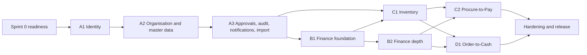

# Sprint Plan (MVP)

Document status: Draft v0.1 (Stage 3 part 2). Proposed. **There are no dates, no velocity, no team size and no effort estimates** (OQ-014), so sprints are ordered work slices. Sprint length is assumed to be two weeks and is not confirmed. Estimating is done by the delivery team at planning, using the Definition of Ready.
Related: [MVP Strategy](../00-Project-Management/MVP-Strategy.md) (milestones A to D), [Module Dependencies](../01-ERP-Module-Analysis/Module-Dependencies.md), [User Stories](../03-Product-and-System-Requirements/User-Stories.md), [Definition of Ready](Definition-of-Ready.md), [Definition of Done](Definition-of-Done.md), [Release Management](Release-Management.md).

## 1. Planning rules

1. Build in dependency order: platform, then finance core, then inventory and procurement, then sales (Module Dependencies).
2. Each slice delivers something demonstrable end to end for its scope, with tests.
3. Stories must meet the Definition of Ready before entering a sprint.
4. Cross-cutting work (audit, authorisation, approval engine, numbering, idempotency, outbox) is built first in MVP-A because every later slice depends on it.
5. Hardening, performance and security work runs in the last slices and as a standing share of each sprint (suggested 20 percent, to confirm).
6. Slices are not sprints. A slice may take several sprints. The team sizes them.

## 2. Sprint 0 (readiness, before slice A1)

| Item | Detail |
|---|---|
| Decisions needed | OQ-005, OQ-015, OQ-016, OQ-019, OQ-024 (tenancy, volumes, hosting, stack), OQ-031 (numbering) |
| Environments | Dev and Test from code ([Environment Setup](../10-Deployment-and-Operations/Environment-Setup.md)) |
| Pipeline | Build, test, scan ([CI/CD Strategy](CICD-Strategy.md)) |
| Skeleton | Module boundaries, dependency rules, policy component, audit writer, outbox, error and logging conventions |
| Test readiness | Baseline data sets and stubs ([Test Data Management](../08-QA-and-Testing/Test-Data-Management.md)) |
| Design | UI shell and navigation, design system start (OQ-027) |

## 3. Work slices (counts measured by script)

"Functional TCs" counts written test cases (functional, security, integration, E2E, excluding API, performance and UAT) linked to the slice through its FRs. A case can serve several slices, so column sums exceed the totals.

| Slice | Milestone | Content | Stories | P0 stories | FRs | Functional TCs | Story range |
|---|---|---|---|---|---|---|---|
| A1 | MVP-A | Identity and access | 11 | 8 | 19 | 72 | US-001..US-011 |
| A2 | MVP-A | Organisation and master data | 7 | 5 | 12 | 24 | US-012..US-018 |
| A3 | MVP-A | Approvals, audit, notifications, import and export, retention, integration queue, concurrency | 17 | 12 | 27 | 68 | US-019..US-031 and US-077..US-080 |
| B1 | MVP-B | Finance foundation: accounts, periods, journals, ledger, close | 8 | 8 | 15 | 38 | US-032..US-039 |
| B2 | MVP-B | Finance depth: currency, tax, bank, payments, statements, open items | 8 | 8 | 18 | 42 | US-040..US-047 |
| C1 | MVP-C | Inventory: items, warehouses, stock ledger, transfers, adjustments, valuation | 9 | 8 | 12 | 30 | US-059..US-067 |
| C2 | MVP-C | Procure-to-Pay: vendors, PR, PO, GRN, invoice, duplicate and match | 11 | 10 | 15 | 32 | US-048..US-058 |
| D1 | MVP-D | Order-to-Cash: customers, quotes, orders, reservation, delivery, invoice, returns, credit notes | 9 | 8 | 12 | 26 | US-068..US-076 |

Stories assigned to a slice: 80 of 80. FRs reached by the slices: 130 of 130.
Stories not assigned: none.

## 4. Order and dependencies

| Slice | Needs first | Why |
|---|---|---|
| A1 | Sprint 0 | Authentication and roles gate everything |
| A2 | A1 | Company and branch scope are in every query |
| A3 | A2 | Approval engine, audit and numbering are used by all documents |
| B1 | A3 | Journals use approvals, numbering, audit, periods |
| B2 | B1 | Payments and tax post through the posting engine |
| C1 | A3 and B1 | Valuation posts to the ledger. Item categories hold accounts |
| C2 | C1 and B2 | GRN writes stock. Invoices and payments need AP and the payment engine |
| D1 | C1 and B2 | Delivery issues stock. Invoices and receipts need AR and the payment engine |
| Hardening | C2 and D1 | Full regression, performance, security tests, UAT, migration rehearsal |

## 5. Hardening and release slice

| Content | Reference |
|---|---|
| Full regression | [Regression Test Plan](../08-QA-and-Testing/Regression-Test-Plan.md) |
| Performance and resilience | [Performance Test Plan](../08-QA-and-Testing/Performance-Test-Plan.md) |
| Security tests and penetration test | [Security Test Plan](../08-QA-and-Testing/Security-Test-Plan.md) |
| Data migration rehearsals | [Data Migration Strategy](../04-System-Architecture/Data-Migration-Strategy.md) |
| UAT | [UAT Test Cases](../08-QA-and-Testing/UAT-Test-Cases.md) |
| Release gates G1 to G9 | MVP Strategy section 6 |

## 6. Backlog beyond the MVP

R2 to R4 modules follow the roadmap. Their stories are not written. No sprint plan exists for them.

## 7. Risks to the plan

| Risk | Handling |
|---|---|
| No capacity or dates (R-017) | Plan by slice, size after Sprint 0, define a smaller fallback cut |
| Open architecture questions (PG-11) | Resolve in Sprint 0 |
| Platform slice larger than it looks (approval engine, policy component) | Build thin vertical versions first, harden later |
| Late discovery of rule changes | Rules are Proposed (PG-03). Review with owners before each slice |
