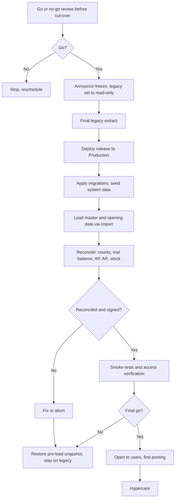

# Deployment Plan (MVP production go-live)

Document status: Draft v0.1 (Stage 3 part 2). Proposed. **No dates or windows exist** (OQ-014, OQ-028). This is a plan of steps, roles and decision points.
Related: [Release Management](../09-Development-and-Delivery/Release-Management.md), [CI/CD Strategy](../09-Development-and-Delivery/CICD-Strategy.md), [Data Migration Strategy](../04-System-Architecture/Data-Migration-Strategy.md), [Backup and Recovery](Backup-and-Recovery.md), [Environment Setup](Environment-Setup.md), [UAT Signoff](../08-QA-and-Testing/UAT-Signoff.md).

## 1. Pre-conditions for go-live

| # | Condition | Evidence |
|---|---|---|
| 1 | Release gates G1 to G9 passed or exceptions signed | Gate report |
| 2 | UAT signed | UAT Signoff |
| 3 | Production environment built and verified | Environment readiness checklist |
| 4 | Monitoring, alerting and on-call in place | Monitoring checklist |
| 5 | Backup running and a restore tested | Restore report |
| 6 | Support model and runbooks ready, staff trained | SLA and Support |
| 7 | Migration rehearsed at least twice with reconciliation passed | Reconciliation reports |
| 8 | Users and roles prepared and approved by owners (SoD checked) | RBAC review |
| 9 | Communication sent to users | Notice |
| 10 | Rollback decision rules agreed | Section 6 |

## 2. Roles

| Role | Responsibility |
|---|---|
| Deployment lead (release manager) | Runs the plan and the checklist |
| Sponsor delegate | Go and no-go decisions |
| Application and database engineers | Deploy, migrate, verify |
| Migration lead | Load, reconcile |
| Finance, procurement, warehouse, sales owners | Business verification and sign-off of balances |
| QA lead | Smoke and verification tests |
| Security officer | Access and configuration review |
| Support lead | Readiness and hypercare start |

## 3. Cut-over sequence

Rollback is possible only until the first live posting. After it, issues are corrected by corrective documents and fixes (Data Migration Strategy section 7).

## 4. Task checklist (to be dated)

| # | Task | Owner | Duration (TBD) | Verification |
|---|---|---|---|---|
| 1 | Freeze legacy, final extract | Legacy owner | | Row counts and checksums |
| 2 | Pre-deployment backup or snapshot of target | Operations | | Backup id |
| 3 | Deploy artifact | Deployment lead | | Version endpoint and health |
| 4 | Migrations and seed | Engineers | | Migration log |
| 5 | Create tenant, companies, branches, roles | Admin | | Checklist |
| 6 | Configure numbering, settings, chains, templates | Finance and admin | | Review |
| 7 | Load master data | Migration lead | | Validate-only then commit, error report empty |
| 8 | Load opening balances, open items, stock | Migration lead | | Reconciliation |
| 9 | Reconcile and sign | Finance Manager | | Signed report |
| 10 | Smoke suite and role-based access checks | QA | | Results |
| 11 | Connect partners, send test notification, test payment file in sandbox | IT | | Evidence |
| 12 | Final go or no-go | Sponsor delegate | | Decision |
| 13 | Open to users, monitor | Support | | Dashboards |

## 5. Verification after deployment

Health checks green, smoke suite passes, a test posting in each of P2P, O2C and journal flows by named testers using test documents that are then reversed or cancelled per plan, trial balance balances, audit records present, alerts quiet, performance within baseline.

## 6. Rollback criteria (before first live posting)

| Trigger | Action |
|---|---|
| Reconciliation fails and cannot be fixed in the window | Abort, restore, stay on legacy |
| Smoke suite fails | Fix forward if small, else abort |
| Critical defect in a P0 flow | Abort |
| Security configuration failure | Abort until fixed |

After first live posting: no rollback of data. Use hotfix or corrective documents (Release Management section 7).

## 7. Post-go-live

Hypercare (Release Management section 9), daily reconciliation, defect triage, first period close support, post-implementation review within an agreed period (TBD).

## 8. Communication plan

Users: notice with date, access instructions, training, support contacts. Management: status at each decision point. Partners (banks, gateways): readiness confirmation. Auditors: notified of the legacy read-only date.

## 9. Open points

Dates, windows, duration of tasks (OQ-014), migration scope and sources (OQ-012, OQ-030), partner readiness (OQ-017), hypercare length.
