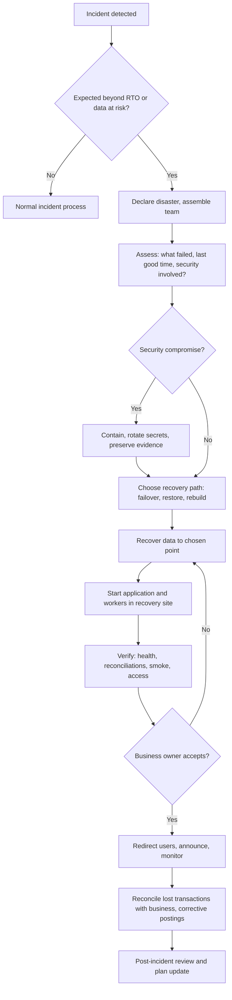

# Disaster Recovery Plan

Document status: Draft v0.1 (Stage 3 part 2). Proposed. The DR level, RPO and RTO are **not agreed** (OQ-028). The structure below shows the plan once they are.
Related: [Backup and Recovery](Backup-and-Recovery.md), [Deployment Architecture](../04-System-Architecture/Deployment-Architecture.md), [Infrastructure Architecture](../04-System-Architecture/Infrastructure-Architecture.md), NFR-007, NFR-009, NFR-010.

## 1. Objectives (proposed)

| Measure | Proposed | Source |
|---|---|---|
| RPO (maximum data loss) | 15 minutes | NFR-009 |
| RTO (maximum time to restore service) | 4 hours | NFR-010 |
| Availability target | 99.5 percent monthly | NFR-007 |

## 2. DR levels (to decide)

| Level | Description | Typical RTO | Cost | Fit |
|---|---|---|---|---|
| Cold | Backups and infrastructure code in another region. Rebuild on demand | Many hours to a day | Low | Only if the sponsor accepts a long RTO |
| Warm | Database replica running in another region. Application scaled down, scaled up in a disaster | A few hours | Medium | Fits the proposed 4 hours |
| Hot | Active-active or fully running standby | Minutes | High | Only if the business needs it |

Recommendation for review: warm standby, to be confirmed against OQ-028 and cost.

## 3. Disaster scenarios

| ID | Scenario | Impact | Response |
|---|---|---|---|
| DR-S1 | Single instance or zone failure | Brief capacity loss | Automatic: load balancer and failover. No DR declaration |
| DR-S2 | Primary database failure | Posting stops | Fail over to standby, verify, resume |
| DR-S3 | Region or provider outage | Service down | Declare disaster, promote DR database, start application in DR, redirect traffic |
| DR-S4 | Data corruption or malicious change | Wrong data | Isolate, point-in-time restore to side environment, corrective documents |
| DR-S5 | Ransomware or key compromise | Data and secrets at risk | Isolate, rotate secrets, restore from immutable backup, forensics, notify per law |
| DR-S6 | Pipeline or registry compromise | Untrusted artifacts | Freeze deployments, rebuild from verified source, rescan |
| DR-S7 | Loss of key personnel or access to the control plane | Cannot operate | Break-glass accounts, documented runbooks, backup staff |
| DR-S8 | Partner outage (bank, mail, gateway) | Features degraded | Not a disaster. Degraded mode and queue (NFR-008) |

## 4. Declaration and command

| Role | Responsibility |
|---|---|
| Incident commander | Declares a disaster after consulting the sponsor delegate |
| Technical lead | Directs recovery steps |
| Communications lead | Informs users, management, partners, regulators if needed |
| Business owner (Finance Manager) | Confirms data integrity and business priorities |
| Security officer | Leads containment for security disasters |

Declaration criteria: expected outage beyond the RTO, or data loss beyond the RPO, or security compromise of production.

## 5. Recovery flow

## 6. Recovery steps (outline for DR-S3)

1. Confirm primary unavailable. Stop writes to the primary if reachable.
2. Promote the DR database. Record the last applied time to measure data loss.
3. Start application and workers from the registry in the DR site using the same images.
4. Point secrets, keys and configuration to the DR copies.
5. Run health checks and the smoke suite. Run reconciliations (AP, AR, stock to ledger, trial balance).
6. Switch DNS or load balancer to the DR site.
7. Notify users. Warn them of any lost transactions beyond the last applied time.
8. Business reviews documents entered in the last minutes before the failure and re-enters them.
9. Plan return to primary (failback) with a controlled window and a fresh backup.

## 7. Communication

Pre-agreed message templates for users, management, partners and regulators. Contact lists kept offline and reviewed quarterly. Status page or alternate channel independent of the main system.

## 8. Testing the plan

| Test | Frequency | Content |
|---|---|---|
| Tabletop | Twice a year | Scenarios DR-S2 to DR-S5 with all roles |
| Component failover | Quarterly | Database failover, instance loss |
| Full DR exercise | Annually and before go-live | Fail over to DR, run business verification, measure RPO and RTO, fail back |

Results and lessons are recorded and the plan is updated. No DR test has been run.

## 9. Dependencies and gaps

| ID | Item |
|---|---|
| OPS-GAP-01 | Runbooks RB-01 to RB-06 and DR runbooks are not written |
| OPS-GAP-02 | DR level, RPO and RTO not agreed (OQ-028) |
| OPS-GAP-03 | Region and provider choices not made (OQ-016, OQ-010). Data residency may limit DR regions |
| OPS-GAP-04 | Tenant-level DR for dedicated tenants depends on OQ-019 |
