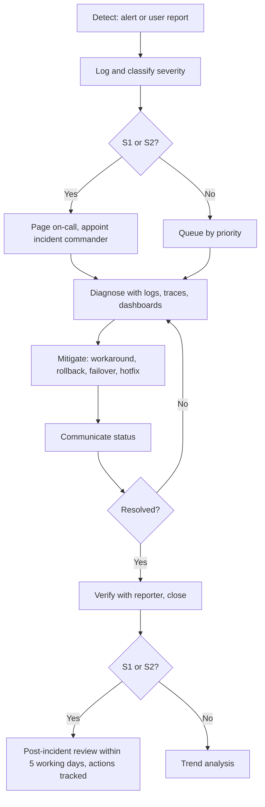

# SLA and Support

Document status: Draft v0.1 (Stage 3 part 2). Proposed. **No service level has been agreed** (OQ-028). Every number is a starting proposal for negotiation. Support hours, languages and staffing are TBD (OQ-014).
Related: NFR-007 to NFR-010, [Monitoring and Logging](Monitoring-and-Logging.md), [Maintenance SOP](Maintenance-SOP.md), [Change Management](../09-Development-and-Delivery/Change-Management.md), Business Glossary (SLA).

## 1. Service description

The ERP web application and API for the MVP modules, with scheduled background jobs and supported integrations, used by named users of the customer organisation. Out of scope: customer's own network, devices, third-party services (banks, mail), custom code outside the product, training beyond the agreed onboarding.

## 2. Service level objectives (proposed)

| Measure | Proposed target | Measured by | Linked |
|---|---|---|---|
| Availability (monthly) | 99.5 percent during the service window, excluding planned maintenance | Synthetic probe (MON-001) | NFR-007 |
| Service window | 24 by 7 with planned maintenance windows outside business hours (TBD) | | |
| Planned maintenance | At most 4 hours per month, notified at least 5 working days ahead | | |
| Interactive response p95 | Reads under 2 s, saves under 3 s | MON-003, MON-004 | NFR-001 |
| RPO | 15 minutes | Restore tests | NFR-009 |
| RTO | 4 hours | DR tests | NFR-010 |
| Backup success | 100 percent of scheduled backups, tested quarterly | MON-022, MON-023 | NFR-011 |

Service credits, penalties and exclusions are commercial terms outside this document.

## 3. Incident severity and response (proposed)

| Severity | Definition | Examples | Response target | Update every | Resolution target |
|---|---|---|---|---|---|
| S1 Critical | Service down, data corruption, security breach, posting impossible for most users | Database failure, cross-tenant exposure, ledger imbalance | 15 minutes, 24 by 7 | 30 minutes | Restore or workaround in 4 hours |
| S2 High | Major function unavailable, no workaround, or a group of users blocked | Payments cannot be released, period close fails | 1 hour in service hours | 2 hours | 1 working day |
| S3 Medium | Function impaired, workaround exists | Report wrong filter, slow list | 4 working hours | Daily | 5 working days or next patch |
| S4 Low | Cosmetic, question, minor request | Label typo, how-to | 1 working day | As needed | Next release |

Severity definitions align with the defect severities in the Test Strategy. The incident commander may raise severity.

## 4. Support model

| Tier | Role | Scope |
|---|---|---|
| Tier 0 | Self-service | Knowledge base (R4), in-app help, user guides |
| Tier 1 | Service desk | Logging, triage, access issues, how-to, known issues |
| Tier 2 | Application support | Data and configuration issues, reconciliations, approvals problems, reports |
| Tier 3 | Engineering | Defects, performance, infrastructure, security |
| Vendor or partner support | Third parties | Provider incidents (mail, bank, cloud) |

Contact channels, hours and languages: TBD. Customers' key users act as first point of contact for their organisation.

## 5. Incident management process

Roles: incident commander (leads), technical lead, communications lead, scribe. Security incidents follow the security incident procedure (SEC-048) and may involve legal notification duties (jurisdiction TBD).

## 6. Escalation

| Condition | Escalate to |
|---|---|
| Response target missed | Support manager |
| S1 not mitigated in 1 hour | Engineering lead and IT manager |
| S1 not mitigated in 4 hours | Sponsor delegate, DR declaration considered |
| Suspected breach | Security officer and legal contact immediately |
| Data integrity issue in ledger | Finance Manager and Auditor informed |

## 7. Problem, change and request management

Repeating incidents lead to problem records with root cause and a permanent fix, tracked to the backlog. Changes follow [Change Management](../09-Development-and-Delivery/Change-Management.md). Service requests (new user, role change, report request) follow standard changes where pre-approved. Role changes respect the SoD rules and are audited.

## 8. Reporting

Monthly service report: availability, incidents by severity with response and resolution times, backup and restore results, change counts and failures, capacity trends, security events summary, open problems. Produced from monitoring and ticket data only.

## 9. Customer responsibilities

Maintain user list and approvals of access, report incidents through the agreed channels, provide key users for triage, own business configuration decisions (limits, chains, tax), test releases in UAT, keep their own devices and network secure.

## 10. Support readiness checklist (before go-live)

| Item | Done when |
|---|---|
| Support staff trained on the system and runbooks | Training log |
| Ticketing, on-call and escalation lists live | Test call made |
| Knowledge base entries for top 20 questions | Reviewed |
| Access to production for support defined and approved | Access list |
| Reporting template agreed | Sample report |

## 11. Open points

OQ-028 (availability, RPO, RTO, support hours), OQ-014 (staffing), OQ-011 (support languages), OQ-005 (single customer or SaaS, affects commercial model).
