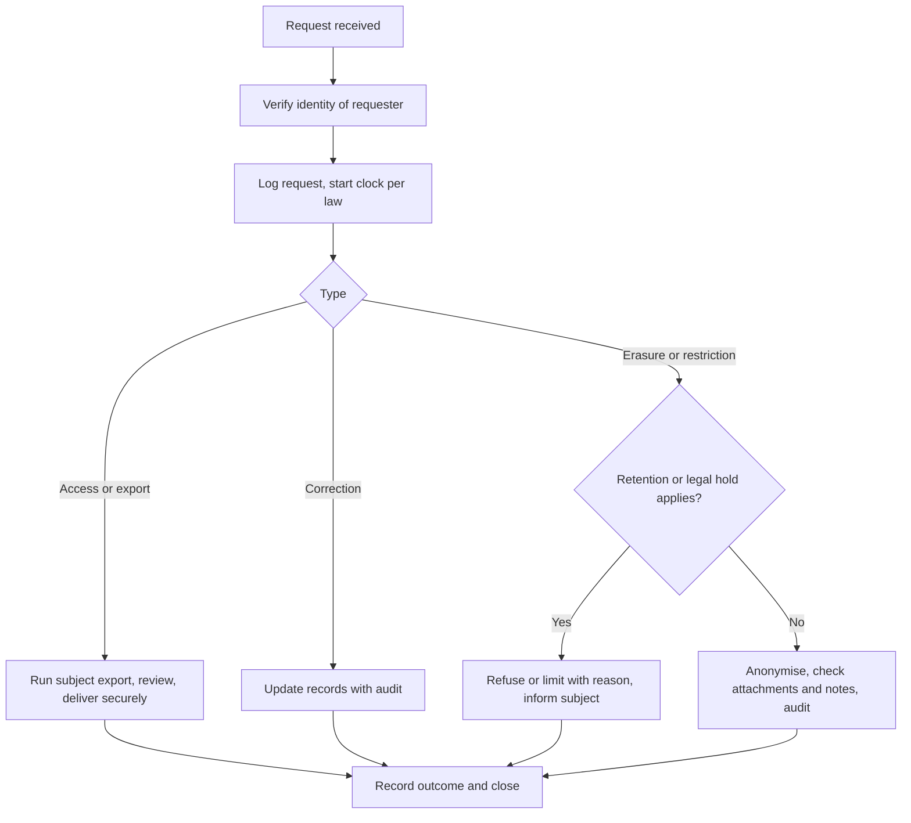

# Privacy Requirements

Document status: Draft v0.1 (Stage 3 part 2). Proposed. **No privacy law is named** (OQ-010). Rights and duties below are generic capabilities. A privacy or legal specialist must confirm what applies. Not legal advice.
Related: [Data Protection](../06-RBAC-and-Security/Data-Protection.md), [Data Retention Policy](Data-Retention-Policy.md), [Compliance Requirements](Compliance-Requirements.md), BR-059, FR-127, FR-129, NFR-039, SEC-037, SEC-039.

## 1. Personal data in the ERP

| Data subject | Data | Where | Class |
|---|---|---|---|
| Employees | Name, job, manager, branch, contact. Later: national id, pay, bank, leave (R2) | employee, user_account, HR modules | Internal to Restricted |
| System users | Name, email, sign-in history, IP address | user_account, session, audit_log | Restricted |
| Customer contacts | Name, email, phone, address | customer, customer_contact, documents | Confidential |
| Vendor contacts and sole traders | Name, contact, tax id, bank details | vendor, vendor_bank_account | Confidential and Restricted |
| Other individuals in free text and attachments | Anything typed or uploaded | Notes, attachments | Varies |

Full inventory: Data Protection section 2. Special categories (health, biometrics and similar) are not intended to be processed in the MVP. If an industry needs them (OQ-002), a new assessment is required.

## 2. Requirements

| ID | Requirement | Linked | Pri | Status |
|---|---|---|---|---|
| PRV-001 | Each personal data field has a documented purpose and lawful basis. New fields need an entry (privacy by design checklist) | Data Protection section 8 | P0 | Process specified, bases TBD |
| PRV-002 | Collect only what the module needs (minimisation) | NFR-039, DP-004 | P0 | Specified |
| PRV-003 | Restrict access to personal data by role and scope. Mask Restricted fields in lists, logs, exports and notifications | SEC-037, DP-003 | P0 | Specified |
| PRV-004 | Provide a data subject export (access and portability) covering master records, documents, audit references | FR-129, AUD-081 | P0 | Specified. Report layout not defined |
| PRV-005 | Allow correction of personal data with audit | FR-008, FR-023 | P0 | Specified |
| PRV-006 | Allow anonymisation or erasure where law permits, preserving ledger totals, blocked by retention or legal hold | FR-129, FR-127, RET-001 | P0 | Specified |
| PRV-007 | Record every subject request, decision and action with dates (evidence) | AUD-080, AUD-081, RP-19 | P0 | Specified |
| PRV-008 | Support restriction or objection handling if law requires (flag to exclude a person from optional processing) | None | P1 | Not specified (PG gap PRV-GAP-01) |
| PRV-009 | Consent management if a lawful basis relies on consent (for example marketing contacts in CRM, R2) | None | P2 | Not in MVP |
| PRV-010 | Keep personal data out of notifications, emails, logs and test environments | SEC-039, DP-005, DP-008 | P0 | Specified |
| PRV-011 | Control cross-border transfers: know where data and backups live, restrict regions, record transfers to providers | DP-007, OQ-010, OQ-016 | P0 | Specified, regions TBD |
| PRV-012 | Maintain a record of processing activities and a list of processors and sub-processors, with agreements in place | DP-010 | P0 | Process only |
| PRV-013 | Perform a privacy impact assessment before go-live where personal data at scale is processed (need confirmed by legal) | Data Protection section 9 | P0 | Not done |
| PRV-014 | Breach detection and notification procedure with roles and timelines per jurisdiction | SEC-048, SLA and Support | P0 | Outline, timelines TBD |
| PRV-015 | Show privacy notices where users or contacts enter data, if required (employees, portal users in R3) | None | P1 | Not specified (PRV-GAP-02) |
| PRV-016 | Define retention for personal data per record type and enforce it | Data Retention Policy | P0 | Specified, periods TBD |
| PRV-017 | Staff with access to personal data are trained, and access is reviewed quarterly | Maintenance SOP MNT-11 | P1 | Process only |
| PRV-018 | Personal data in backups is protected and erasure timing is documented | Backup and Recovery section 2 | P0 | Specified |

Requirements: 18 (P0 14, P1 3, P2 1), counted by script.

## 3. Subject request process (generic)

## 4. Who does what

| Role | Responsibility |
|---|---|
| Compliance and privacy officer (TBD) | Determines applicable law, approves bases, retention, handles regulators |
| Organization Admin | Runs subject requests in the system (platform.privacy.manage) |
| Data owners | Confirm data for their domain, review anonymisation scope |
| Security officer | Breach handling, access controls |
| Auditor | Reviews records of requests |

## 5. Gaps

| ID | Gap | Action |
|---|---|---|
| PRV-GAP-01 | Restriction and objection handling not specified | Decide after law is known |
| PRV-GAP-02 | Privacy notices and consent not specified | Decide with legal |
| PRV-GAP-03 | Subject export content and format not defined | Define with data owners |
| PRV-GAP-04 | Free text and attachments may hold personal data that automatic anonymisation cannot find | Manual review step |
| PRV-GAP-05 | No impact assessment, no record of processing | Before go-live |

## 6. Open points

OQ-010 (laws, residency), OQ-016 (providers), OQ-017 (partners that receive data), OQ-022 (retention), OQ-002 (special categories).
