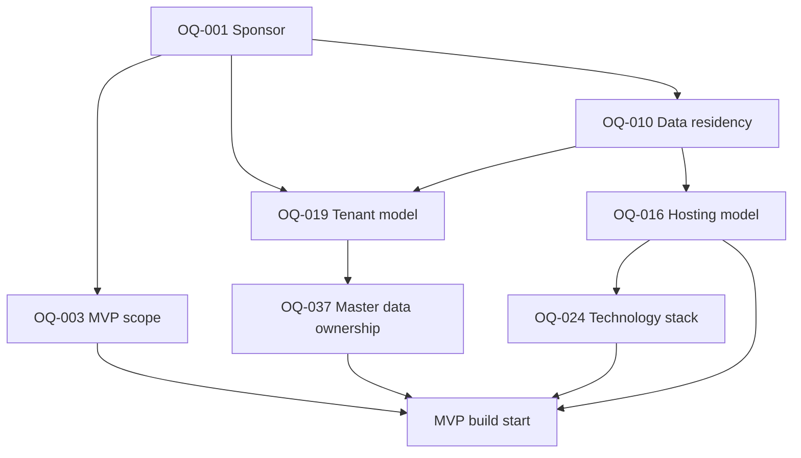

# Decision Dependency Matrix

Phase 3, 2026-11-11. Status of every row: **PENDING**. Nothing here is approved.
Related: [Decision Pack](Stakeholder-Decision-Pack.md), [Decision Papers](Open-Question-Decision-Papers.md), [Approval Register](Approval-Register.md), [Phase 3 Readiness](Phase-3-Readiness-Summary.md).

## 1. Matrix

| Decision | Subject | Needs first | Unblocks | Blocks |
|---|---|---|---|---|
| OQ-001 | Sponsor | Approves every item | OQ-003, OQ-014, all Approval Register items | Blocking: no approver |
| OQ-003 | MVP scope | Needs OQ-001, OQ-014 | Sprint plan, test scope, RTM counts, MVP-Scope-Decision-Matrix | Build start |
| OQ-019 | Tenant model | Needs OQ-005, OQ-010 | OQ-037, schema, row-level security, ADR-017, FR-019, SEC-016 | Build start (schema) |
| OQ-037 | Master data ownership | Needs OQ-019 | M-009, M-054, M-061, M-062, M-079, FR-126, isolation tests | Build start (schema) |
| OQ-010 | Data residency | Needs legal determination | OQ-016, OQ-022, OQ-019 (option D), NFR-039, NFR-040 | Build start (hosting) |
| OQ-016 | Hosting model | Needs OQ-010, OQ-015, OQ-028 | OQ-024 (managed services), Deployment-Plan, DR plan, NFR-007 to NFR-011 | Build start (infrastructure) |
| OQ-024 | Technology stack | Needs OQ-016, team skills | DBC-02, SEC-016, ADR-021, all code | Build start |
| OQ-005 | Single customer or product | Needs OQ-001 | OQ-019, ADR-018 | Configuration |
| OQ-015 | Volumes | Needs customer input | OQ-016, ADR-019, NFR-003, NFR-005 | Configuration |
| OQ-014 | Budget, team, dates | Needs OQ-001 | OQ-003, Sprint-Plan, R-017 | Configuration |
| OQ-034 | Payment limits, role above Finance Manager, reopen approver | Needs OQ-013 | ADR-022, FR-137, FR-140 | Configuration |
| OQ-023 | MFA and SSO | Needs security officer | SEC-006, SEC-007, SEC-068, step-up, FR-145 | Configuration |

## 2. Graph of the seven build-blocking questions

## 3. Suggested order (proposal)

1. OQ-001 sponsor, because every approval needs an approver.
2. OQ-010 residency (legal determination), in parallel with OQ-003 scope and OQ-014 budget.
3. OQ-019 tenant model and OQ-005 delivery model.
4. OQ-037 master data ownership, once OQ-019 is known.
5. OQ-016 hosting, then OQ-024 technology.
6. Approval of ADR-022, the RBAC design and the NFR values in parallel with 3 to 5.

This order follows the dependencies above. It is not a schedule: no dates or capacity are known.
